# Atlas console: Ask Atlas, Book view and the opportunity workflow

**File:** `atlas-console-book-view.html`. It opens from disk with no server. Fonts load from the web when they can, and fall back to system fonts when offline.

**What this is:** a new standalone version of the Atlas advisor console, built around one path through it:
1. **Ask Atlas** is the starting point.
2. **Book view** finds the clients that meet a condition.
3. The **Client dashboard** lists every household.
4. The **client deep dive** summarizes one household and shows its opportunities.
5. A **three-step workflow** turns an opportunity into a proposal, including moving brokerage assets into the **Advisory program**.
6. **Ask Atlas** stays alongside on every screen: it knows what you are looking at, opens each screen with a point of view, answers ✦ questions about any figure, cites its sources, and in the workflow acts as a **decision guide**. It can be collapsed or opened full screen.
7. A **guided tour** covers all of it.

**Changes from the original console:**

| Area | Change |
|---|---|
| Landing | Ask Atlas, with a minimal chat window and two prompt bubbles |
| Book of Business | Renamed **Client dashboard** |
| Book view | New. A heat map of 13 criteria; selecting one lists the clients that meet it |
| Client deep dive | Rebuilt around **Portfolio at a glance**, the summary from Portfolio Review |
| Opportunities | New. A heat map of actions sized for one household |
| Workflow | New. What led here → Solutions → Proposal, with Ask Atlas docked beside it |
| Brokerage → Advisory program | New. Trigger, risk shift, tax impact, tax-efficient management, eligibility, conversion matrix, program options (including a tax-efficient transition with a yearly gain budget) and proposal sections |
| Ask Atlas | Now a decision guide with a knowledge base of program rules, tax services, eligibility and transition rules; suggested questions sit in short sections inside the chat |
| Ask Atlas on every screen | New. A docked panel on Book view, the Client dashboard, the deep dive and the workflow; one conversation; screen openers; ✦ Ask about this; CIO citations that open the source PDF; collapse and full screen |
| Tour | New. 25 steps, from the top bar or the Ask Atlas page |

**Not in this file:** the other screens of the original console (Today, Tax Overlay Desk, Cross-Sell Radar, Transition, Draft review). They can be brought back in.

**What was checked:**

| Check | Result |
|---|---|
| Book view counts and dollar totals, for all 13 criteria and both advisors | Match a separate Python calculation exactly |
| Opportunities in the deep dive, all 37 households | 169 opportunities; the tile count matches the Book view checks for every household |
| Workflow options | All 544 options render all three steps |
| Advisory program transition | For every candidate household and three gain budgets: the matrix buckets add up to the brokerage total; excluded assets and lots without basis stay in brokerage; gains sold in the tax-efficient transition stay within the budget; "Stay in brokerage" changes nothing; "rebalance now" ends at 0.0 pts drift wherever everything in brokerage can move |
| Wash sales | No option buys back a security it sells at a loss |
| Decision guide | 676 recommendations (every opportunity × 4 sets of client answers) without an error |
| Suggested questions | All 16 home-page questions and every workflow question (1,543 in all) get a specific answer |
| Trade engine | Household assets unchanged by every option (largest difference under $0.01), except gifts, which leave the household on purpose; no negative positions or cash |
| Portfolio at a glance | 518 combinations of view and show: no errors and no blank figures |
| Ask Atlas on every screen | 115 screens (Book view, all 13 criteria, the dashboard, and 4 views of every household) each open with a point of view; 2,104 in-context questions (suggested questions, ✦ on figures and rows) all get a specific answer; collapse, full screen and the citation PDF work on desktop and phone |
| Guided tour | All 25 steps find their target, on desktop and on a phone |
| Display | No page errors in light, dark or phone layout; no sideways scrolling at 390 px on any screen |
| Names | Name scan clean |

**All households, people, prices, ratings and the CIO house view are made up.** The 17 households from the original console are kept. I added 20 more, so Dana Whitfield's book has 25 households and Marcus Chen's has 12. I also added sector data, research rating changes, individual bonds and CDs with maturity dates, and accounts: 11 households are entirely in brokerage and 3 have some brokerage assets, each with trades and commissions over the last 12 months.

**Program naming:** the program is called the **Advisory program** throughout, and the source documents are described generically (program brochure, transition term sheet, Form CRS).

---

## 1. Ask Atlas: the starting point

The console opens on a minimal chat window. The two bubbles under it, **Take me to Book view** and **Take me to Client dashboard**, open those screens.

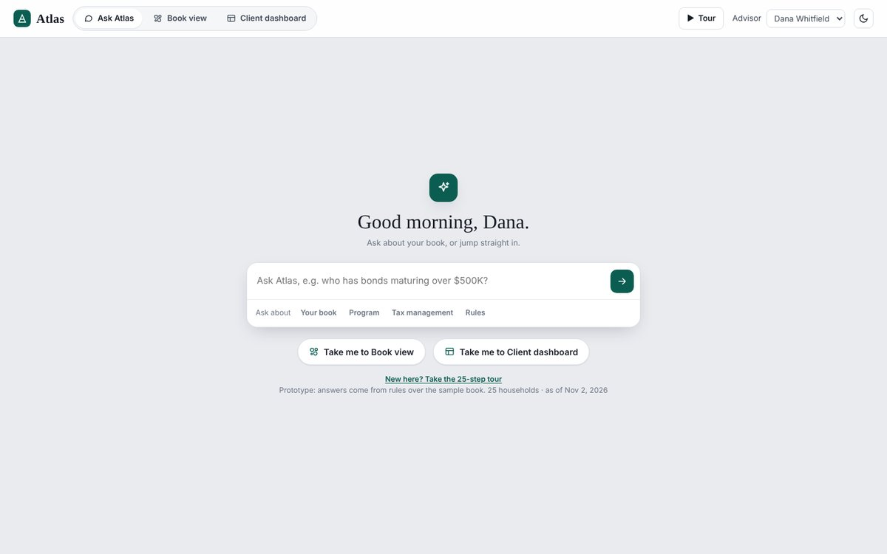

**What you can type:**
- **A criterion:** "who has bonds maturing over $500K in the next 6 months", "downgraded holdings", "excess cash", "meetings this week". Atlas answers with the count, the total and the top clients, plus a button that opens the matching list in Book view. Amounts and time windows in the question are applied to the list.
- **A client's name:** "open Henderson". Atlas gives a one-line summary and a button to open the client.
- **Anything else:** Atlas suggests what it can do.

**Suggested questions sit inside the chat window**, in four short sections: **Your book**, **Program**, **Tax management** and **Rules**. Nothing shows until you pick a section; then its three or four questions appear. Pick it again to close it.

| Section | Questions |
|---|---|
| Your book | Which clients should move to the Advisory program? Bonds maturing over $500K, downgraded holdings, meetings this week |
| Program | What the program offers, brokerage against advisory, strategy types, direct indexing |
| Tax management | Tax management services, how the tax-efficient transition works, how each holding converts, wash sales |
| Rules | Who is eligible, excluded assets, insider stock, conflicts to disclose |

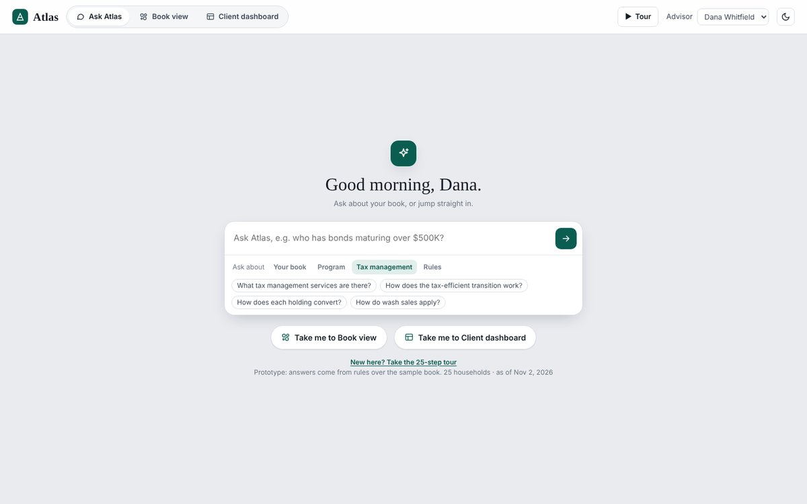

In this prototype the answers come from rules over the sample book and the program documents, not a language model, and the page says so.

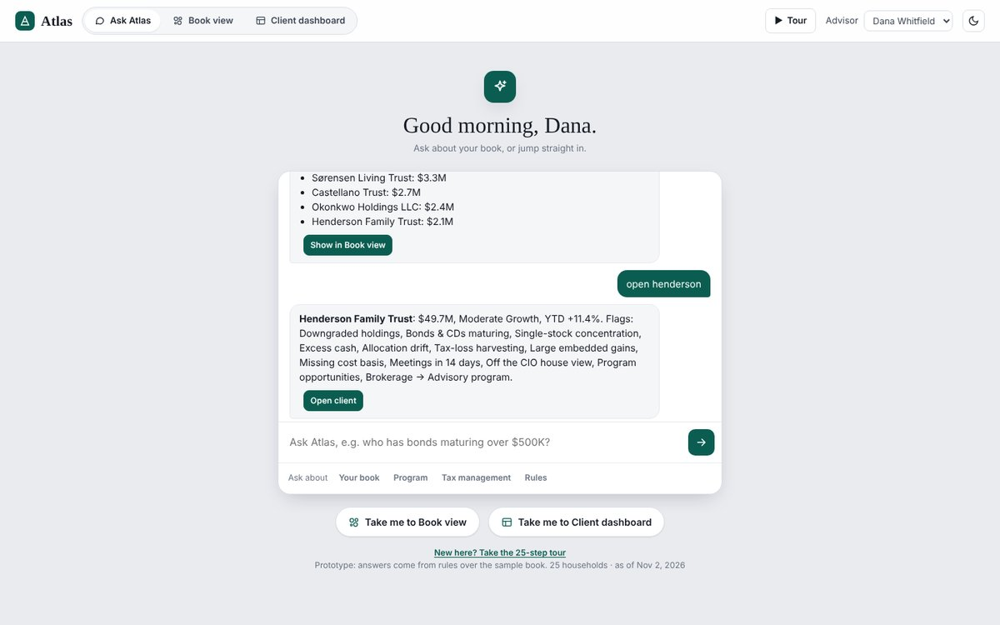

## 2. Book view: criteria across the whole book

**What's on the screen:**
- **The cards:** each card is one criterion checked across the advisor's book. The big number is how many clients meet it, and the line under it is the dollars involved.
- **The heat:** the cards are white, with a thin colored left edge for the heat. A darker edge means a larger share of the book is affected (1–15% up to 60% and over).
- **Selecting a card** lists the clients that meet it. The columns change with the criterion.

**Bonds & CDs maturing** has two extra controls:
- **Minimum:** $100K, $250K, $500K or $1M.
- **Window:** 6, 12 or 24 months.

Changing either updates both the list and the card. With the default ($250K over 12 months), Dana has 10 households and $15.4M maturing.

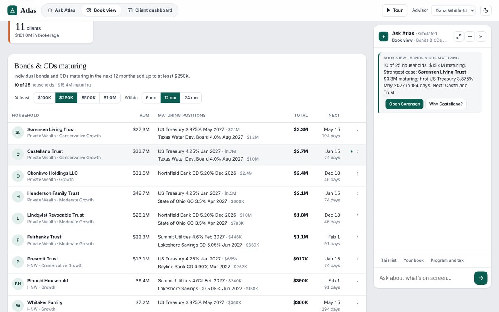

**Downgraded holdings** lists each security with its old and new rating and the date of the change.

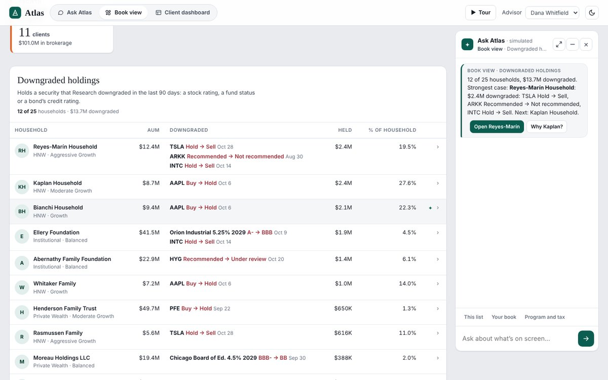

**The 13 criteria** (Dana's book, 25 households):

| Criterion | Rule | Clients | Amount |
|---|---|---:|---:|
| Downgraded holdings | Holds a security downgraded in the last 90 days (stock rating, fund status or credit rating) | 12 | $13.7M held |
| Bonds & CDs maturing | Individual bonds and CDs maturing in the window add up to at least the minimum | 10 | $15.4M |
| Single-stock concentration | One stock over 10% of the household (lots combined) | 7 | $30.7M |
| Excess cash | Cash more than 5 pts above target and at least $250K over | 7 | $22.9M |
| Allocation drift | An asset group more than 5 pts from target | 13 | $30.1M to rebalance |
| Behind benchmark YTD | More than 1.5 pts behind the benchmark for the risk profile | 10 | $151.7M AUM |
| Tax-loss harvesting | Unrealized losses of at least $250K | 9 | $7.5M |
| Large embedded gains | Unrealized gains over 20% of the household | 6 | $30.2M |
| Missing cost basis | A position with no cost basis on file | 3 | $1.1M |
| Meetings in 14 days | A meeting in the next 14 days | 15 | $304.5M AUM |
| Off the CIO house view | CIO alignment score High | 4 | $126.0M AUM |
| Program opportunities | Eligible for 5 or more programs not yet in use | 13 | $210.2M AUM |
| Brokerage → Advisory program | At least $250K in brokerage plus a reason for ongoing advice (drift, concentration, excess cash, downgrades or harvestable losses), or commissions of 0.4% or more of brokerage assets a year | 11 | $101.0M in brokerage |

## 3. Client dashboard (formerly Book of Business)

**What it shows:** every household in the book.
- **Columns:** assets, YTD return against the benchmark, unrealized gain or loss, cash, next meeting, and the number of Book view flags with the first two named.
- **Controls:** sort on any column, search by household or contact, and filter by segment.
- **Selecting a row** opens the deep dive.

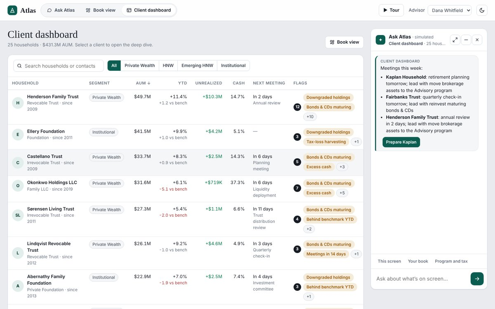

## 4. Client deep dive: Portfolio at a glance

**The order on the page:** the client header, then Portfolio at a glance, then the household's opportunities. Portfolio at a glance follows the Portfolio Review step of the same name.

**The top of Portfolio at a glance:**
- **AI-drafted summary:** the mix, expected risk against the profile's band, tracking error to target, the largest name, the YTD result, the open opportunities and the next meeting. For Henderson: expected risk 8.7%, inside the 8–12% band; tracking error 2.2%; NVDA 22.1%.
- **Key figures:** YTD return against the benchmark, unrealized gain or loss, cash against target, largest position, estimated income and largest drift.
- **CIO view for this client:** the client's alignment score and the house view's overweights and underweights.

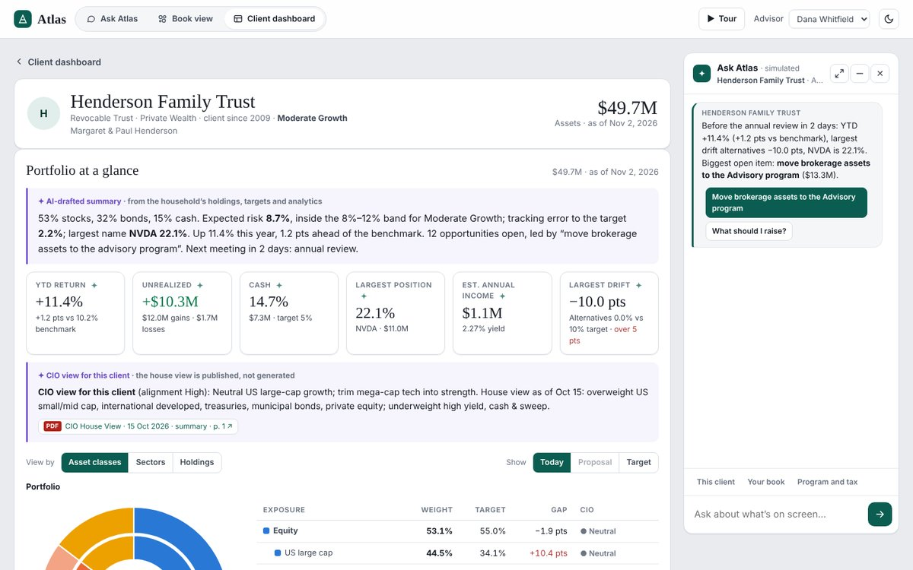

**View by** has three options:
- **Asset classes:** a sunburst, with asset groups (L1) on the inner ring and asset classes (L2) on the outer ring. Next to it is a table of weight, target, gap and the CIO stance (▲ Overweight, ● Neutral, ▼ Underweight) for every group and class.
- **Sectors:** equity bars against the equity benchmark, with funds counted by the sectors they hold.
- **Holdings:** a treemap of all positions with the full holdings table.

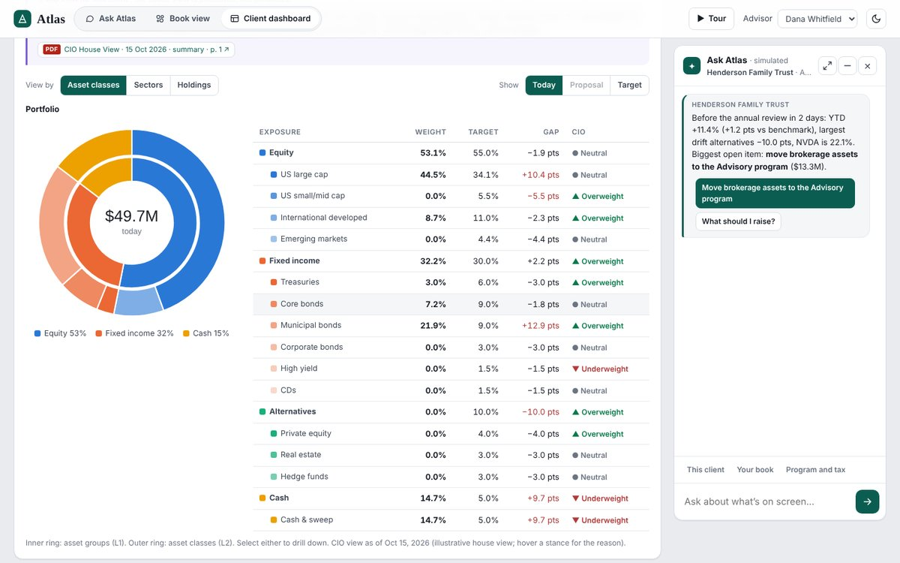

**Drilling down:**
- Selecting a group shows its classes.
- Selecting a class shows its holdings, with unrealized gain, research rating (downgrades marked ↓), yield and maturity.
- The breadcrumb line takes you back up.

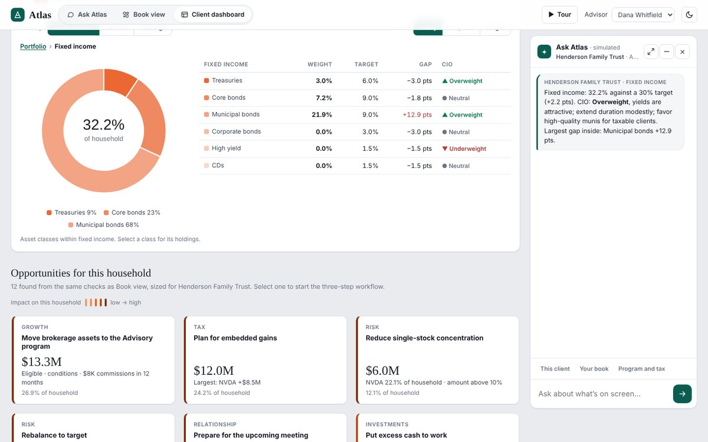

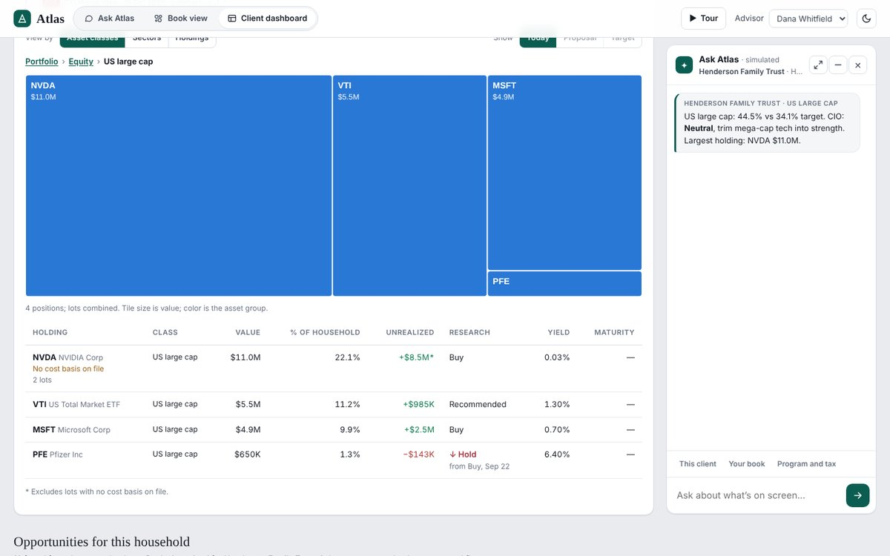

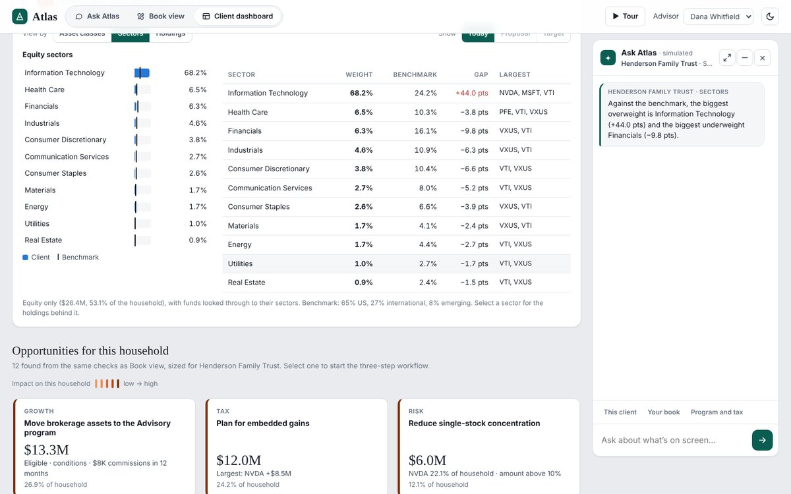

**Show** switches between three versions of the portfolio:
- **Today.**
- **Target:** the target mix, available in the asset-class view.
- **Proposal:** once you choose a solution in an opportunity workflow, the whole glance shows the portfolio after the change, with today alongside (section 6.5).

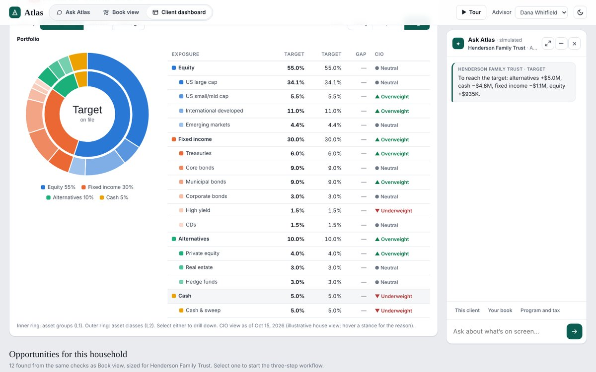

## 5. Opportunities for this household

The opportunities use the same checks as Book view, but the tiles mean something different:

| | Book view | Household opportunities |
|---|---|---|
| A tile is | A filter across the book | One opportunity for this client |
| Title | The criterion, e.g. "Single-stock concentration" | An action, e.g. "Reduce single-stock concentration" |
| Big number | How many clients | This client's dollars ($6.0M above 10%) or timing ("In 2 days") |
| Edge color | Share of the book affected | Impact on this household (dollars as a % of its assets; urgency for meetings and the performance gap) |
| Order | Fixed | Largest impact first |
| Selecting it | Lists clients | Starts the three-step workflow |

**Henderson** has 12 opportunities. The largest are $13.3M still in brokerage (move to the Advisory program), $12.0M of embedded gains, $6.0M of NVDA above 10%, $5.9M to rebalance and a meeting in 2 days. A line under the tiles lists the checks that found nothing to do.

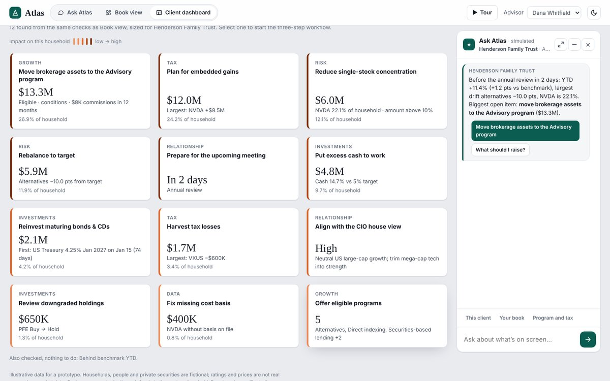

## 6. The opportunity workflow

**The steps:** 1 What led here · 2 Solutions · 3 Proposal. The Proposal step unlocks once a solution is chosen.

**Ask Atlas** is docked on the right. On a phone or narrow screen it opens from an "Ask Atlas" button.

### 6.1 Step 1: what led here

**What's on the screen:**
- **AI-drafted recap:** built from the household's own figures, with the purple label. For Henderson's concentration: how NVDA grew from a cost of $2.1M to $11.0M and 22.1% of the household, the $6.0M above the guideline, the meeting in 2 days and the CIO view.
- **The facts and the rule** that flagged it.
- **Links:** to the holdings involved, and to the other clients in the book with the same opportunity.

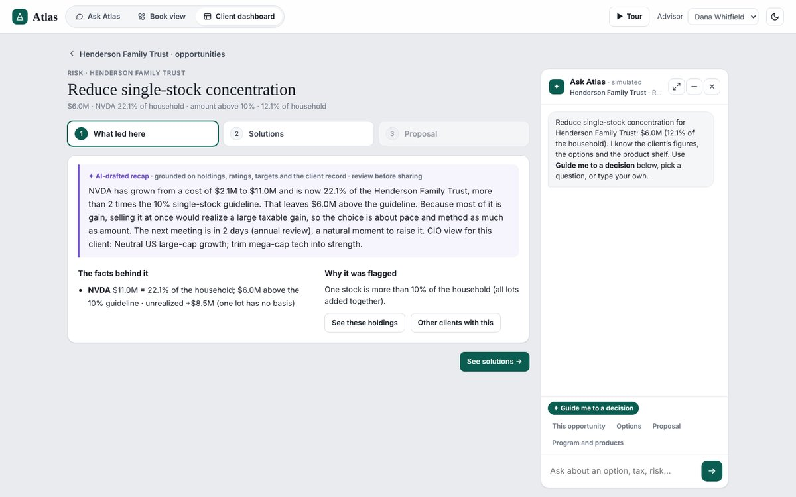

### 6.2 Step 2: solutions

Each opportunity offers 3–4 options built from the household's figures. Each card shows the estimated tax, the change in income and the drift after the change, with badges for **Lowest tax**, **Most income** and **Closest to target**.

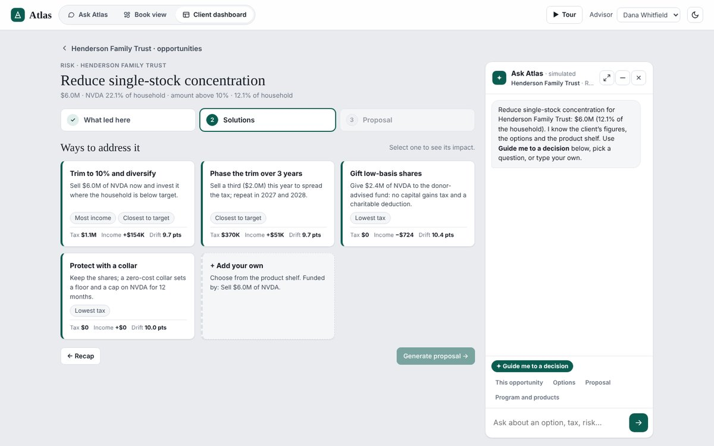

**Henderson, reduce single-stock concentration:**

| Option | Est. tax | Income change | Largest drift after | NVDA after | Badges |
|---|---:|---:|---:|---:|---|
| Trim to 10% and diversify | $1.1M | +$154K | 9.7 pts | 10.0% | Most income, Closest to target |
| Phase the trim over 3 years (year one) | $370K | +$51K | 9.7 pts | 18.1% | Closest to target |
| Gift low-basis shares | $0 | −$724 | 10.4 pts | 18.2% | Lowest tax |
| Protect with a collar | $0 | $0 | 10.0 pts | 22.1% | Lowest tax |

**Selecting an option** highlights it and dims the others ("Show all options" brings them back). Below the cards, the selected option shows:
- **Trades:** sells (with the gain realized) and buys.
- **Impact on key metrics:** before, after and change for allocation, largest drift, largest stock, yield, income, estimated volatility, downgraded holdings, unrealized gain, gain realized now, estimated tax and household assets.

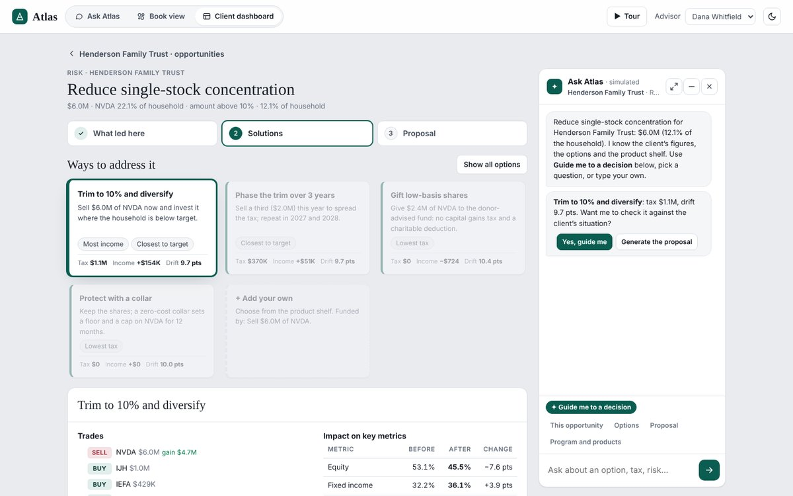

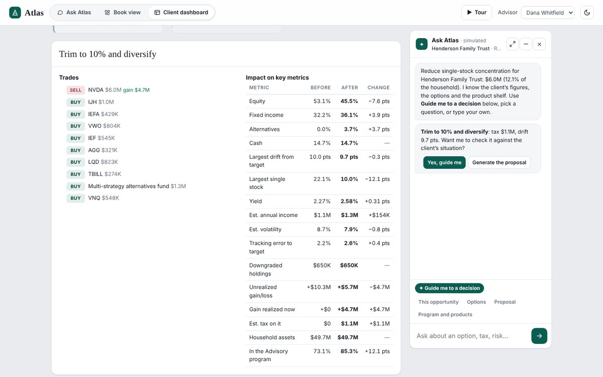

**Ask Atlas about the options.** Suggested questions change with the step:
- Step 1: "Why is this coming up now?", "What happens if we do nothing?"
- Step 2: "Compare the options", "Which option has the lowest tax?", "Which fits the CIO view best?"
- Step 3: "Summarize this for the client", "What are the risks of this proposal?"

You can also type a question about an option by name, tax, income, risk, a product ticker, or how many other clients have the same opportunity. Answers use the figures on the page.

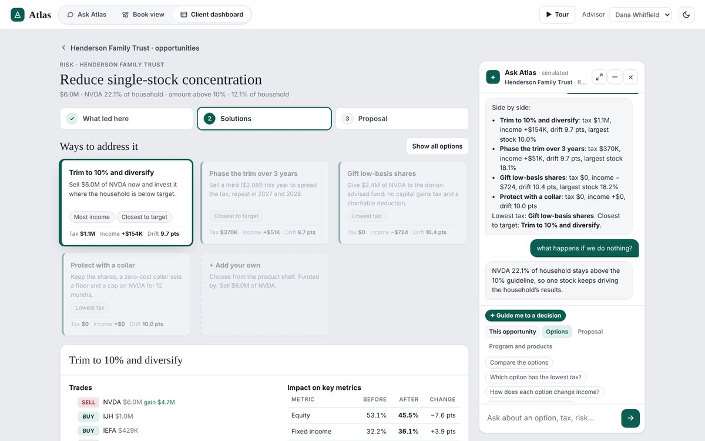

### 6.3 Add your own from the product shelf

**+ Add your own** opens the product shelf: 21 approved products, either ETFs or managed accounts, with class, yield, fee and research rating.
1. Pick up to 4 products and set an amount.
2. The funding comes from the opportunity itself. For Henderson it is "Sell $6.0M of NVDA"; for maturing bonds it is the proceeds; for excess cash it is the cash.
3. The choice becomes a **Your selection** card, with the same figures and impact as the other options.

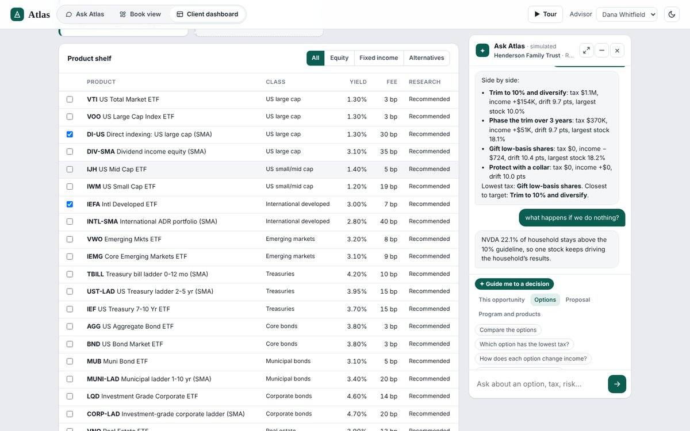

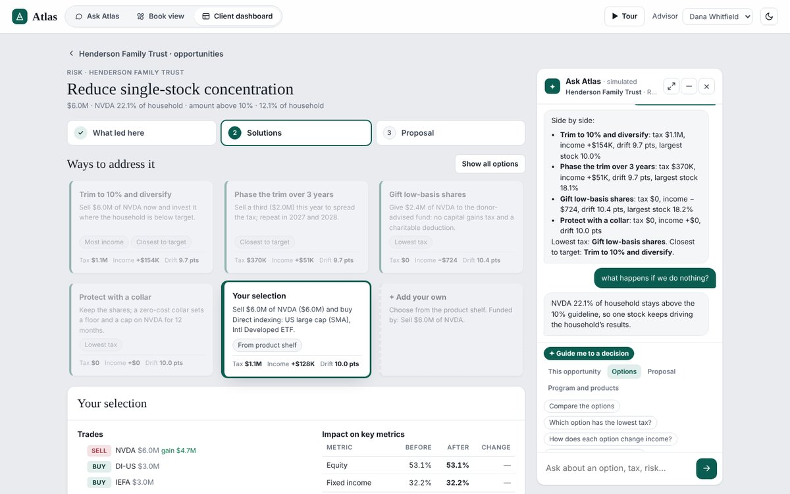

### 6.4 Step 3: the proposal

A report for advisor review, which you can print or save as a PDF. It has these sections:
- an AI-drafted summary;
- 1. why we are recommending this;
- 2. the proposed trades, with realized gains and estimated tax;
- 3. asset allocation (L1) before and after, as a chart and a table;
- 4. asset classes (L2) before and after;
- 5. holdings before and after, with changed rows highlighted;
- 6. key metrics;
- disclosures.

**Henderson, trim to 10% and diversify:** 10 trades realize $4.7M of gains (estimated tax $1.1M). NVDA goes from 22.1% to 10.0%, estimated income rises by $154K a year, and equity moves from 53.1% to 45.5%.

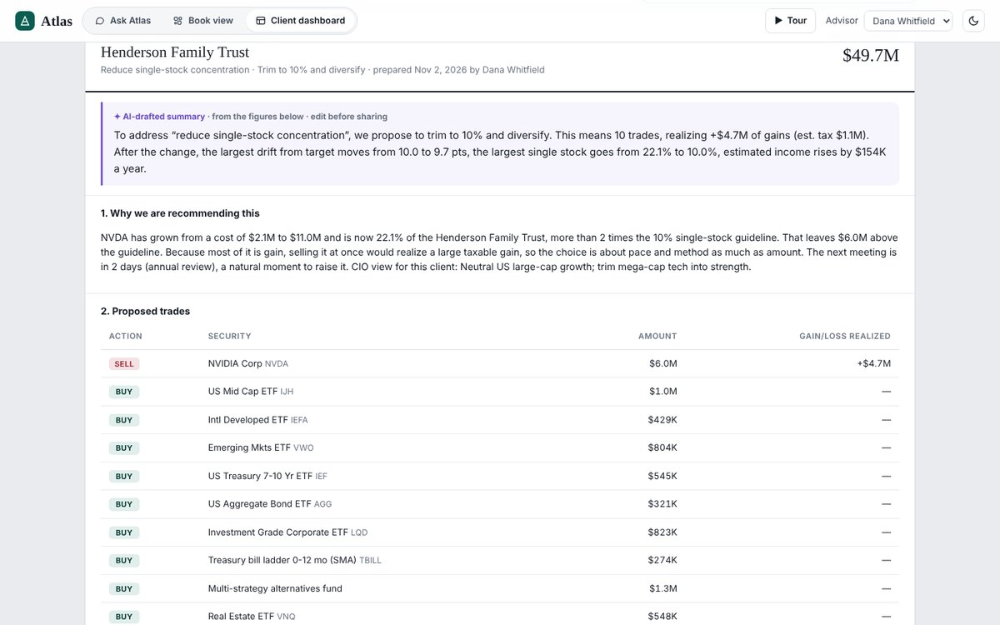

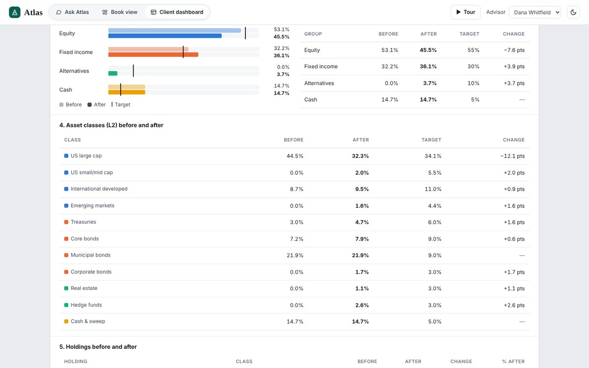

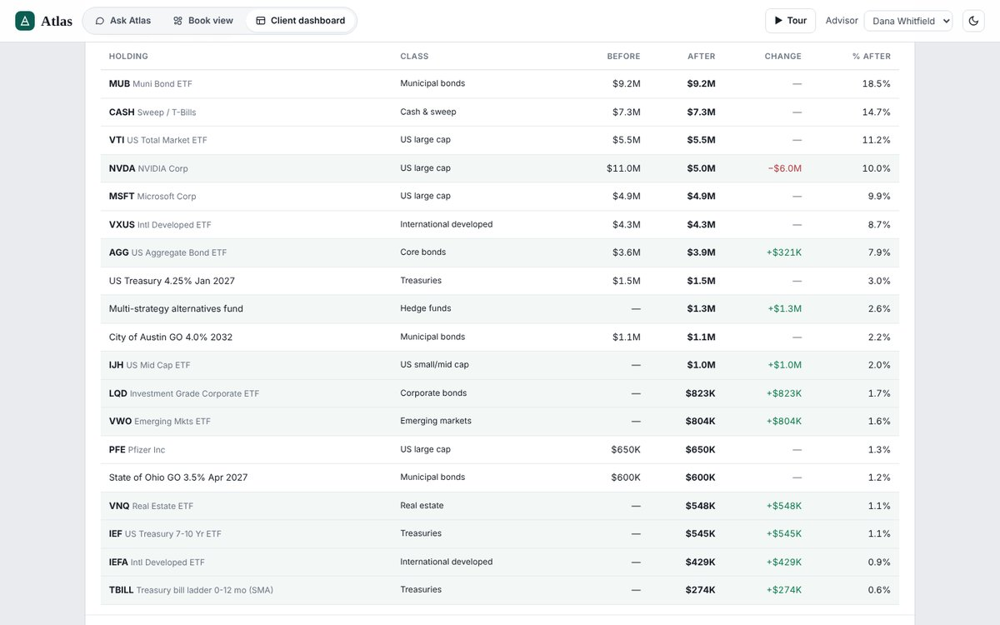

### 6.5 The proposal back in the deep dive

The deep dive's **Show: Proposal** displays the whole Portfolio at a glance after the change, with today alongside and a link back to the report.

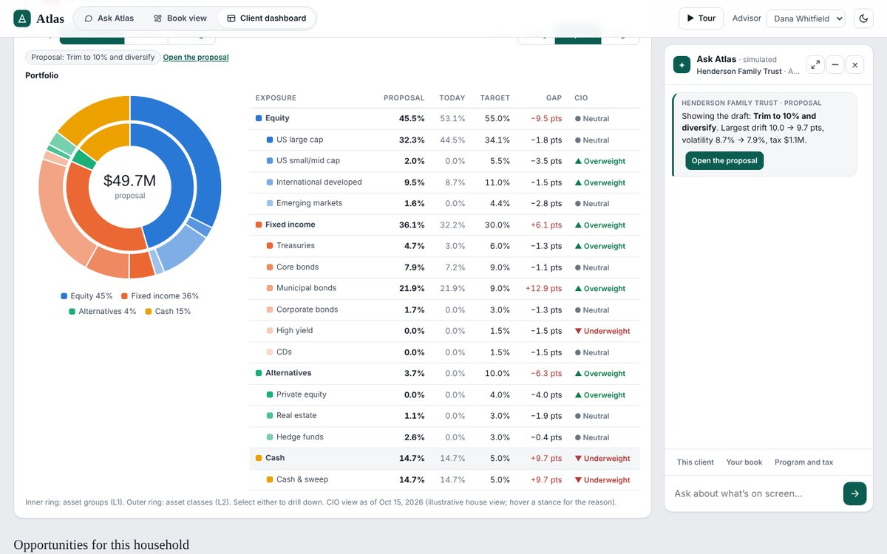

## 7. Brokerage → Advisory program

This is the transition use case: clients who hold assets in brokerage, where they pay per trade and there is no ongoing monitoring, and who would benefit from moving into the Advisory program (an asset-based-fee, wrap-fee program). The rules come from the program brochure, the tax-efficient transition term sheet, Form CRS and the earlier Atlas conversion matrix.

### 7.1 The trigger: Book view and the household tile

**Book view criterion "Brokerage → Advisory program":** at least $250K in brokerage, plus a reason for ongoing advice (drift, concentration, excess cash, downgraded holdings or harvestable losses), or commissions of 0.4% or more of brokerage assets a year.
- In Dana's book, 11 households match, with $101.0M in brokerage.
- The list shows each client's eligibility, how far risk is off target (tracking error and largest drift), losses to harvest, and the reasons.
- The Oyelaran Family is entirely in brokerage but isn't flagged: it shows none of the signals and its commissions are low. That's the rule working as intended.

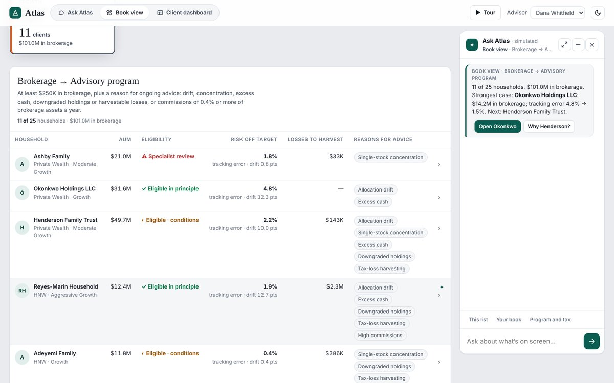

**In the deep dive**, the same check becomes the tile "Move brokerage assets to the Advisory program", sized by the brokerage assets.

**The simulated non-advisory clients:**

| Household | In brokerage | Trades / commissions (12 mo) | Eligibility | What makes it interesting |
|---|---:|---|---|---|
| Reyes-Marín | $12.4M (all) | 142 / $61K | Eligible in principle | Active trader; $7.4M of positions at a loss |
| Whitaker | $7.2M (all) | 18 / $6K | With conditions | AAPL at 14% with large gains; private assets that must stay in brokerage |
| Kaplan | $8.7M (all) | 22 / $9K | With conditions | AAPL from restricted stock: insider pre-clearance |
| Adeyemi | $11.8M (all) | 31 / $14K | With conditions | NVDA at 12% with large gains; downgraded fund |
| Novak | $2.9M (all) | 9 / $2K | With conditions | A transferred lot with no cost basis |
| Lund | $3.8M (all) | 64 / $12K | Eligible in principle | Tech-heavy; aggressive profile |
| Delacroix | $4.9M (all) | 8 / $2K | Eligible in principle | Light trader; 8.5 pts of drift |
| Ashby | $21.0M (all) | 4 / $2K | **Specialist review** | One stock is 58% of the household (above the 50% limit) |
| Henderson | $13.3M (part) | 6 / $8K | With conditions | NVDA lots in brokerage, one with no basis; municipal bonds |
| Okonkwo | $14.2M (part) | 3 / $2K | Eligible in principle | Cash and a CD in brokerage |
| Callahan | $0.7M (part) | 2 / $900 | Eligible in principle | One stock left in brokerage |
| Varga, Brennan (Marcus) | $6.4M, $4.4M (all) | 48 / $9K, 26 / $4K | With conditions | Downgraded stocks (Varga); a high-cost, downgraded fund (Brennan) |

### 7.2 Step 1: what led here: risk shift, tax impact and the conversion matrix

Step 1 doesn't explain the program's benefits or its cost: advisors know them. It shows three things for this household: **how risk shifts**, **the tax impact** and **what tax-efficient management does**.

**AI-drafted recap.** For example, Reyes:
- **Today:** $12.4M in brokerage, where nobody monitors risk or tax between trades. Cash is 12.7 points over target, $2.3M of losses can be harvested, and $1.6M of excess cash can be put to work.
- **Risk shift:** tracking error to target goes from 1.9% to 0.8%, the largest drift from 12.7 to 0.0 pts, the largest single stock from 8.9% to 0%, and volatility from 13.7% to 12.9%.
- **Tax:** no tax this year, after $2.3M of losses harvested in the move (worth $555K of tax); $521K of gains stay deferred. Afterwards $9.3M of equity is under ongoing loss harvesting and tax-efficient rebalancing.

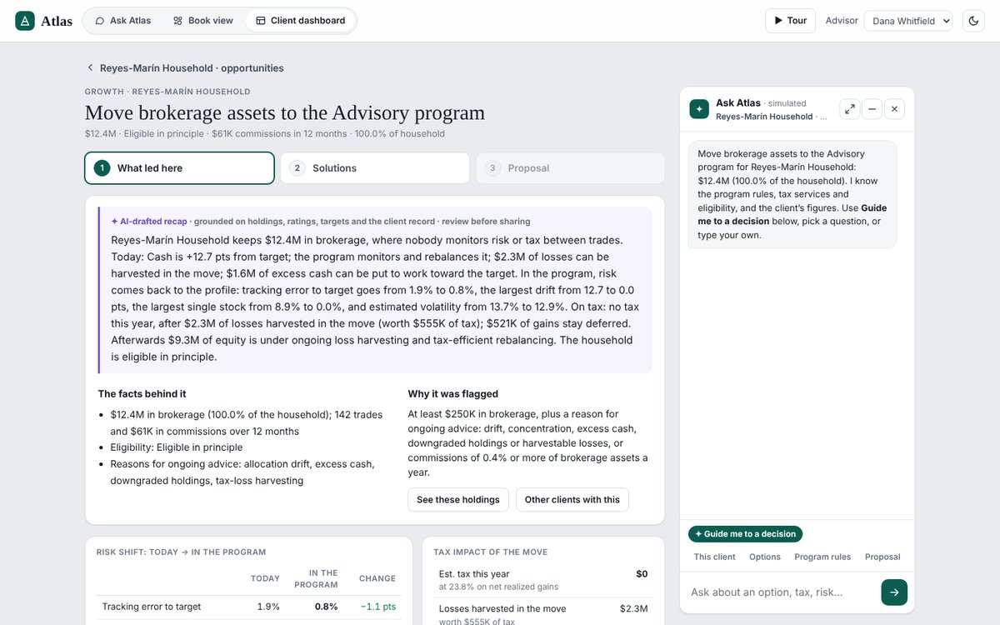

**Risk shift: today → in the program.** Shown for the default option (the tax-efficient transition when it applies, otherwise "rebalance now"). Lower is shown in green; volatility and the stress scenario are shown without color, because moving to the target can raise them.

| Metric (Reyes) | Today | In the program |
|---|---:|---:|
| Tracking error to target | 1.9% | 0.8% |
| Largest drift from target | 12.7 pts | 0.0 pts |
| Est. volatility | 13.7% | 12.9% |
| Largest single stock | 8.9% | 0% |
| 2008 financial crisis scenario | −43.1% | −42.4% |
| Downgraded holdings | $2.4M | $0 |

**Tax impact of the move:** tax this year, losses harvested and the tax they are worth, gains deferred by moving in kind (and, for the transition, the years and yearly budget over which they are realized), and the equity that comes under ongoing tax management.

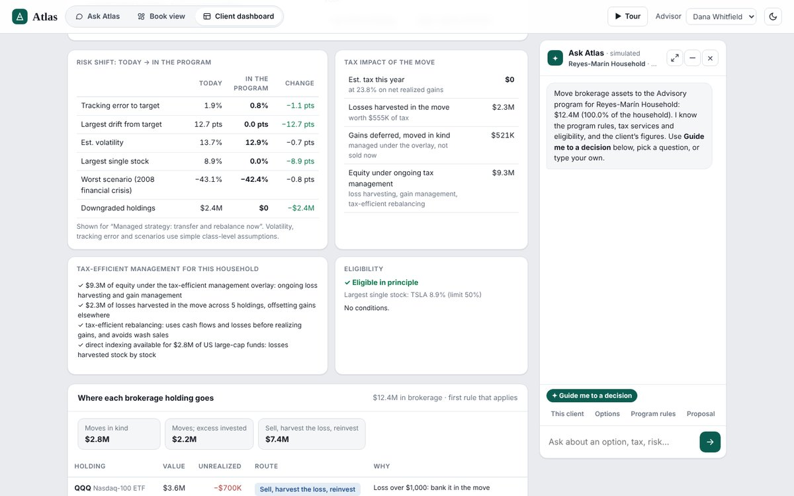

**Tax-efficient management for this household** turns the services into figures:
- equity under the tax-efficient management overlay (ongoing loss harvesting and gain management);
- the holdings in the tax-efficient transition, with the budget and years;
- losses harvested in the move;
- tax-efficient rebalancing (cash flows and losses before gains; no wash sales);
- direct indexing, when there are $250K or more of US large-cap funds.

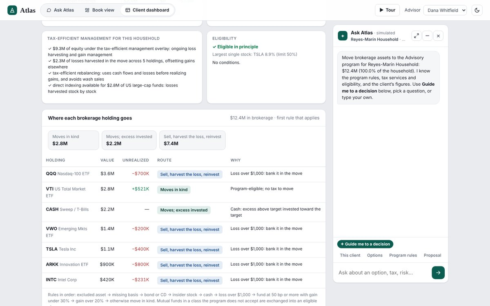

**Eligibility** uses the 50% single-stock limit and lists each condition with an owner.

**Where each brokerage holding goes**: the conversion matrix, with bucket totals.

**The conversion matrix.** Each holding takes the first route that applies:
1. Excluded asset → stays in brokerage (no program fee; commissions apply).
2. No cost basis → held until found (the transition service needs basis).
3. Individual bond or CD → moves in kind, held to maturity (outside the gain budget).
4. Insider stock → moves in kind; any sale needs pre-clearance.
5. Cash → moves; the excess over target is invested.
6. Loss over $1,000 → sell, harvest the loss, reinvest.
7. Fund costing 50 bp or more with a gain under 30% → swap to a lower-cost fund.
8. Gain over 20% → moves in kind, sold over time within the gain budget.
9. Otherwise → moves in kind.

Lots with and without basis in the same security are routed separately (Henderson's NVDA).

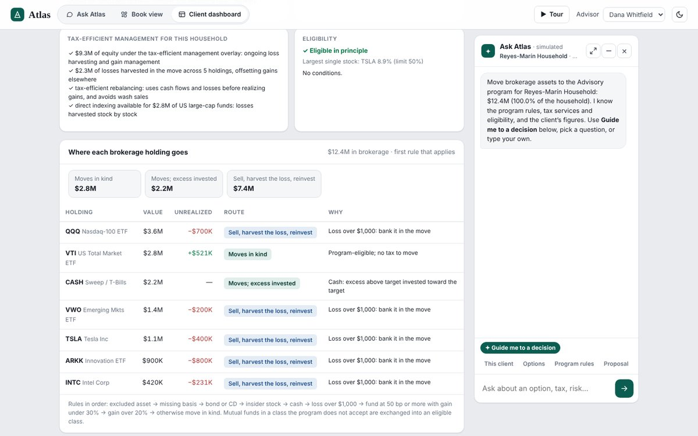

**Kaplan, with conditions:** the insider stock and its pre-clearance condition.

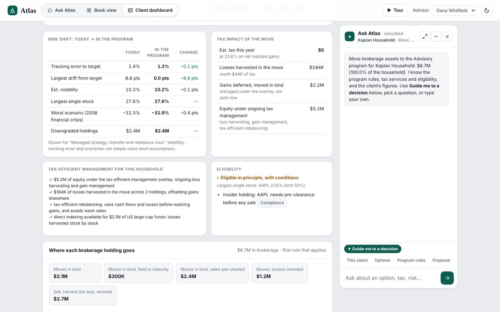

### 7.3 Step 2: program options

| Option | What it does | Fee assumption |
|---|---|---|
| Managed strategy: transfer and rebalance now | Moves what is eligible, sells what is not in the CIO model, rebalances at once | CIO model, 0.10% manager fee |
| Managed strategy with tax-efficient transition | Moves in kind; sells appreciated non-model holdings over time within a yearly net long-term gain budget ($100K, $250K, $500K or $1M); harvests losses and swaps high-cost funds now | CIO model, 0.10% |
| Personalized strategy: move in kind, advisor discretion | Moves as is; harvests losses, swaps high-cost funds, invests excess cash | Advisory fee only |
| Direct indexing for US equity + model for the rest | US large-cap funds move in kind into direct indexing; offered when they are $250K or more; the transition service doesn't cover it | 0.20% |
| Stay in brokerage | No change; no ongoing monitoring or tax management | — |
| Specialist route / move everything except the stock | Only when one stock is above 50% | — |

**What each card shows:** tax this year, tracking error to target, largest drift, equity under ongoing tax management and, for the transition, the years to complete it. Badges mark Lowest tax, Closest to target, Lowest tracking error and Most tax-managed. The impact table adds "Tracking error to target", "Tax value of losses harvested", "In the Advisory program" and "Equity under ongoing tax management".

**Whitaker** (today: tracking error 0.4%, drift 4.0 pts, AAPL 14%):

| Option | Tax now | Tracking error | Drift | Largest stock | Tax-managed equity | Years |
|---|---:|---:|---:|---:|---:|---:|
| Transfer and rebalance now | $152K | 0.2% | 0.0 pts | 0% | $5.0M | 1 |
| Tax-efficient transition ($250K budget) | $56K | 0.2% | 0.0 pts | 8.7% | $5.0M | 3 |
| Personalized, move in kind | $0 | 0.2% | 0.0 pts | 14.0% | advisor-run | 1 |
| Direct indexing + model | $0 | 0.4% | 4.0 pts | 14.0% | $4.9M | 1 |
| Stay in brokerage | $0 | 0.4% | 4.0 pts | 14.0% | $0 | — |

The trade-off is plain: the transition gets risk back to target and the equity under tax management for a third of the tax of selling now; the personalized move costs no tax but leaves AAPL at 14%.

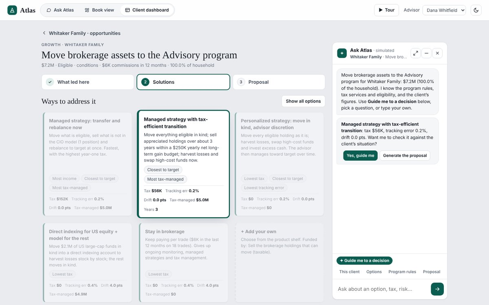

**The gain budget is a control on the selected option.** Changing it re-runs the transition: a smaller budget means less tax each year and more years. The note under the option sets out the term-sheet rules: the short-term gain budget is $0, fixed income and lots without basis are outside the budget, and year one is shown.

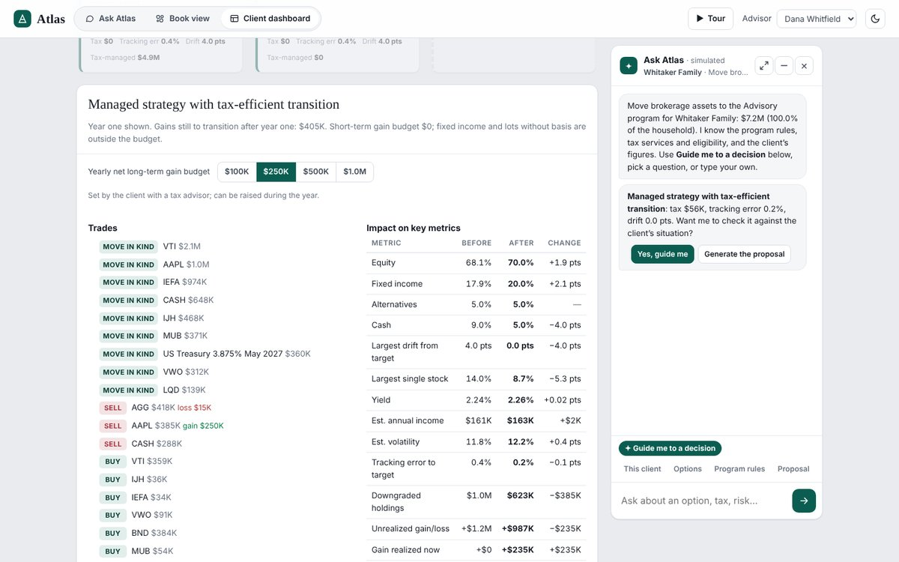

**Ashby (specialist review):** nothing moves into the program until a specialist plans the 58% position. The alternatives are to move everything except that stock, or to stay.

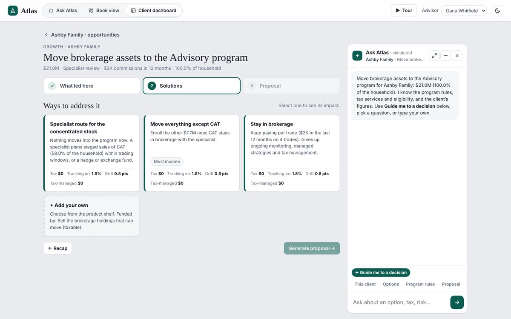

### 7.4 Step 3: the proposal

When the proposal is a move into the Advisory program, the report adds four sections:
- **Risk and tax: today and after**: the risk-shift table, the tax impact and the tax-efficient management for the chosen option.
- **Program and strategy**, with eligibility and its conditions.
- **Where each brokerage holding goes.**
- **Documents to deliver before enrolling:** Form CRS, the program brochure and client agreement and, for the transition, the term sheet with the client's yearly gain budget.

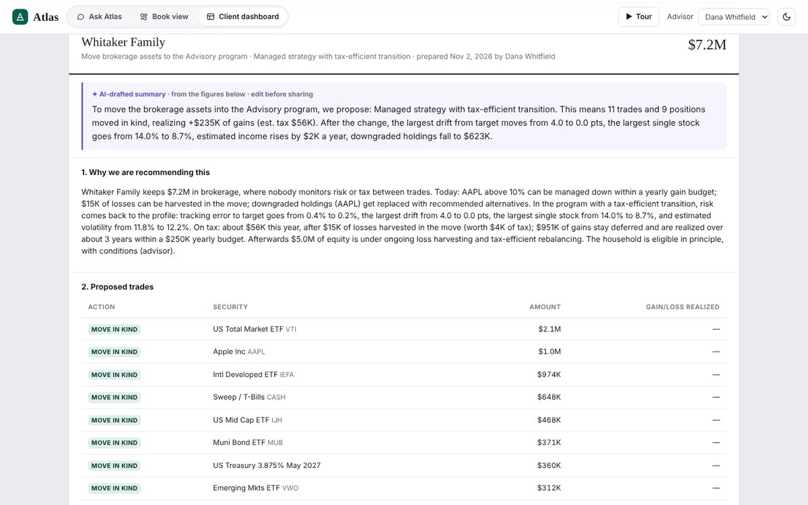

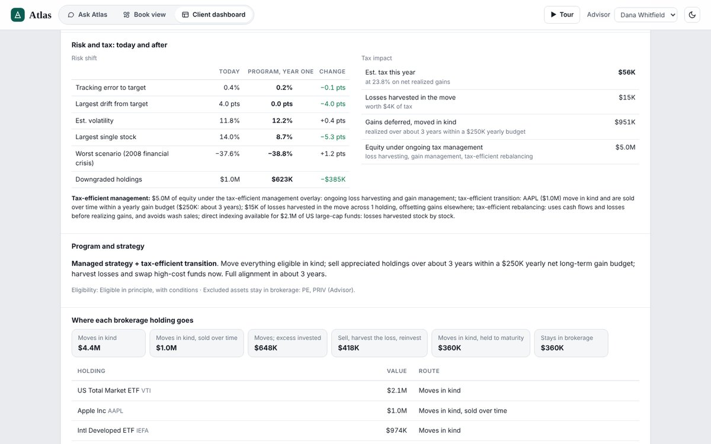

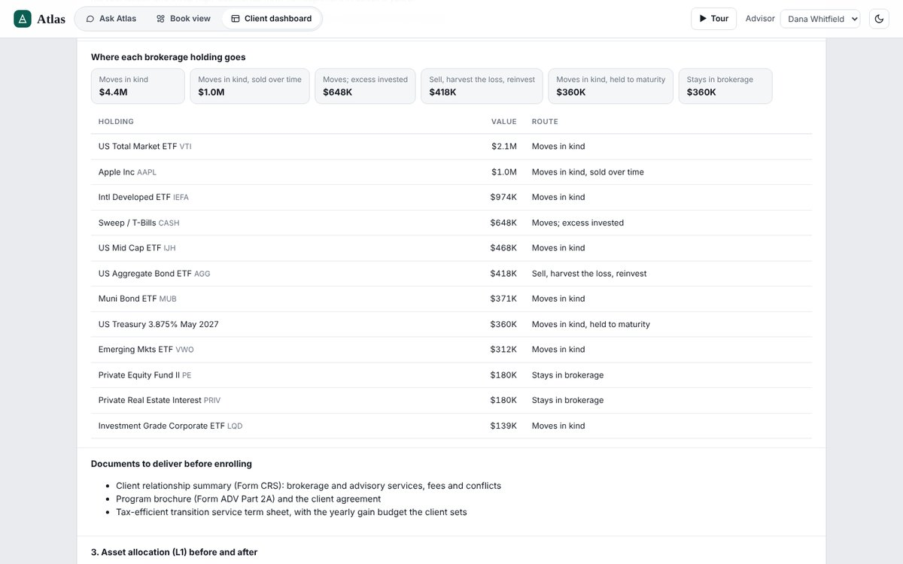

## 8. Ask Atlas as a decision guide

Ask Atlas is no longer just a list of options to pick from. In the workflow it leads the decision.

**When the workflow opens**, Atlas introduces the opportunity and points to **Guide me to a decision**, which sits once, above the suggested questions.

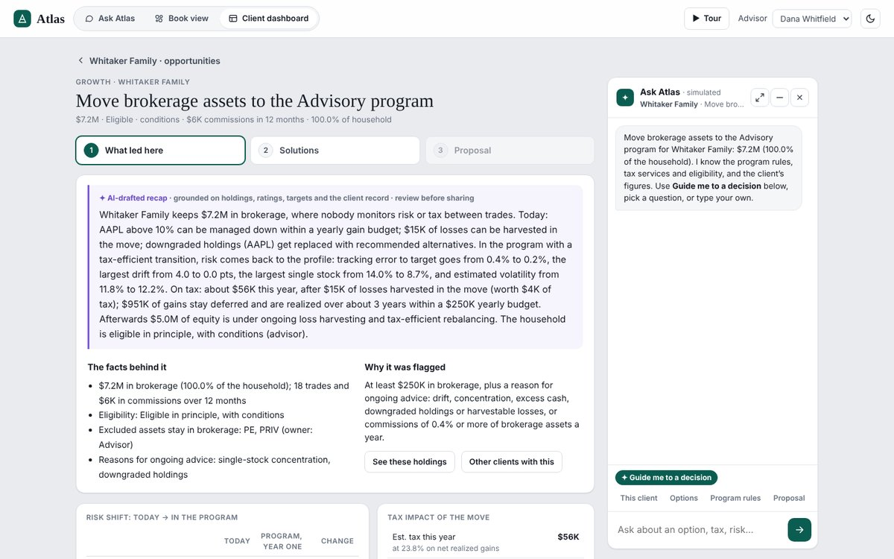

**It asks about the client, one question at a time.** Answers are quick replies.
- **For the Advisory program:**
  - how much tax the client will accept this year;
  - who should make day-to-day decisions (manager or CIO model, the advisor, or the client approving each trade);
  - what matters most in the move: bringing risk back to the profile, ongoing tax management, or keeping tax low this year;
  - cash needs in the next 12 months;
  - interest in direct indexing, when it is offered.
- **For other opportunities:** tax tolerance, act now or phase in, and what matters most (risk, income, target, tax).

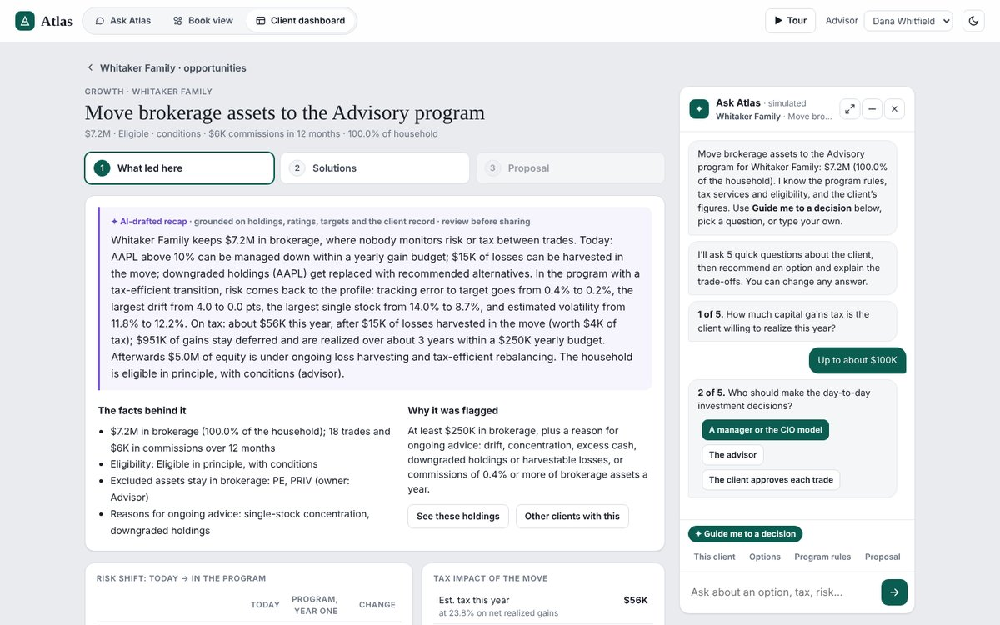

**It recommends, with reasons.** It scores every option against the answers using the page's own figures.
- It shows ✓ for what fits and △ for what doesn't, and names a runner-up.
- It adjusts settings to match, for example setting the yearly gain budget to $100K.
- For the Advisory program it weighs tracking error, drift and the equity under tax management against the tax.
- It reminds you that suitability is yours to confirm.
- Whitaker, with "up to about $100K of tax, a manager or CIO model, bring risk back to the profile, no cash needs": the tax-efficient transition (tax $20K, tracking error 0.2%, $5.0M tax-managed, about 7 years). The runner-up is the personalized move in kind (no tax).

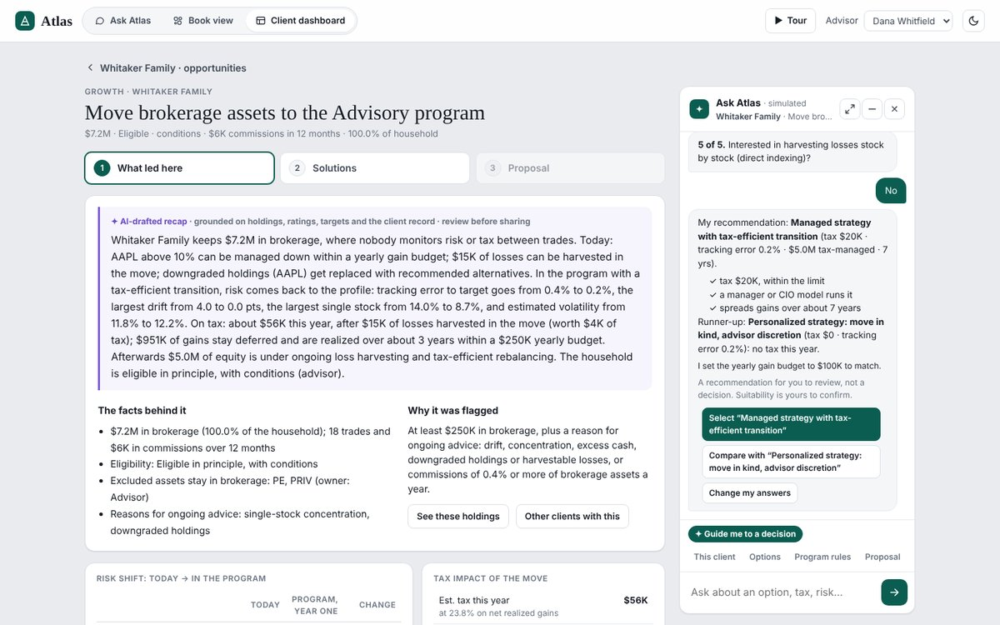

**You stay in control:**
- **Select** applies the choice on the page.
- **Compare** puts the two side by side.
- **Change my answers** starts again.
- **If you pick a different option by hand**, Atlas says how it stands against the client's answers, for example "tax $152K is above what the client accepts".

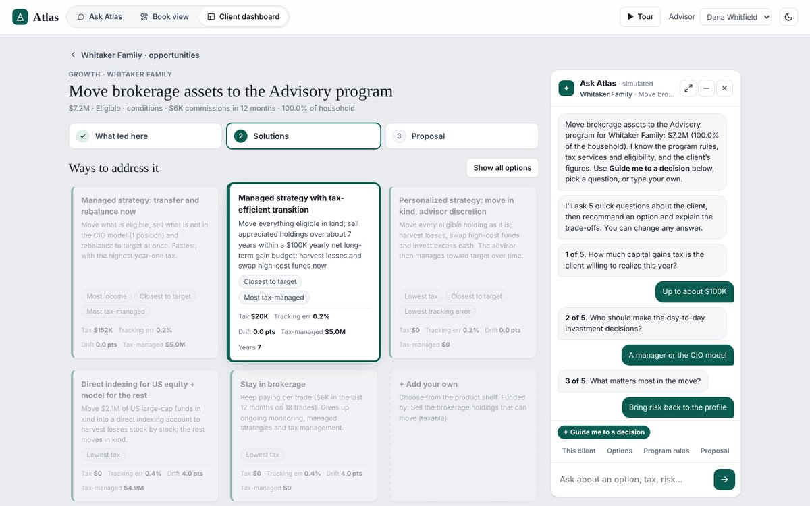

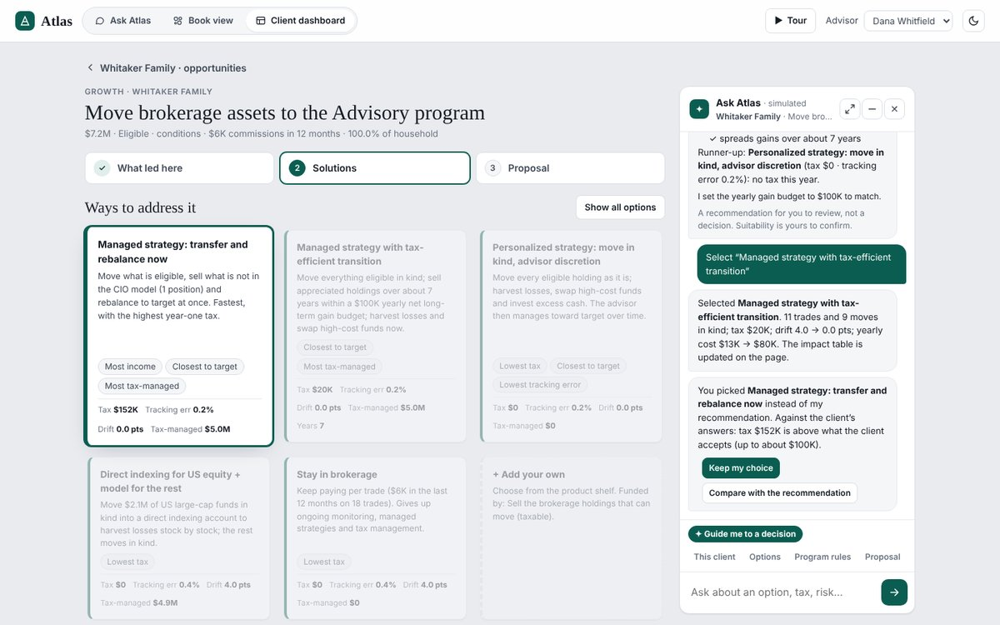

**On to the proposal.** Atlas lists what must happen before it reaches the client:
- documents;
- the client confirming the gain budget with a tax advisor;
- each eligibility condition and its owner;
- suitability;
- compliance and supervisory approval.

It then offers to draft the client explanation.

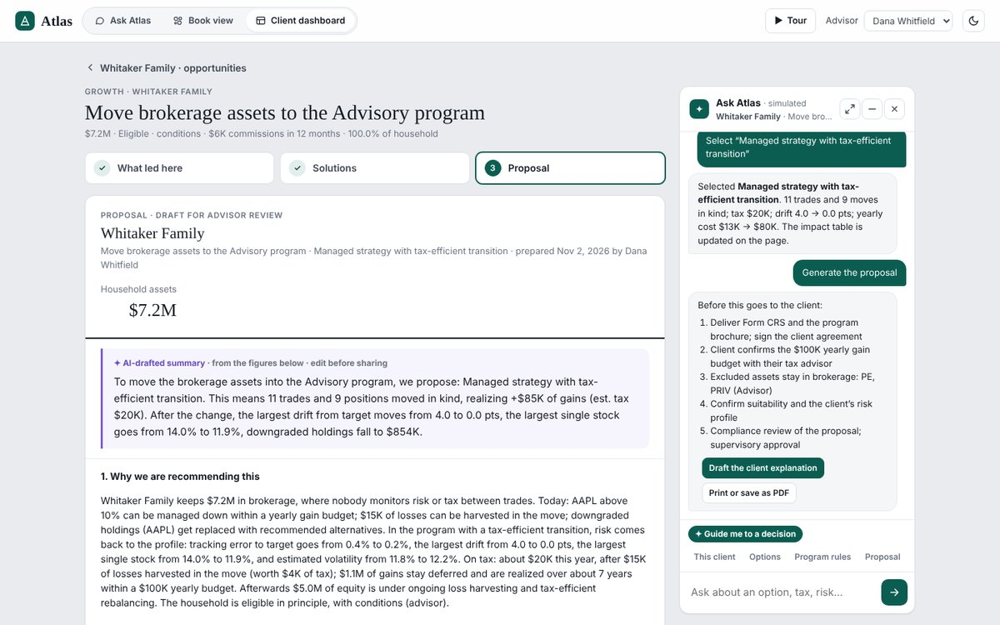

**What Atlas knows** (answers cite their source):

| Topic | Source |
|---|---|
| What the Advisory program offers: advice and monitoring, tax management, managed strategies, trading and reporting included, discretion choices, reviews | Program brochure |
| Tax management services: transition, loss-harvesting and gain-management overlay, tax-efficient rebalancing, direct indexing | Program brochure |
| Managed strategies: CIO models, manager strategies, custom portfolios; CIO review; manager fees | Program brochure |
| Program fee: advisory fee (negotiable, maximum 1.75%), manager fee (0–0.65%), billed monthly in advance; what it covers and doesn't | Program brochure |
| Excluded assets; mutual fund share-class exchanges | Program brochure |
| Strategy types and who has discretion | Program brochure |
| Tax-efficient transition: yearly net long-term budget, short-term $0, raise any time, lower next year, fixed income outside, cost basis required, taxable accounts only, not with direct indexing, fee on assets waiting to transition | Transition term sheet |
| Brokerage vs advisory, monitoring, best interest, conflicts | Form CRS |
| Eligibility, the 50% limit and conditions; the conversion matrix | Atlas conversion rules |
| Direct indexing, minimums, cash sweep, wash sales, insider stock, cost basis | Brochure and Atlas rules |
| Any product on the shelf | Product shelf |

**Suggested questions in the workflow** sit under **Guide me to a decision** in four short sections; the section that fits the step opens on its own, the others stay closed.

| Section | Questions (Advisory program) |
|---|---|
| This client | How does risk shift? What is the tax impact? Which tax management services apply? Is this client eligible? |
| Options | Compare the options, lowest tax, how long the transition takes, which strategy type fits |
| Program rules | How each holding moves, how the transition works, excluded assets, documents |
| Proposal | Summarize for the client, risks of the proposal, what would change the recommendation |

Other opportunities use **This opportunity**, **Options**, **Proposal** and **Program and products**. Typed questions about fees and what the client pays still get an answer.

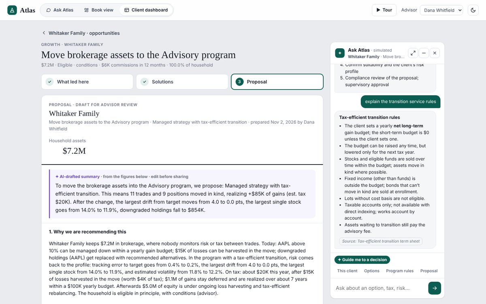

## 9. Ask Atlas on every screen

Ask Atlas is no longer only the starting page and the workflow panel. It sits beside **Book view, the Client dashboard and the client deep dive** as well, and keeps **one conversation** as you move between them. What you asked on Book view is still there when you open a client. The workflow keeps its own decision thread, with the same header and controls.

### 9.1 It knows what you are looking at

The panel header says what Atlas sees, for example *Book view · Brokerage → Advisory program* or *Whitaker Family · Asset groups*. Typed questions are answered in that context: on Whitaker's page, "how risky is it?" needs no client name.

### 9.2 It opens each screen with a point of view

When the screen or the view changes, Atlas adds one short message with a next step. If you didn't reply to the previous one, it is replaced, not stacked, so the thread doesn't fill up.

| Screen | What Atlas says first | Next step |
|---|---|---|
| Book view | Three things worth your time: the bond maturing soonest, the meeting this week with the most open items, the largest loss to harvest before year-end, and the strongest Advisory case | One button per item |
| A criterion in Book view | How many clients and how much; the strongest case and why; who is next | Open the strongest case, or ask why the next one is there |
| Client dashboard | This week's meetings and what to lead with | Prepare the first |
| Client deep dive | Before the meeting: performance against benchmark, largest drift, any stock above 10%, the biggest open item, and any draft proposal | Start the next item, or "What should I raise?" |
| Drilling in | A group: weight against target and the CIO stance. A class: CIO stance and largest holding. A sector: against the benchmark. Show target or proposal: what changes | — |

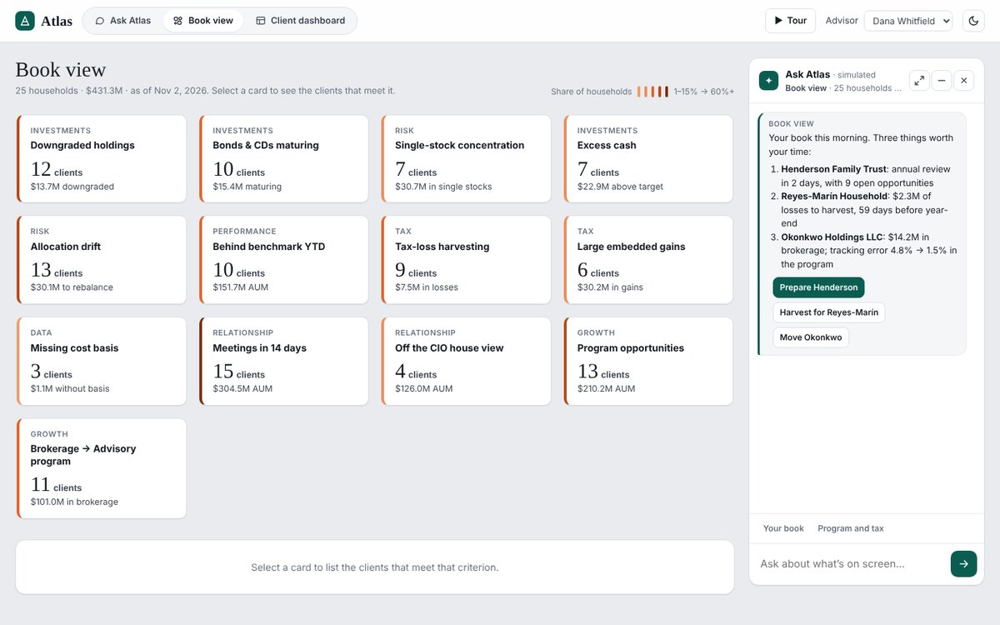

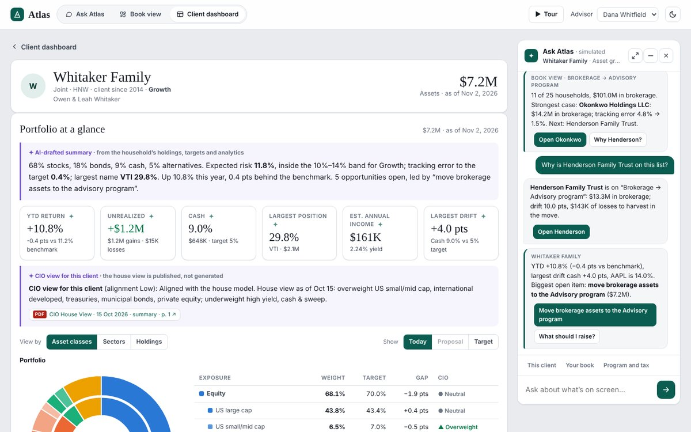

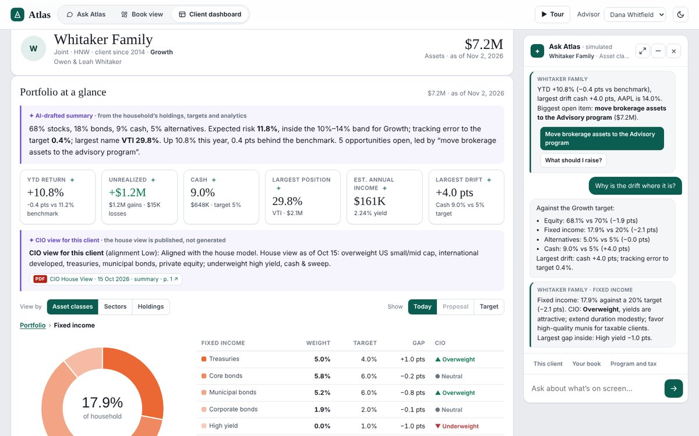

**The storyline carries through.** Once you have chosen an option in a workflow, the client's opener mentions the draft and points to the next open item, and Book view lists the drafts so far.

### 9.3 ✦ Ask about this

Figures and rows can be asked about directly, with the context filled in:
- **Key figures in the deep dive:** each has a ✦ (for example "Why is the drift where it is?").
- **Rows in Book view and the Client dashboard:** a ✦ appears on hover ("Why is Henderson on this list?", "What should I raise with Kaplan?").
- **Metric names in the workflow's impact and risk tables:** select the name ("Explain the change in largest single stock"). Atlas gives before and after, and the trades that cause it.

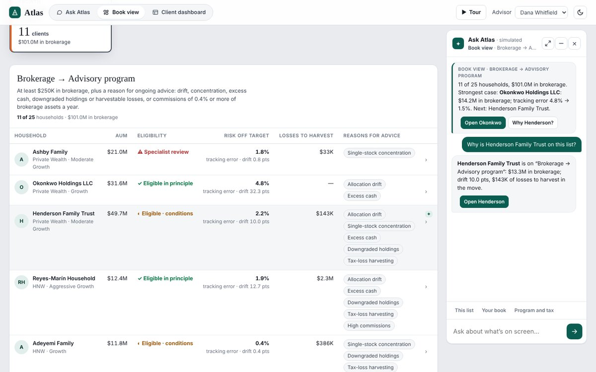

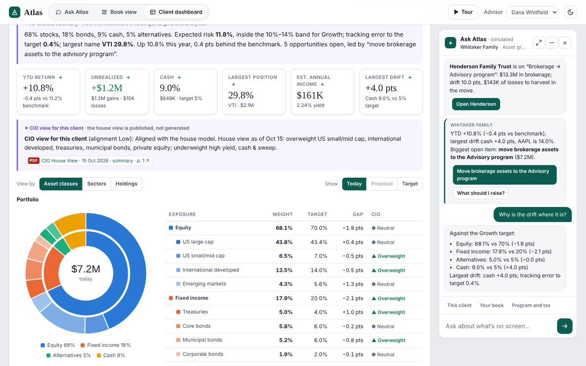

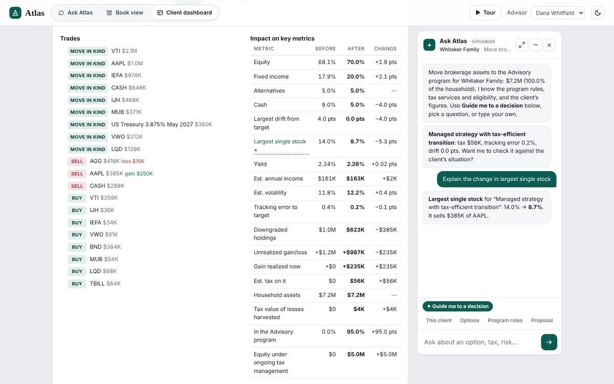

### 9.4 Citations: the CIO view, with its source

Every CIO stance in the deep dive's table (▲ Overweight, ● Neutral, ▼ Underweight) can be selected. Atlas answers with:
- the stance and a quote from the **CIO House View** document;
- what it means for this household (weight against target, and whether adding or trimming fits both the target and the view);
- a citation chip: **PDF · CIO House View · 15 Oct 2026 · Fixed income · p. 1 ↗**. Selecting it opens the document at that page in a new tab.

The CIO summary card in the deep dive carries the same citation. The document is an illustrative 5-page PDF (made-up content) embedded in the HTML, so the link works offline; it is also in the zip as `cio-house-view-2026-10.pdf`. Knowledge answers about the program cite their source document the same way, as text.

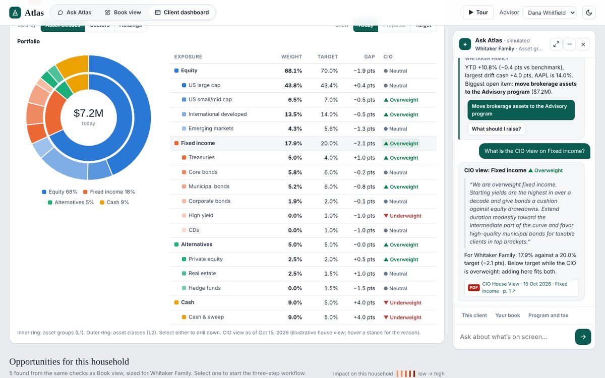

### 9.5 Collapse, dock or full screen

The header has two controls on every screen, including the workflow:
- **Full screen (⤢):** the conversation opens over the page at reading width, with the suggested questions open. Esc, ⤡ or a click outside returns it to the side.
- **Collapse (—):** the panel folds into an **✦ Ask Atlas** button at the bottom right and the page takes the full width. A dot on the button shows that Atlas has something new.

**Kept uncluttered:**
- One header line for what Atlas is looking at, instead of a separate bar.
- Suggested questions stay folded into section names until you pick one (they open on their own in full screen).
- ✦ on table rows only appears on hover; in the workflow tables the metric name itself is the link, so nothing wraps.
- One opener per screen, replaced if unanswered.
- With the panel docked, the opportunity tiles use three columns so titles and figures don't collide.

**On a phone,** the panel opens from the ✦ button as a sheet, and full screen fills the screen.

 

## 10. Guided tour

**Where to start it:** **▶ Tour** in the top bar, or "Take the 25-step tour" on the Ask Atlas page.

**How it works:**
- It highlights each part of the screen and moves between screens on its own.
- It walks Henderson's concentration opportunity through all three steps.
- Use Next or Back, the arrow keys, or Esc to close.
- On a phone, the explanation pins to the top or bottom of the screen so it doesn't cover the highlighted part.

| # | Step | # | Step |
|---|---|---|---|
| 1 | Welcome | 14 | A three-step workflow |
| 2 | Ask Atlas is the starting point | 15 | Step 1: what led here |
| 3 | Two ways in | 16 | Step 2: ways to address it |
| 4 | Book view: criteria as a heat map | 17 | See the impact before you choose |
| 5 | Select a card to see who meets it | 18 | Ask Atlas guides the decision |
| 6 | Each row is a client | 19 | Step 3: the proposal |
| 7 | **Ask Atlas follows you** | 20 | The proposal shows at a glance too |
| 8 | Client dashboard | 21 | Brokerage → Advisory program |
| 9 | Portfolio at a glance | 22 | Risk shift and tax impact |
| 10 | Key figures | 23 | Where each brokerage holding goes |
| 11 | View by and show | 24 | Program options, including a gradual transition |
| 12 | Groups and classes in one picture | 25 | End |
| 13 | Opportunities for this household | | |

## 11. Dark mode and phone

**Dark mode:** it follows the system setting, and the moon button in the top bar switches it by hand. The heat edges have their own dark-mode colors.

**Phone (390 px):**
- The tabs become Ask, Book and Clients.
- Cards stack.
- Wide tables scroll inside their card, never the page.
- Ask Atlas opens from a button on every screen, as a sheet that can go full screen.

    

## 12. How the figures are calculated

**Holdings:** every figure comes from the household's holdings at security level.
- **Asset groups and classes:** each security has an asset group (L1) and an asset class (L2).
- **Sectors:** stocks have a sector, and funds are counted by the sectors they hold.
- **Lots:** lots of the same security are combined for display.

**Targets:**
- **Group targets (L1):** from the household's record.
- **Class targets (L2):** each group's target split by a fixed house model. For example, equity is 62% US large cap, 10% US small/mid cap, 20% international and 8% emerging markets.

**Book view and household opportunities** use the same rules (section 2). Opportunity heat by share of the household: ≤1%, ≤3%, ≤6%, ≤10%, over 10%. Some opportunities use a floor or a fixed level instead:

| Opportunity | Heat |
|---|---|
| Single-stock concentration | At least step 3 |
| Maturing within 60 days | At least step 4 |
| Meetings | By days away |
| Behind benchmark | By the size of the gap |
| CIO view and programs | Fixed level |
| Missing cost basis | At least step 2 |

**The trade engine:**
- **Sells** reduce each lot in proportion and realize gain on lots with a known basis. Lots without a basis are flagged.
- **Buys** are paid for by the proceeds and then by cash; household assets don't change.
- **Gifts** leave the household with no gain realized.
- **In-kind moves** (direct indexing) carry the cost basis across.

**"Fill the gaps" buys** spread the money across the asset classes below target, in proportion to each gap, using one representative product per class. For the Advisory program options, the gaps are measured **after** the sells and capped at each asset group's own gap, so "rebalance now" lands on the target instead of overshooting it.

**Tax:** estimated at 23.8% of net realized gains. That is the long-term federal rate including the net investment income tax; state tax is excluded.

**Risk measures:** expected volatility and tracking error to target come from class-level volatility assumptions and a simple correlation by asset group. Expected return uses illustrative long-term assumptions per class. The worst past event replays 2008 and 2022 class returns on today's mix.

**CIO view:** an illustrative house view as of 15 Oct 2026, with a stance and a reason for every group and class.

**Advisory program key metrics:**
- **Risk shift:** tracking error to target, largest drift, volatility, largest single stock, the 2008 scenario and downgraded holdings, computed on today's household and on the household after the option's trades. The default option is the tax-efficient transition when it applies, otherwise "rebalance now"; for the transition, year one is shown.
- **Tax this year:** 23.8% of net realized gains in the option's trades.
- **Losses harvested:** losses realized in the move; their tax value is the loss × 23.8%.
- **Gains deferred:** unrealized gains newly held in the program, moved in kind rather than sold.
- **Equity under ongoing tax management:** equity in the program under a managed strategy (CIO model, transition or direct indexing) in a taxable account. Advisor-run strategies count as $0 here.
- **Fees** are still modeled (illustrative schedule within the program's 1.75% maximum; manager fee 0.10% for the CIO model and 0.20% for direct indexing) so Atlas can answer a typed question about them, but they are not shown on the screens.

**The transition:** sells appreciated holdings that are not in the CIO model, least gain per dollar first, until the year's net long-term budget is used. Years ≈ total gains to transition ÷ budget, rounded up.

**The decision guide:** scores each option against the answers:
- tax above the client's limit is penalized;
- matching the decision-maker earns points;
- "bring risk back to the profile" rewards lower tracking error and drift;
- "ongoing tax management" rewards equity under tax management, and direct indexing;
- "keep tax low" penalizes tax and credits harvested losses;
- staying in brokerage is penalized when the portfolio shows signals that need advice.

## 13. Limits, and what production needs

**What is simulated in this prototype:**
- **AI-drafted text:** the recap, summaries and chat are built from rules over the page's figures. In production a language model would draft them, grounded on the same figures, and they would be checked before use (see the production architecture note).
- **Phased options** show the first year or first step only.
- **Gifts** don't show the charitable deduction.
- **The collar** has no pricing.
- **"Save as draft proposal"** only shows a confirmation.
- **Ask Atlas on every screen** is rules over the page state: what is on screen is passed to the answer functions. In production the same screen context (screen, client, selection, choices so far) is passed to a language model with the page's figures as tools, and citations come from a document store rather than one embedded PDF.
- **The CIO House View PDF** is made up for the prototype.
- **The decision guide** uses fixed questions and scoring rules. In production a language model would hold the conversation, with the same rules and figures as its tools.
- **The Advisory program fee schedule, manager fees and eligibility thresholds** are illustrative. Production uses the firm's schedules, the client's negotiated rate and the current strategy profiles.

**Data production needs:**
- holdings and tax lots from the systems of record;
- research ratings with their change dates;
- bond maturities;
- the approved product shelf;
- the CIO house view;
- capital-market assumptions;
- each client's targets and benchmark;
- account registrations and brokerage activity (trades and commissions);
- insider and restricted-stock flags;
- the program's excluded-asset and share-class lists.

**Proposals:** they should be saved on the server with versions and an audit trail, and sent through the firm's review before anything reaches the client.
