# CIO Model Fit: screenshots by use case

Taken from the Python v2 app (Dana Whitfield, Bridgewater NJ, business date 16 Oct 2026) at 1440 px wide, plus two phone shots. Images are in `img/`.

CIO Model Fit compares each brokerage account over $50,000 with the CIO strategic model it maps to. Both sides use the same capital market assumptions (CMA), so expected return, risk and Sharpe compare like for like. Actual performance is shown beside them but kept separate.

| # | Use case | Screenshot |
|---|---|---|
| 1 | First visit: the workspace and its how-to panel | `01-overview.png` |
| 2 | Book at a glance: risk vs return | `02-scatter.png` |
| 3 | Book at a glance: one row per account | `03-table.png` |
| 4 | Profile mismatch, muni proxy, single-stock concentration (Montgomery) | `04-montgomery-detail.png`, `08`, `09` |
| 5 | Low coverage and a defaulted liquidity tier (Fairbanks) | `05-fairbanks-detail.png` |
| 6 | Short history, blank profile field, margin credit (Brennan) | `06-brennan-detail.png` |
| 7 | Margin debit and an over-risk account (Kaplan) | `07-kaplan-detail.png` |
| 8 | How accounts are matched: the judgment calls | `10-judgment-calls.png` |
| 9 | From Today to the account | `11-today-tile.png`, `12-tile-drilldown.png` |
| 10 | From Ask Atlas | `13-ask-book.png`, `14-ask-montgomery-opens.png` |
| 11 | Previewing the 2027 CMA | `15-cma-2027-preview.png`, `17-cma-preview-what-changes.png` |
| 12 | The November release | `16-nov-fairbanks-flags.png`, `16b-nov-table.png` |
| 13 | An advisor with no accounts in scope (Marcus) | `18-marcus.png` |
| 14 | Phone, dark mode | `19-mobile-dark.png`, `20-mobile-dark-allocation.png` |

---

## 1. First visit

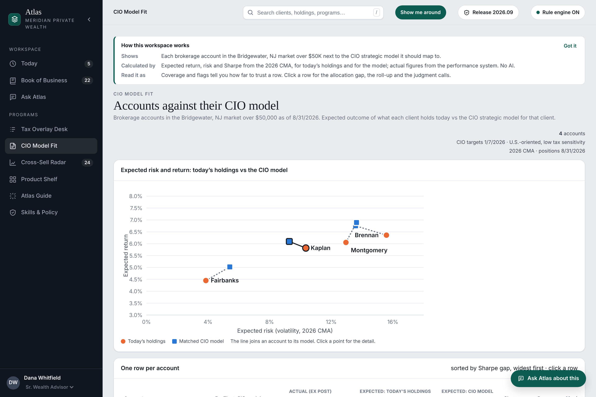

On the first visit, the "How this workspace works" panel says what is shown, how it is calculated (CMA math, no AI) and how to read it. The header gives the scope (4 accounts), the CIO targets date and the CMA in use.

## 2. Book at a glance: risk vs return

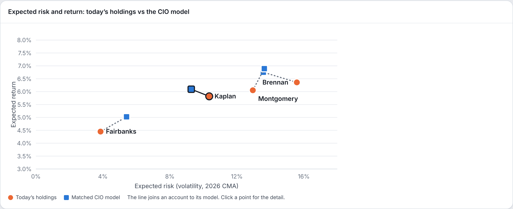

Each account is a circle (today's holdings) joined to a square (its CIO model). Read it as follows:
- A line going **up and left** means the model earns more for less risk.
- **Kaplan and Brennan** sit to the right of their models: today's holdings take more risk than the model for less return.
- **Montgomery and Fairbanks** sit below and left of theirs: they take less risk but give up return.

Click a point to open that account.

## 3. Book at a glance: the table

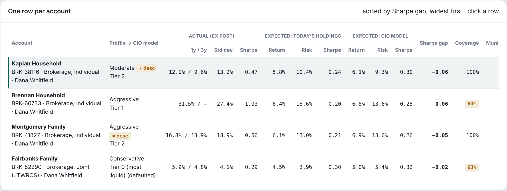

Rows are sorted by Sharpe gap, widest first: Kaplan −0.06, Brennan −0.06, Montgomery −0.05, Fairbanks −0.02. The table puts three groups of figures side by side:
- actual (ex post) performance;
- expected figures for today's holdings;
- expected figures for the model.

The Coverage and Muni columns, plus the flags, tell you how far to trust each row.

## 4. Montgomery: profile mismatch, muni proxy, concentration

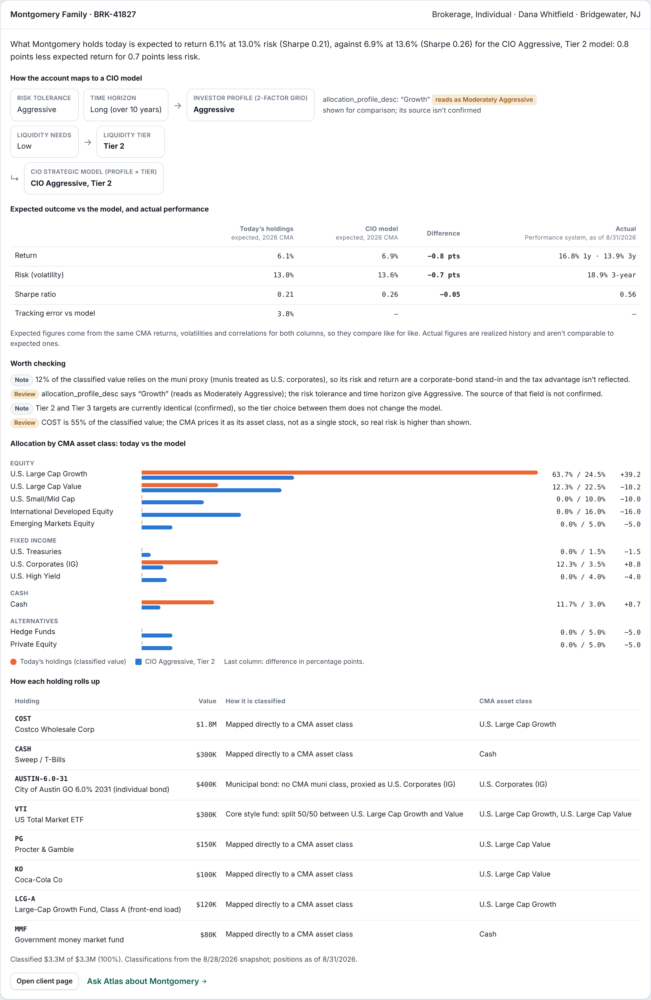

The setup chain shows how the model was chosen:
- risk tolerance (Aggressive) and time horizon (Long) give the profile Aggressive;
- liquidity (Low) gives Tier 2;
- together they give **CIO Aggressive, Tier 2**.

The free-text profile field says "Growth", which reads as Moderately Aggressive, so it is tagged and flagged for review.

Expected return is 6.1% against 6.9% for the model, at 13.0% risk against 13.6%. Tracking error is 3.8%.

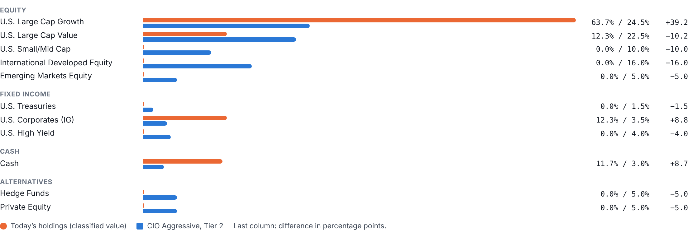

The allocation chart compares the asset classes, current vs model. U.S. Large Cap Growth is heavily overweight. Small/mid cap, international and emerging markets are at zero against the model.

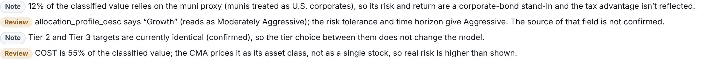

The flags say:
- 12% of the account is on the muni proxy;
- the profile field disagrees with the derived profile;
- Tier 2 and Tier 3 targets are identical;
- **COST is 55% of the classified value**, so real risk is higher than the CMA shows.

## 5. Fairbanks: read with care

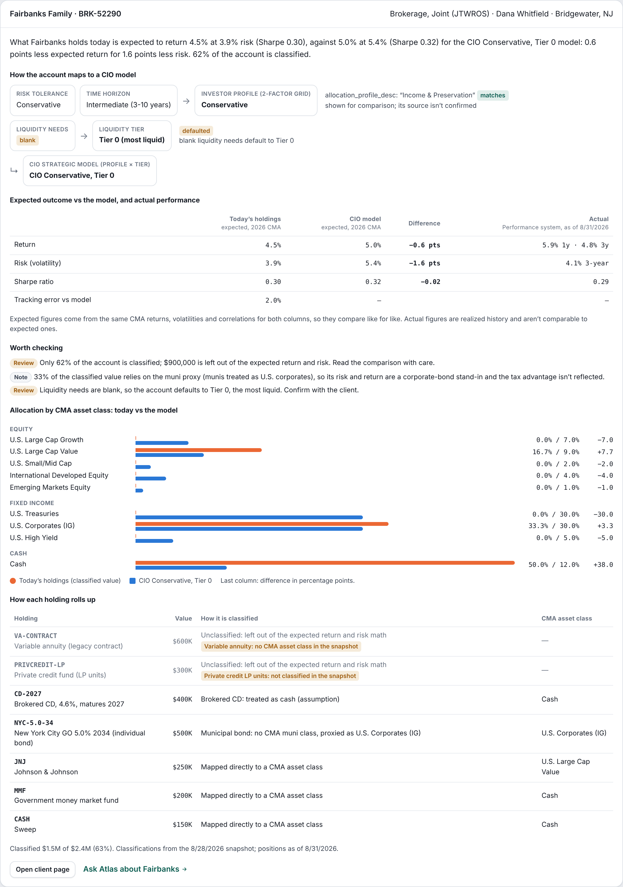

- **Coverage.** Only 62% of the account is classified. The variable annuity ($600K) and the private credit LP ($300K) have no CMA class, so they are left out of the math, and the roll-up at the bottom says why.
- **Liquidity tier.** Liquidity needs are blank, so the tier **defaults to Tier 0**, and this is tagged.
- **Allocation.** The account holds 50% cash against a 12% model weight, and no Treasuries against a 30% weight. That is why its risk (3.9%) is well under the model's (5.4%).

## 6. Brennan: short history, blank field, margin credit

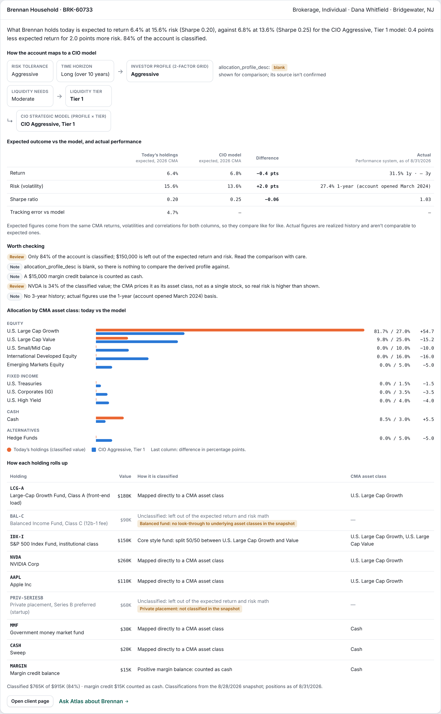

- **History.** The account opened in March 2024, so there is no 3-year history and actual figures use a 1-year basis (31.5% return, Sharpe 1.03). That return is realized and is not comparable with the expected figures.
- **Profile field.** It is blank, so there is nothing to cross-check.
- **Margin.** A $15,000 margin credit is counted as cash.
- **Concentration.** NVDA is 34% of the classified value.
- **Coverage.** It is 84%.

## 7. Kaplan: margin debit, more risk than the model

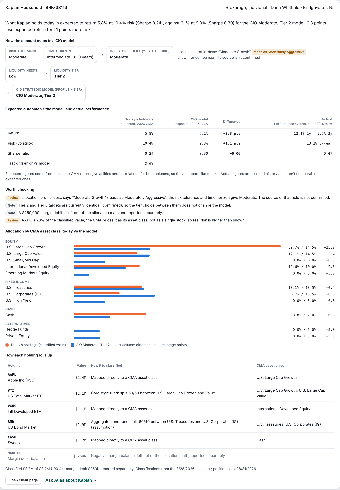

Kaplan is expected to return 5.8% at 10.4% risk, against 6.1% at 9.3% for **CIO Moderate, Tier 2**. That is less return for more risk; its Sharpe gap (−0.06) is tied with Brennan's for the widest in the book.
- **Margin.** A $250,000 margin debit is left out of the allocation and reported separately.
- **Concentration.** AAPL is 28% of the classified value.
- **Profile field.** It says "Moderate Growth" (reads as Moderately Aggressive), while the derived profile is Moderate.

## 8. Judgment calls

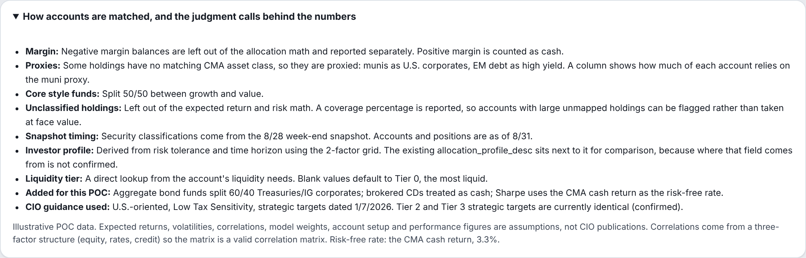

Under the table, one expandable panel lists every assumption behind the numbers:
- how margin is handled;
- the muni proxy;
- CDs treated as cash;
- unclassified holdings;
- blank liquidity defaulting to Tier 0;
- the scope filter;
- which CIO targets and CMA are used.

An advisor or reviewer can check the method without reading code.

## 9. From Today

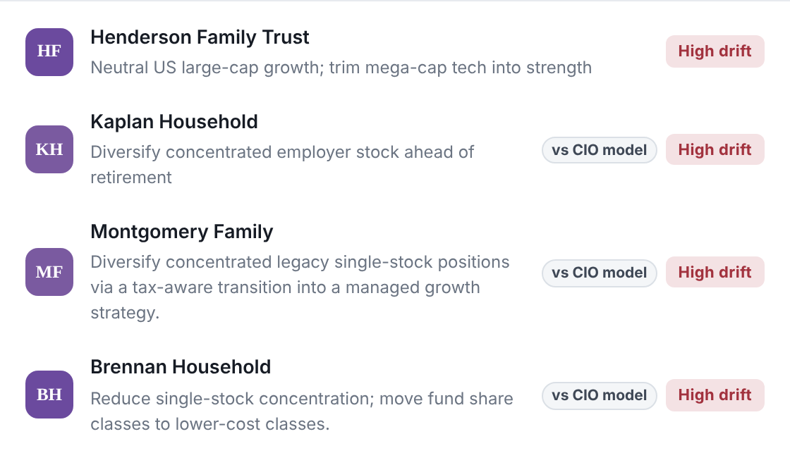

On Today, client tiles that have a CIO model carry a **"vs CIO model"** tag.

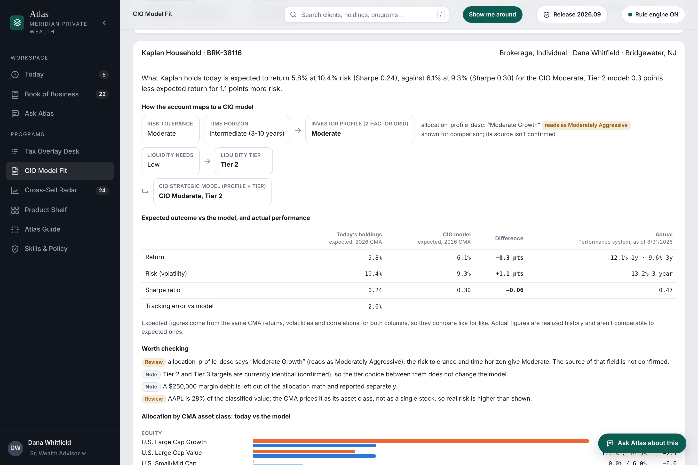

Clicking the tag opens CIO Model Fit with that account selected.

## 10. From Ask Atlas

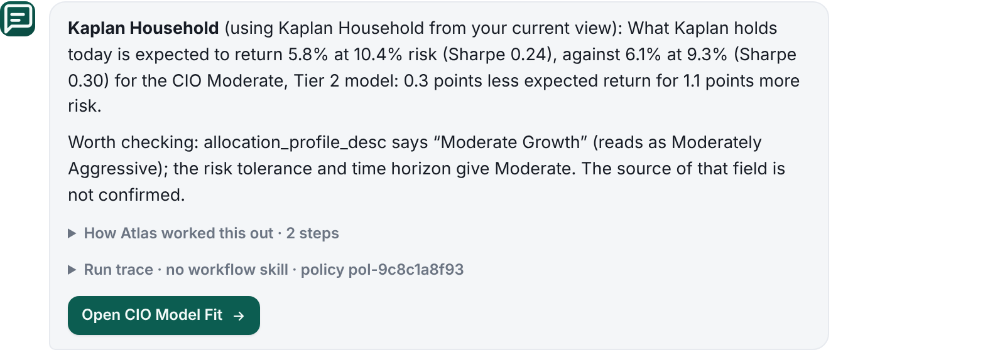

The answer gives the account's expected figures against its model and the "Worth checking" items, and offers **Open CIO Model Fit**. With an account already in view, Atlas answers about that account, and says so ("using Kaplan Household from your current view").

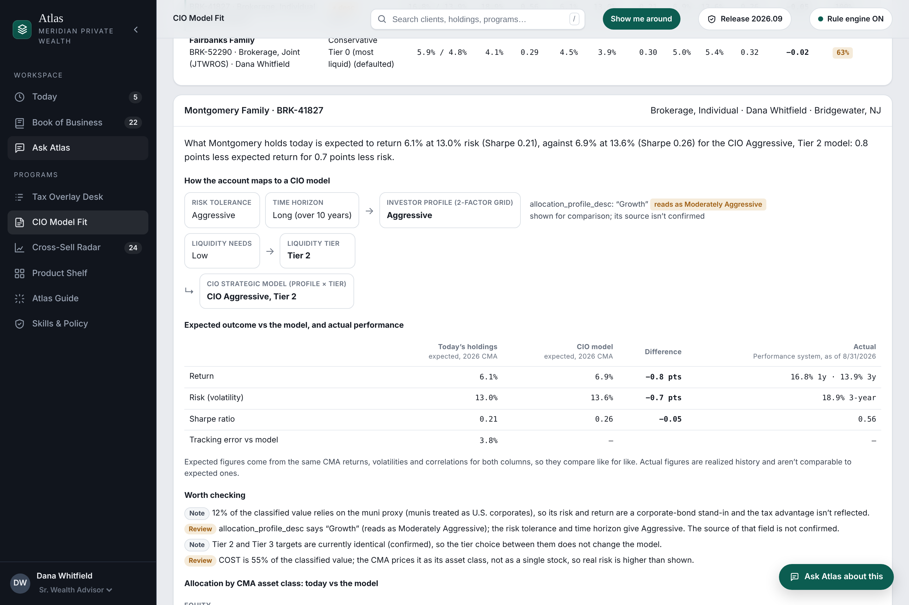

"Compare Montgomery's account with its CIO model" opens the workspace on Montgomery.

## 11. Previewing the 2027 CMA

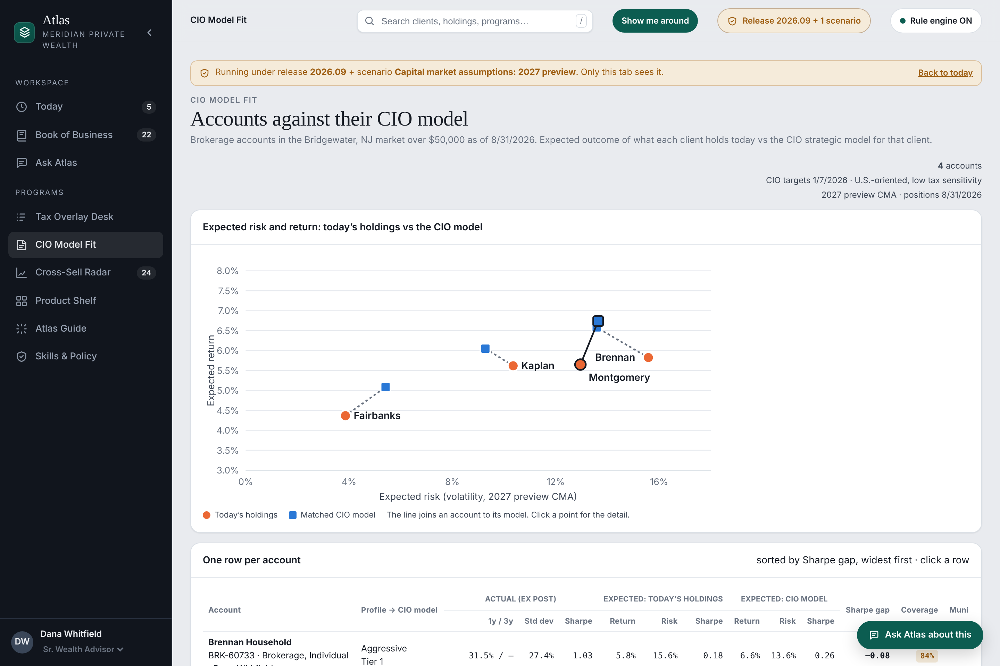

The policy button in the top bar selects the **2027 CMA preview** scenario for this tab only. In this view:
- an amber banner names the scenario;
- the header and axis say "2027 preview CMA";
- expected figures are recalculated, and Brennan moves to the top of the list.

Other tabs, and other advisors, stay on the 2026 CMA.

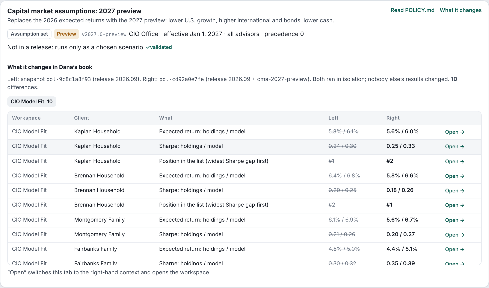

Skills & Policy → "What it changes" runs Dana's book under both snapshots side by side and lists the 10 differences, for example:
- Kaplan's expected return moves from 5.8% / 6.1% to 5.6% / 6.0%;
- Brennan and Kaplan swap places in the list.

"Open" switches the tab to the preview.

## 12. The November release

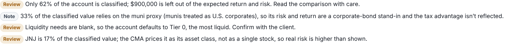

With the as-of date set to 1 Nov 2026, release 2026.11 applies. Its tighter CIO risk flags add a fourth flag to Fairbanks: **JNJ is 17% of the classified value**. Under today's release, that position is below the concentration threshold.

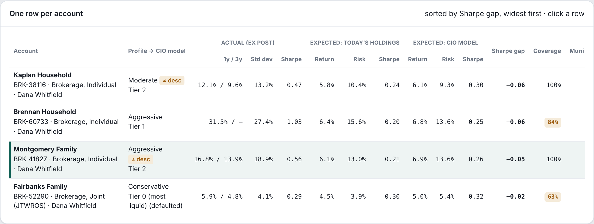

## 13. An advisor with no accounts in scope

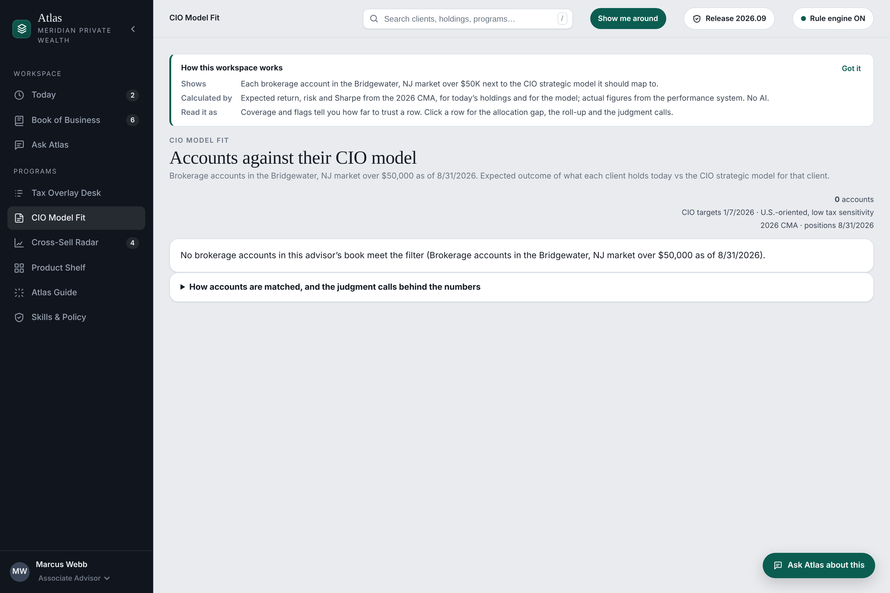

Marcus Webb has no brokerage accounts over $50K in the Bridgewater market, so the workspace says so plainly and still offers the judgment-calls panel.

## 14. Phone, dark mode

| Book | Allocation |
|---|---|
| 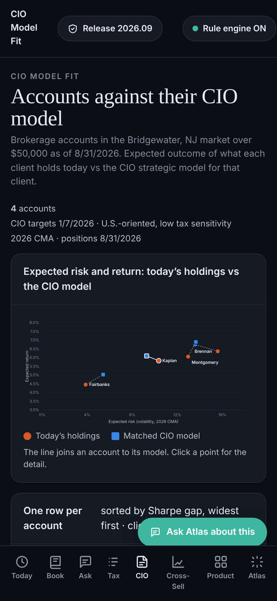 | 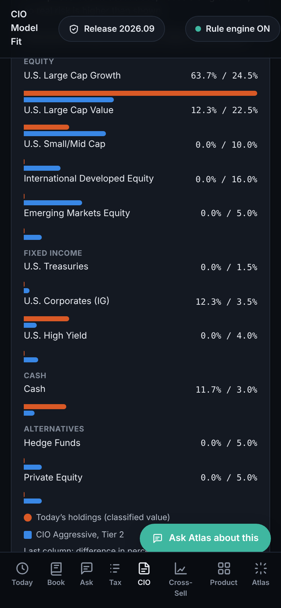 |

On a phone, the workspace keeps the same sections in one column, and the allocation chart puts each label above its bars.

---

*All clients, holdings, models and CMA figures are illustrative demo data.*
