# Outside accounts: proof of concept and Portfolio Review v2.2

This adds a new capability to portfolio review. An advisor uploads statements for accounts a client or prospect holds elsewhere, up to 5 at a time. The tool then:

1. extracts the holdings and allocation;
2. validates them against the firm's approved list;
3. shows inside and outside together against the target and the CIO view;
4. carries the valid positions into several proposals, with firm guidance applied.

A recommended workflow covers the whole process, from consent to implementation.

**Two deliverables:**

| | What it is | How to run it |
|---|---|---|
| **Python POC** (`outside-accounts-poc.zip`) | The working proof of concept: real extraction from PDF, scanned PDF, images, Excel and CSV; validation; household comparison; proposals; checks; a web UI with a guided tour; 26 tests | `uvicorn app.main:app --port 8010` |
| **Portfolio Review v2.2** (`portfolio-review-prototype-v2.2.html`) | v2.1 plus a new **Outside accounts** step. Outside positions become transfer, sell and buy lines in the existing multi-proposal mode. A guided tour is included. It runs offline from one file. | Open the file, then choose **▶ Tour** |

All institutions, people and private securities in the samples are fictional.

**What was checked:**
- **Sample statements:** 8, in 6 formats. 40 of 40 holdings found, 194 of 194 fields correct, every statement reconciles to its printed total.
- **Python tests:** 26 pass.
- **v2.2 vs v2.1:** every existing figure, check and explanation matches v2.1 for all five households (0 differences).
- **Errors:** no console errors in either app, light or dark, desktop or phone.

---

## Part 1. The recommended workflow

The review has eight stages. Each stage has one control that makes it safe.

| # | Stage | What happens | Control |
|---|---|---|---|
| 1 | Collect | Client consent; up to 5 statements per upload (PDF, image, Excel, CSV) | Consent recorded before upload; account numbers kept to the last 4 digits; files deleted after reading |
| 2 | Extract | Text layer, OCR or cells become holdings, allocation and statement details, each with a confidence score | Rows reconcile to the printed total; quantity × price checked; OCR repairs and low-confidence cells flagged |
| 3 | Review and correct | The advisor confirms flagged rows, edits values and sets classes for unrecognized securities | Human review on every flagged row; edits logged with the original value |
| 4 | Validate | Each row checked against the approved list, reference data and category rules; the account type decides what can move | The approved list is the only source of truth; exceptions need a named approver |
| 5 | Compare | Inside and outside together against the target and the CIO view: allocation, single names, fees, cash, risk, stress | All figures calculated; any narrative is drafted from them and labelled |
| 6 | Propose | Three proposals side by side | Firm guidance applied: CIO tilt on new money, approved funds only, gain budget, single-name and high-yield limits |
| 7 | Check and document | Policy checks, tax and surrender costs, suitability notes, client summary | Failed checks block submission; warnings need an advisor note |
| 8 | Implement | Transfer requests to operations; sales only after assets arrive; held-away accounts re-reviewed with the next statement | Transfers reconcile to the statement; trades placed only after settlement |

**Who does what:**

| Role | Responsibility |
|---|---|
| Advisor | Gets consent, uploads, confirms flagged rows, chooses a proposal, edits talking points |
| Engine | Extraction, validation, all figures, proposals and checks. Deterministic and repeatable. |
| Language model | Optional second reader for statements the parser cannot read (every number must appear on the page). Also drafts narrative. Never sets a status or a figure. |
| Supervision | Approves exceptions to the approved list, and any failed check that goes ahead |
| Operations | Transfer requests, settlement, then trades |

**When to use which proposal:**

| Proposal | Use it when |
|---|---|
| A. Transfer what is approved | First meeting; client not ready to sell; or most outside holdings are already approved |
| B. Consolidate and align | The client wants one plan now and accepts the tax inside the gain budget |
| C. Tax-aware phased move | Large embedded gains. Move what is tax-free now. Revisit the rest every year, or at an event: CD maturity, end of a surrender period, or a job change. |

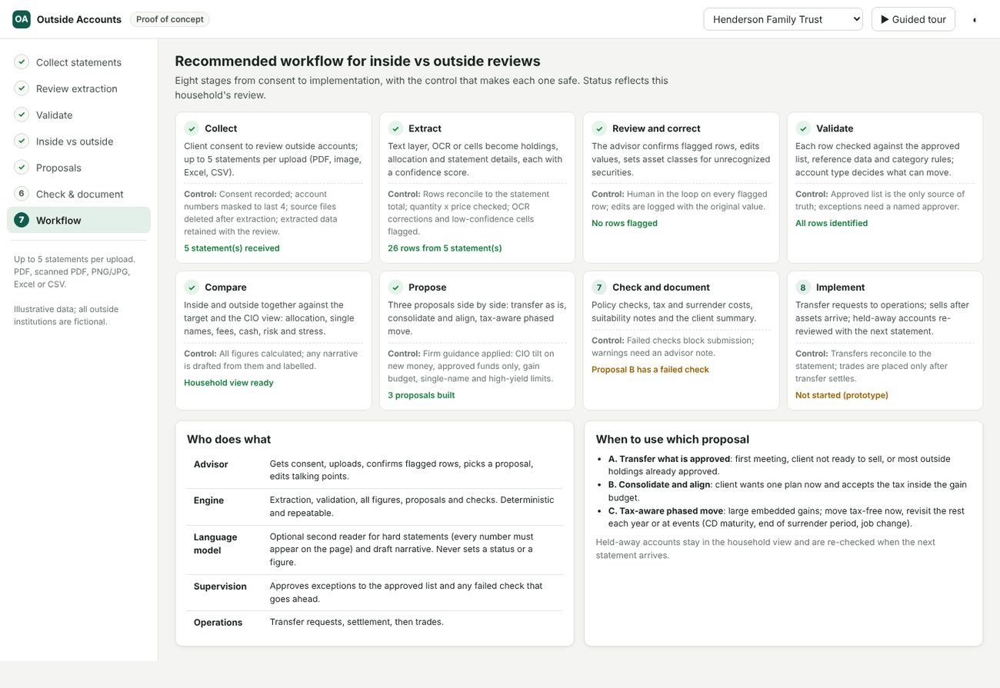

---

## Part 2. The Python proof of concept

### Sample statements

There are eight statements, chosen to cover what advisors actually receive.

| File | Format | Household | What it tests |
|---|---|---|---|
| H1 Harborview brokerage | Text PDF | Henderson (client) | Holdings table, allocation section, private placement, money market |
| H2 Summit 401(k) | Portal screenshot (PNG) | Henderson | OCR, missing tickers ("--"), inline allocation ("Stocks 68% Bonds 24%…"), plan-only funds |
| H3 Northfield export | Excel | Henderson | Title rows above the header, totals row, municipal bond without a ticker, not-approved funds |
| H4 Lakeshore bank | Phone photo (JPG), rotated and noisy | Henderson | Deskew and OCR, CD and savings |
| H5 Crestmark annuity | Scanned PDF (no text layer) | Henderson | OCR of a scan, subaccounts, surrender charge |
| R1 Bayline positions | CSV with a preamble | Rivera (prospect) | Header synonyms, "CASH" symbol, 29% single stock |
| R2 Pathway robo | Screenshot (PNG) | Rivera | OCR misreads VTI as "vTl"; it is repaired and flagged |
| R3 Harborview IRA | Text PDF | Rivera | IRA, brokered CD, an unknown ETF (ZQXI) |

`samples/truth.json` records what each statement contains. `tools/measure.py` scores extraction against it:

```
H1 pdf-text  holdings 7/7  fields 40/40  reconciles
H2 image     holdings 5/5  fields 15/15  reconciles
H3 xlsx      holdings 9/9  fields 49/49  reconciles
H4 image     holdings 2/2  fields 9/9    reconciles
H5 pdf-scan  holdings 3/3  fields 10/10  reconciles
R1 csv       holdings 5/5  fields 29/29  reconciles
R2 image     holdings 4/4  fields 13/13  reconciles   (1 row flagged: OCR repair)
R3 pdf-text  holdings 5/5  fields 29/29  reconciles
Holdings found 40/40, extra rows 0, fields correct 194/194 (100.0%)
```

The tests also shrink the screenshots and the photo to 50–60% of their size and compress them as JPEG. Every degraded copy still reconciles. These are generated statements, so real ones will vary more. That is why stage 3 (review and correct) and the optional language-model reader exist.

### 1. Collect

The household card shows the risk profile, what is held at the firm, the gain budget and the next meeting. Uploads stay locked until consent is ticked. Up to 5 files can be dropped at once. Each statement card shows:
- a thumbnail;
- the institution, account type, last 4 digits and date;
- how it was read;
- the rows found and the total;
- whether it reconciles.

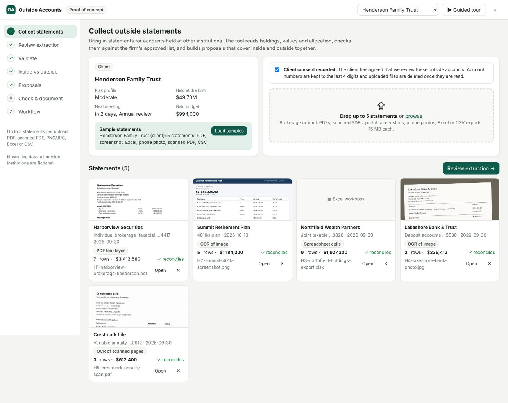

### 2. Review extraction

The statement page sits next to what was read from it. The panel shows the institution, owner, account, date, printed total and the reader used. It also shows the checks:
- reconciles to the total;
- statement age;
- owner matches the household;
- confidence.

Flagged rows are highlighted. Any row can be edited or excluded, and the edit is logged.

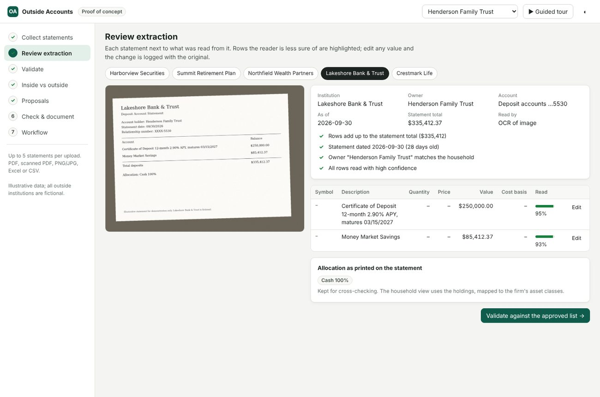

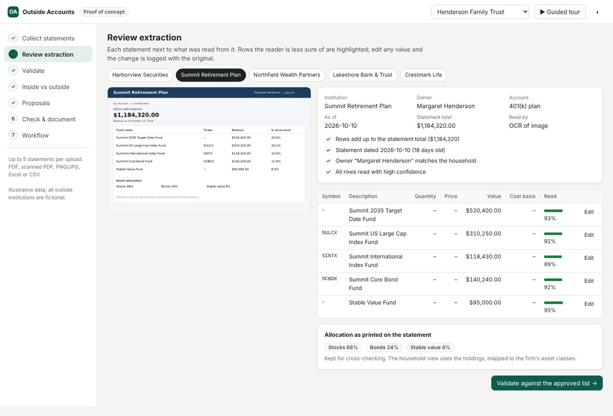

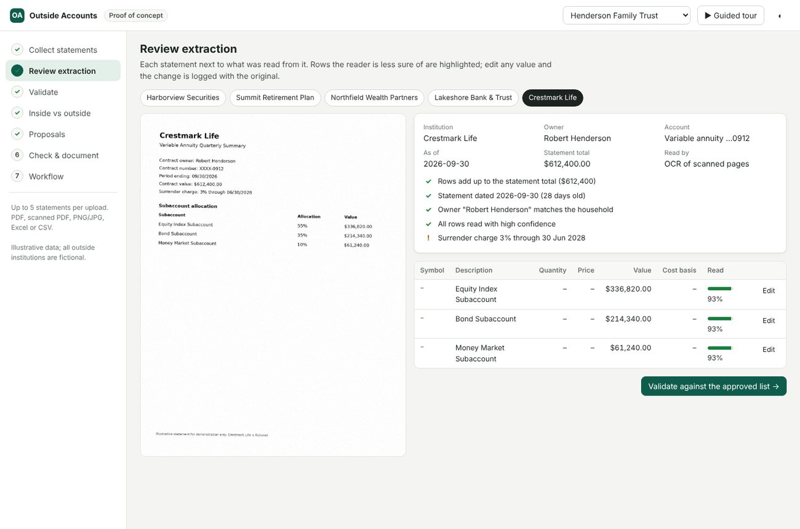

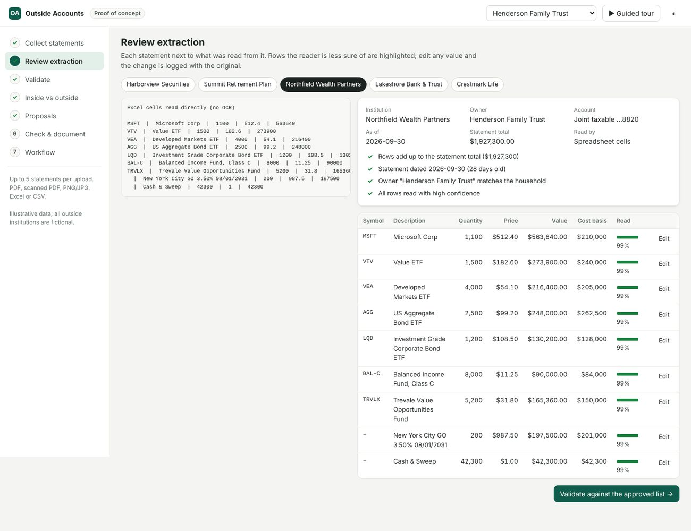

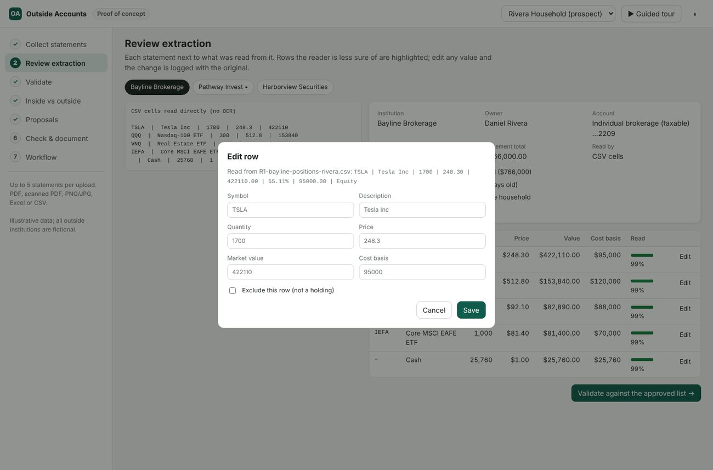

### 3. Validate

Validation checks each row in this order:

1. **Approved list:** by symbol, or by name when no symbol is printed.
2. **Reference data:** known securities that are not approved, and plan-only funds.
3. **Category rules:**
   - municipal bonds → approved and held to maturity;
   - CDs, money market, sweep and stable value → cash;
   - private placements → held away.
4. **Anything else:** not recognized.

The account type then decides what can move:

| Account type | Can move? | What happens |
|---|---|---|
| Employer plan | No | Stays while the client is employed |
| Annuity | No | Stays in the contract; review a 1035 exchange after the surrender period |
| Bank | No | Stays as the reserve |
| Taxable and IRA | Yes | Can move |

For Henderson, the tiles read:
- Approved: 9 rows, $3.18M;
- Under review: 2 rows (ARKK and BAL-C are on the list but rated Not recommended), $464K;
- Not approved: 2 rows (QZLGX and TRVLX, mapped to VUG and SCHD), $557K;
- Held away: 9 rows, $2.05M;
- Cash: 4 rows, $1.22M.

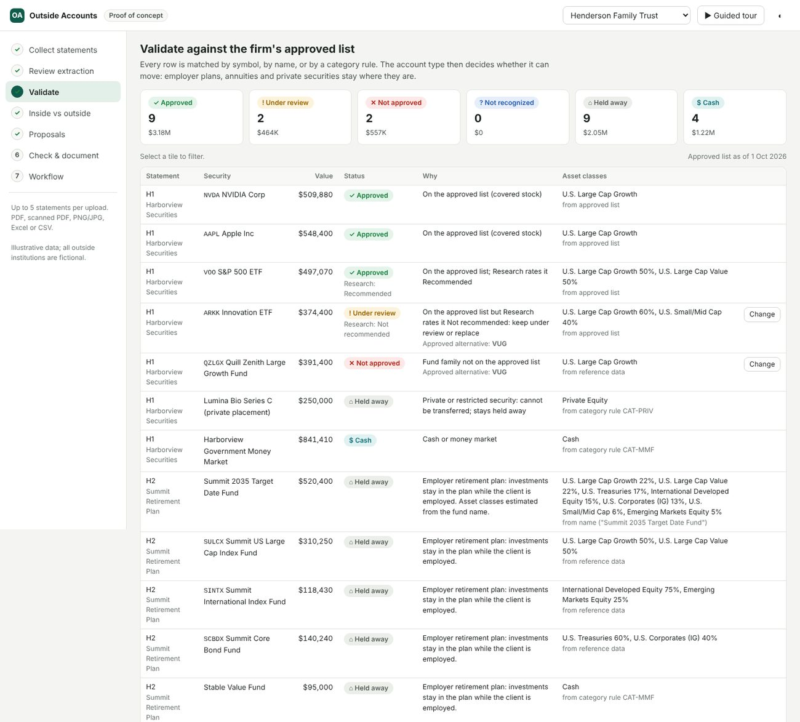

### 4. Inside vs outside

Firm and outside holdings are shown together by asset class. Each class shows its target, its gap, the CIO stance and whether the household is with or against the view.

| Household view (Henderson) | |
|---|---|
| Held at the firm | $49.70M |
| Outside | $7.47M |
| Stays held away | $2.05M |
| Household risk | 9.4% (band 8.3–10.3%) |
| Tracking error vs target | 2.2% |

Three panels sit below the table:

- **Single names across all accounts** (direct plus fund look-through). NVDA is 20.9% of the household and MSFT 10.2%, both over the 10% limit. Both are held at the firm and outside.
- **Fund costs outside.** These funds have cheaper approved alternatives:
  - ARKK (75 bp) could save $2,658 a year;
  - QZLGX (88 bp) could save $3,288;
  - TRVLX (79 bp) could save $1,207.
  Plan funds, annuity subaccounts and private holdings show no fee on their statements. The panel says to request fee schedules for them.
- **Overlap and cash.** AGG, MSFT and NVDA are held on both sides. $1.38M of outside cash sits against a CIO underweight view on cash.

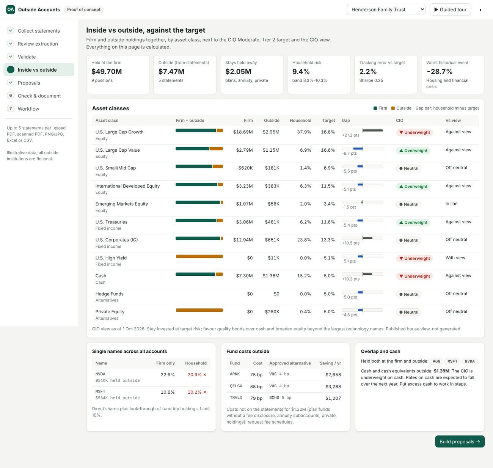

### 5. Proposals

All three proposals are built from the same validated rows, with firm guidance applied.

| Henderson | A. Transfer what is approved | B. Consolidate and align | C. Tax-aware phased move |
|---|---|---|---|
| Moves to the firm | $4.53M | $5.09M | $4.53M |
| Sold after transfer | $0 | $2.77M | $374K (ARKK) |
| Net realized gain | $0 | $983,630 (budget $994,000) | −$123,600 (loss harvested) |
| Estimated tax | $0 | $234,104 | $0 |
| Risk | 9.4% | 9.4% | 9.6% |
| Tracking error | 2.2% | 2.0% | 2.1% |

**Proposal B, step by step:**
1. Sells NVDA and MSFT after transfer, because both are over the single-name limit.
2. Trims AAPL and LQD, because their classes are over target.
3. Replaces QZLGX, TRVLX, ARKK and BAL-C.
4. Invests the proceeds and the brokerage cash in SCHD, IJH, IEFA, VWO and VGSH. These are the classes below target, weighted toward the CIO overweights.

No large cap growth fund is bought, because that class is over target and the CIO is underweight.

**NVDA is still over the limit in every proposal.** Most of it is held at the firm already. The check says so and points to the Holdings and concentration step in Portfolio Review.

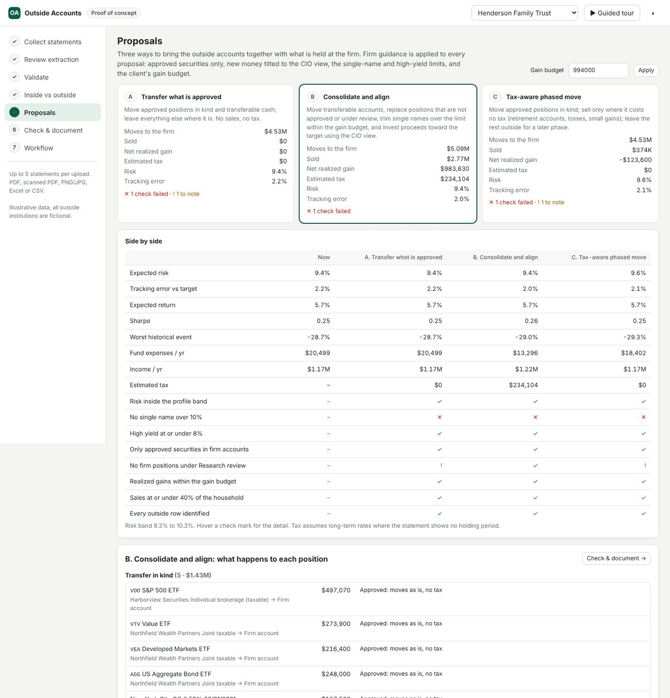

**The prospect (Rivera), step by step:**
1. Three statements total $1.49M, and TSLA is 29% of the household.
2. Risk is 13.7%, above the 10.3–12.5% band.
3. ZQXI is not recognized, so the advisor resolves it as not approved (an IRA holding, so selling it costs no tax).
4. At a $75K gain budget, Proposal B still fails the risk band and the single-name limit.
5. The advisor raises the budget to $250K after talking with the client. Every check then passes: risk 12.2%, estimated tax $59,500.

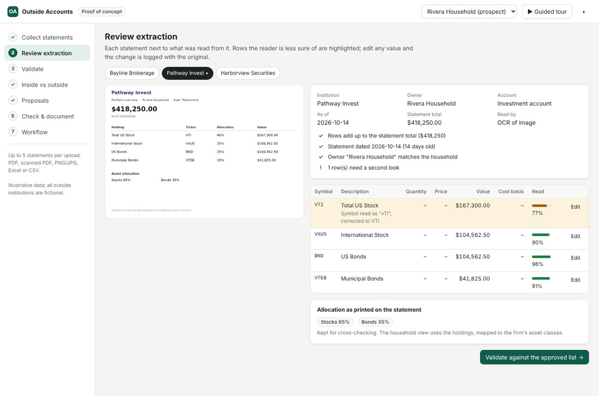

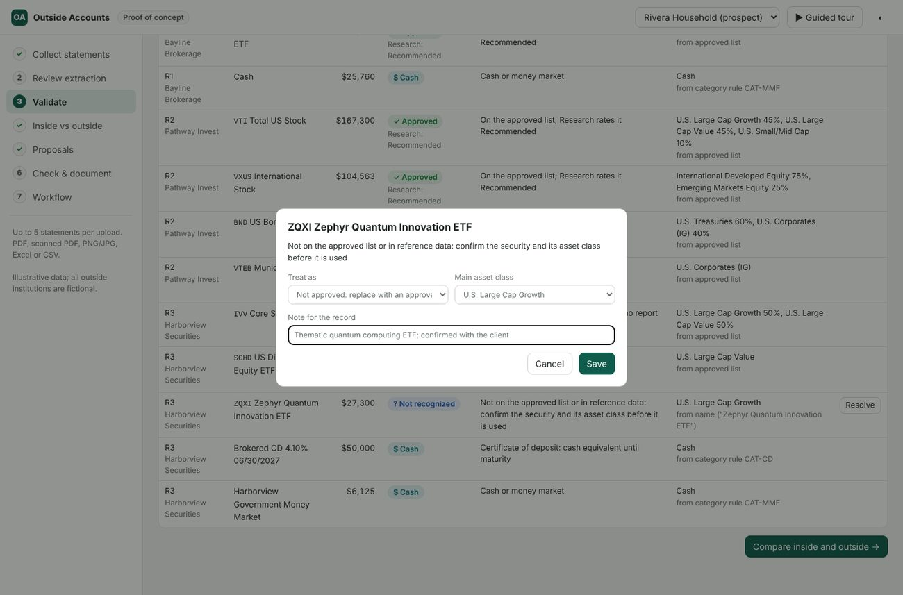

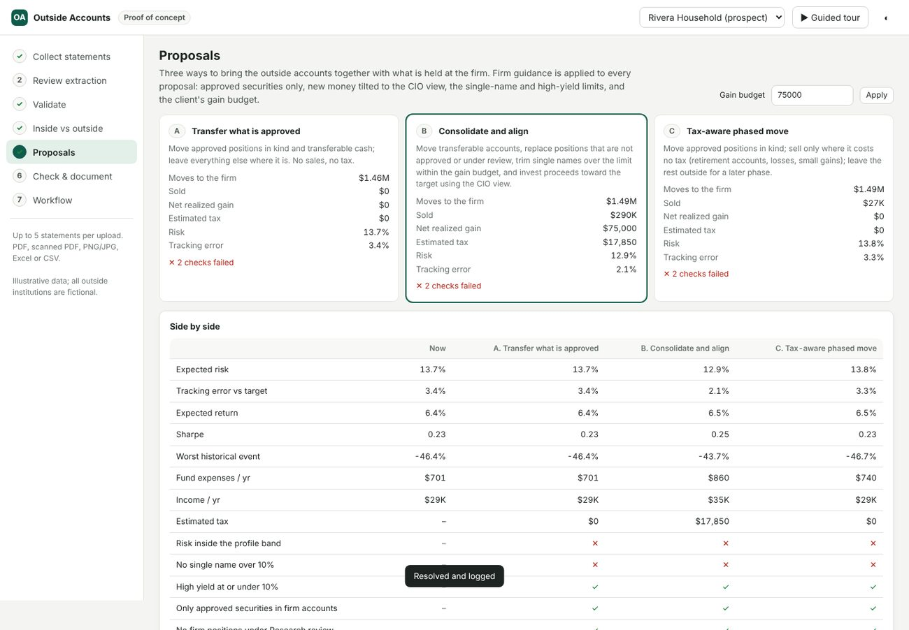


### 6. Check and document

This screen shows the policy checks for the chosen proposal and the client talking points. In production a language model drafts the talking points, so they carry an AI touchpoint label. It also lists costs and constraints to disclose (tax, the annuity surrender charge, plan rules, transfer timing) and the audit trail. **Review record (.md)** downloads a plain-text record with:
- statements and their checks;
- validation of every row;
- the comparison table;
- the three proposals with their actions and checks;
- talking points;
- disclosures.

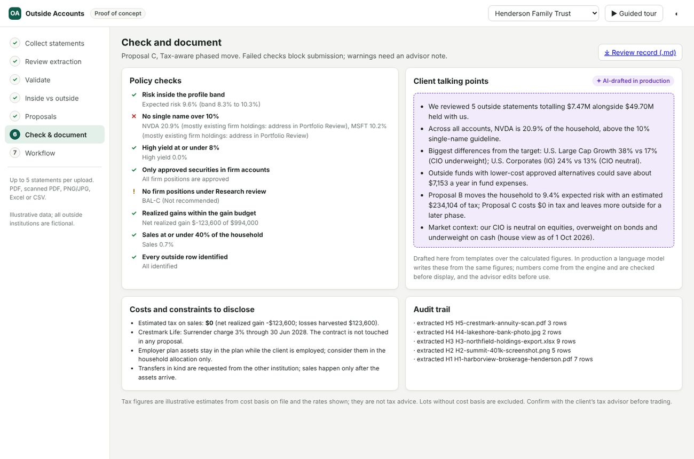

### Guided tour, phone and dark mode

**▶ Guided tour** runs 19 steps. It loads the Henderson samples and walks through every stage. It ends by switching to the Rivera prospect.

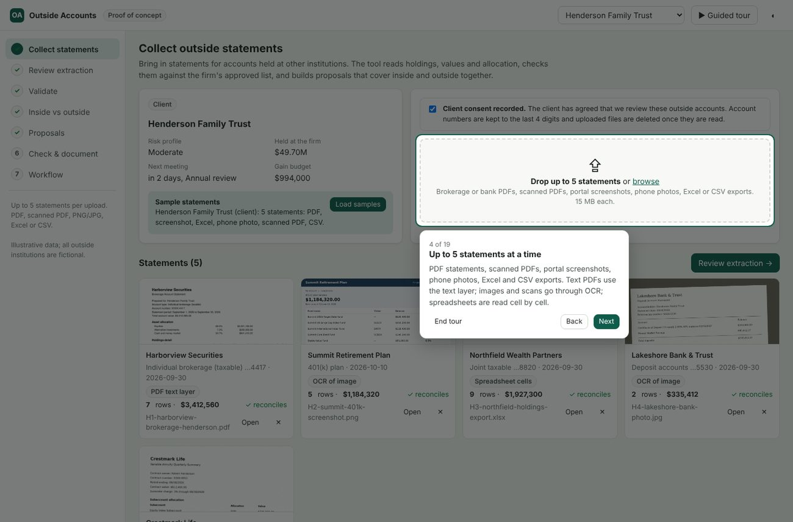

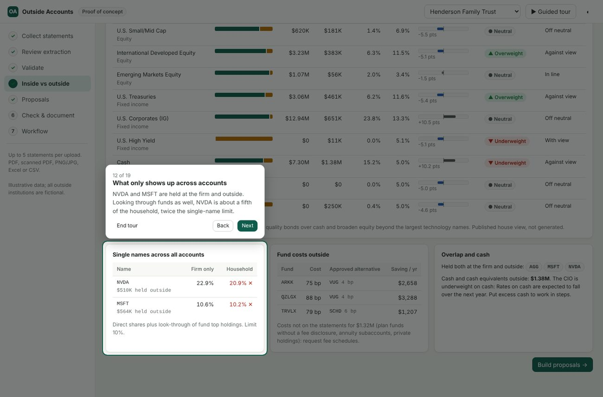

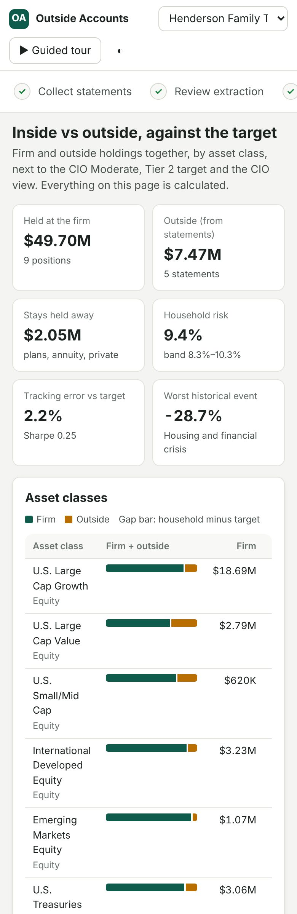

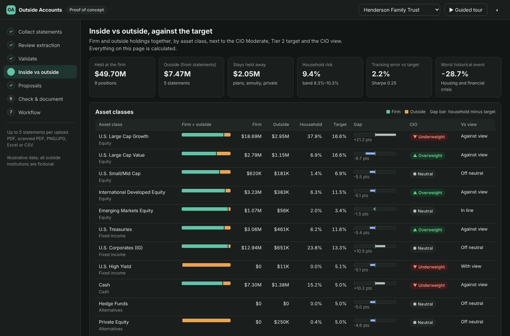

### Optional language-model reader

With `OUTSIDE_LLM=1` and an API key, the model reads only statements that have flagged rows or no rows. The deterministic parser always runs first.

The model returns JSON. A row is accepted only if every number in it appears on the statement page. Accepted rows are flagged for the advisor. Rows with an invented number are dropped, and a warning lists them. A test checks this with a mocked model.

---

## Part 3. Portfolio Review v2.2

v2.2 is v2.1 with one new review step, **Outside accounts**, placed between Downgraded stock alternatives and Compare proposals. It still opens from disk with no server.

It ships with the five Henderson statements already read by the Python pipeline. So the step works offline:
- **Load the 5 sample statements** brings them in.
- Dropping those same files does the same.
- CSV and Excel exports from any household are read in the browser.

PDFs and images are attached with a preview and marked "Waiting for the extraction service" (the Python POC). The screen says so.

### The step

The step has six parts:

1. **AI-drafted summary.** Example: "5 outside statements add $7.47M to the $49.70M held here; $2.05M of it stays held away… NVDA is 20.9% and MSFT is 10.2% of the household…"
2. **Consent and upload.** Statement cards show a thumbnail of the document, the reading method and the reconciliation result. Select a thumbnail to open the document viewer.
3. **Validation.** Shows the rows that need a decision by default, with status chips to filter.
4. **Inside and outside together.** Asset classes with firm vs outside bars, the target, the CIO stance and with/against view.
5. **Single names and fund costs.**
6. **Carry into proposals.** Options A, B and C, recalculated by this review's own engine, plus the workflow strip.

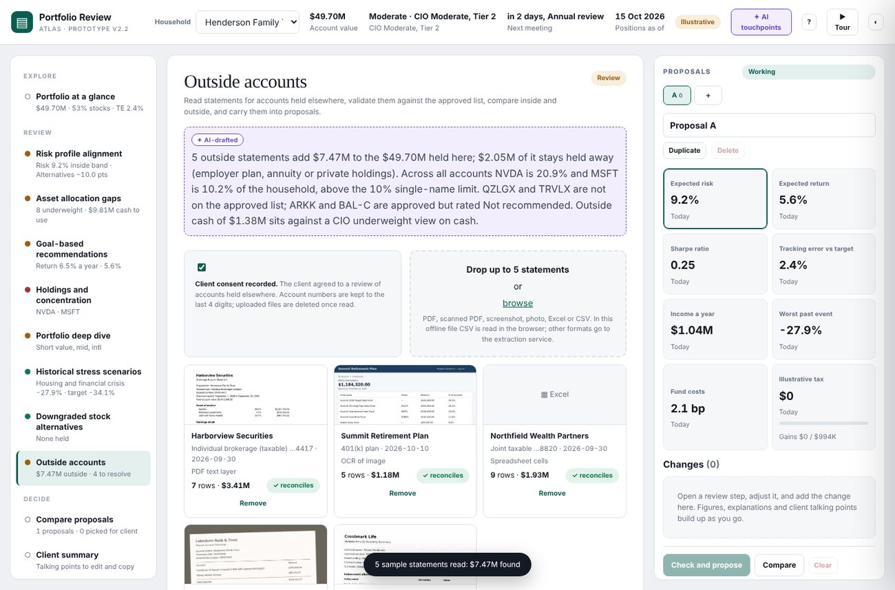

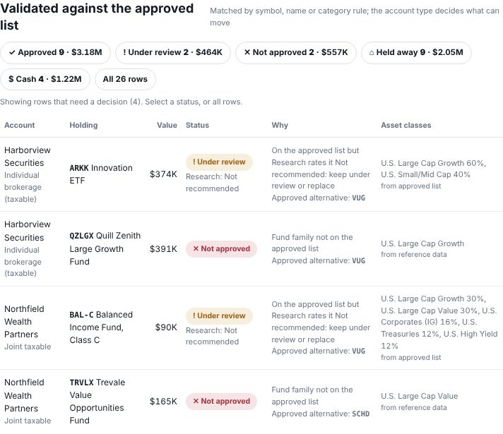

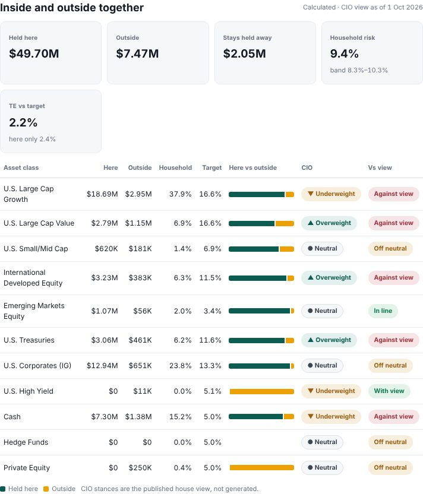

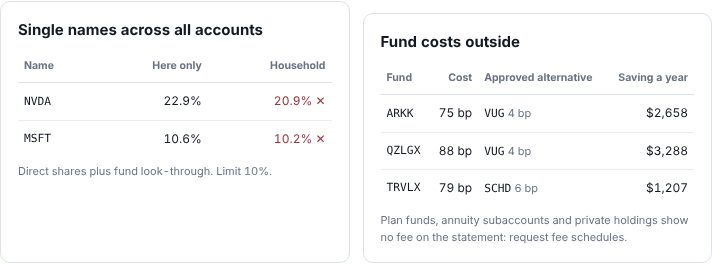

### Previewing an attached statement

Every statement card has a thumbnail of the document: the first page for PDFs and images, and a mini spreadsheet for Excel and CSV. Select the thumbnail, or **Preview**, to open the viewer. It has two panes:

- **Left: the document.**
  - PDFs and images show the full page, with zoom (50–300%) and Fit.
  - Excel and CSV show the cells with row numbers and column letters.
  - A PDF you attach yourself opens in the browser's built-in PDF viewer, with a link to open it in a new tab if that viewer is blocked.
- **Right: what was read.** Institution, owner, account, date, statement total and the reader used. Then the statement checks, every row with its value and approved-list status, the total read, and the allocation as printed.

The arrows (or the ← and → keys) step through the statements, and Escape closes the viewer.

**How each kind of file is previewed and read:**

| Attached file | Thumbnail | Viewer | Read in this offline file? |
|---|---|---|---|
| Sample statements (all five formats) | First page, or a mini spreadsheet | Full page or cells | Yes: the bundled Python results |
| Your PDF | PDF icon with page count and size | The browser's PDF viewer | No: attached, waiting for the extraction service |
| Your image (PNG, JPG, WebP, GIF) | The image | Full image with zoom | No: attached, waiting for the extraction service |
| Your Excel file (.xlsx) | Mini spreadsheet | All cells | Yes: unzipped and read in the browser, no library needed |
| Your CSV | Mini spreadsheet | All cells | Yes |

**Checked:** a copy of the Northfield Excel export uploaded under another household is read in the browser to the same 9 rows and $1,927,300 total as the Python POC, and it reconciles. An attached PDF and PNG get previews and are marked as waiting. Removing a statement frees its file from memory. No console errors on desktop, phone or dark mode, and every existing figure still matches v2.1.

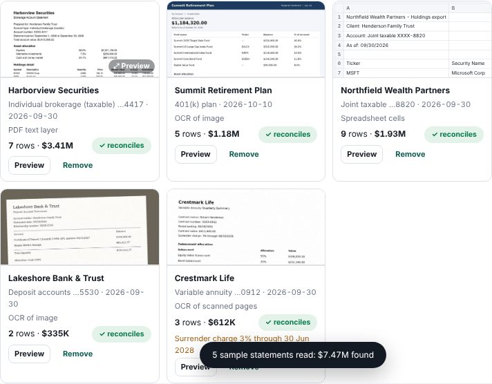

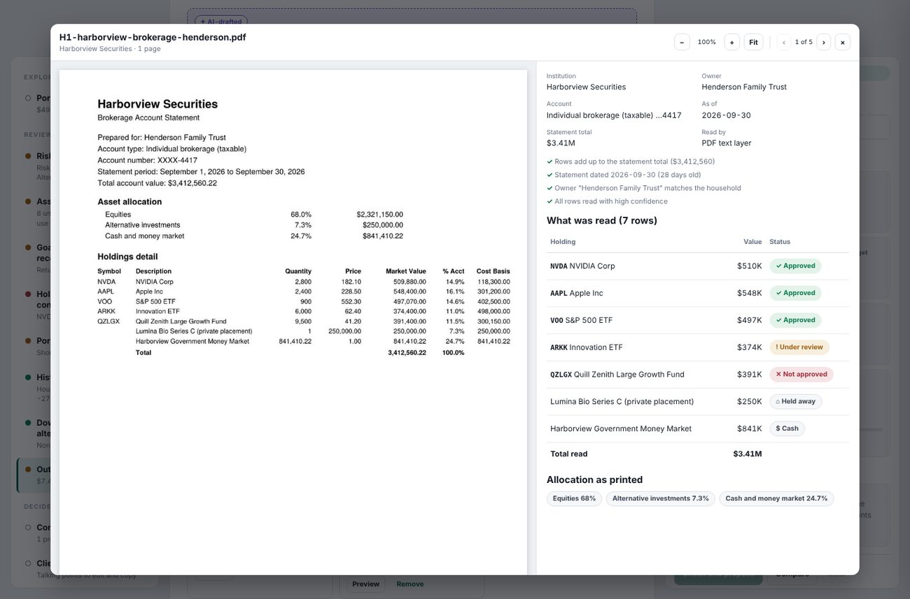

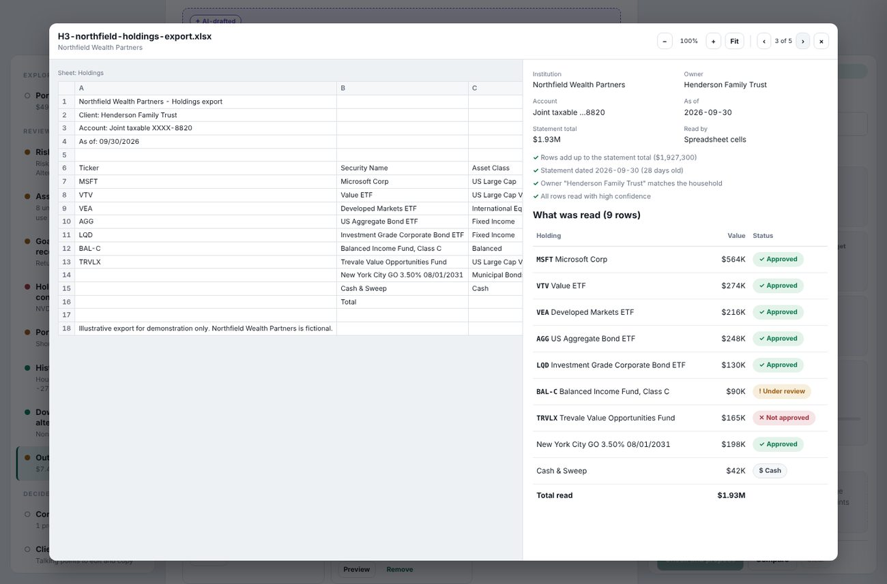

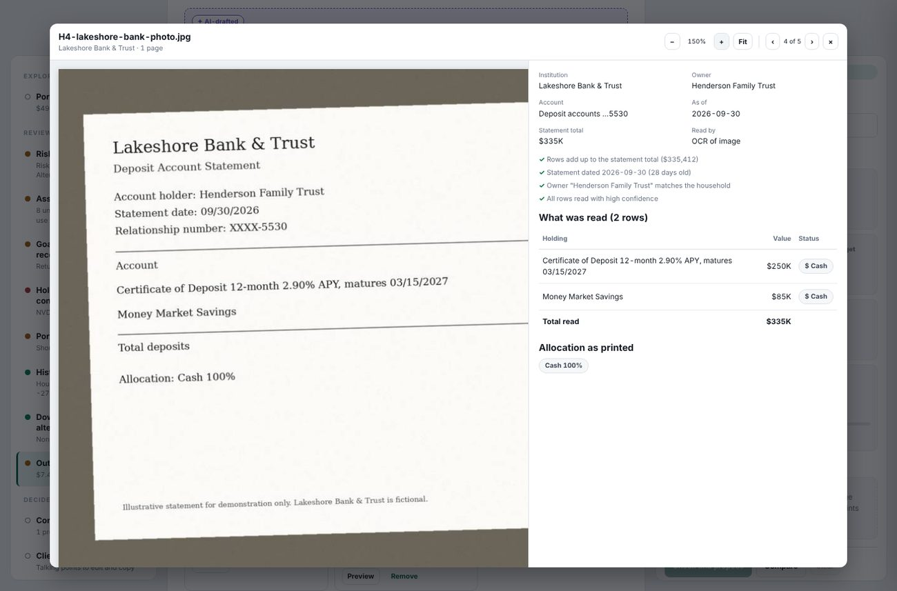

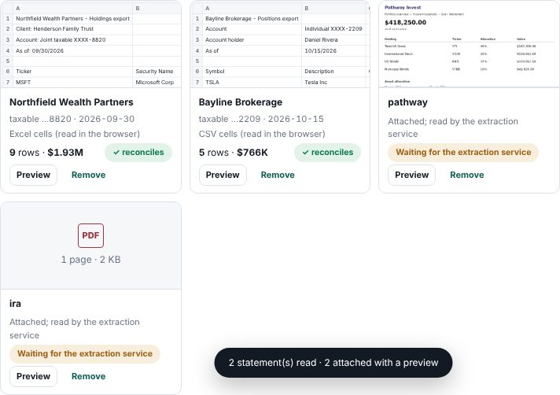

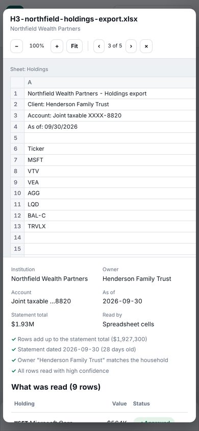

### Into multi-proposal mode

Each option becomes proposal lines in the existing engine:

| Line | What it does |
|---|---|
| **TRANSFER** (new) | Brings the position in with its cost basis. If no holding period is printed, the lot is treated as long-term. |
| **SELL** | After the transfer, using the review's own lot rules. These pick the lowest-gain lots first. |
| **BUY** | Buys approved funds. |

You can add any option to the active proposal, or choose **Create proposals A, B and C to compare** to add all three as proposals marked for the client. They then appear in Compare proposals and the Client summary next to anything else built in the review. Every figure, waterfall, "why" sentence and check works on them.

| v2.2 (review engine, firm account after the move) | Outside A | Outside B | Outside C |
|---|---|---|---|
| Expected risk | 9.4% | 9.4% | 9.5% |
| Tracking error vs target | 2.3% | 2.0% | 2.2% |
| Fund costs | 2.8 bp | 2.4 bp | 2.4 bp |
| Tax this year | $0 | $218K | $29K saved |

The tax differs from the Python POC ($234K for B). Portfolio Review sells the lowest-gain lot of a name first, wherever it is held. For MSFT, that is the firm lot rather than the transferred one.

For proposals that contain outside lines, three checks are added:
- no single name over 10%;
- only approved securities kept at the firm;
- every outside row identified.

All three outside proposals fail the single-name check because of the NVDA held at the firm, which is the right result.

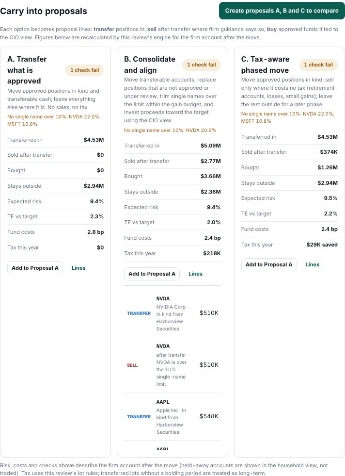

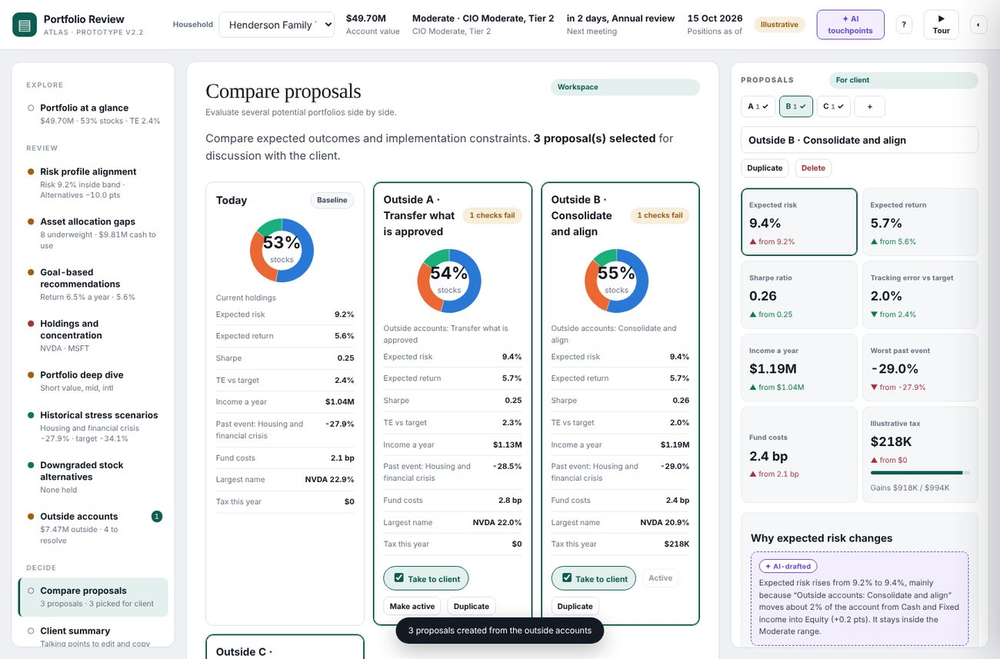

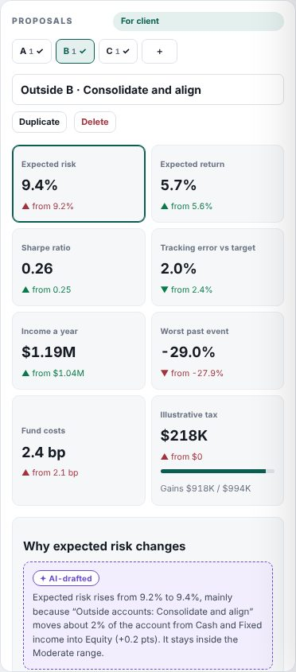

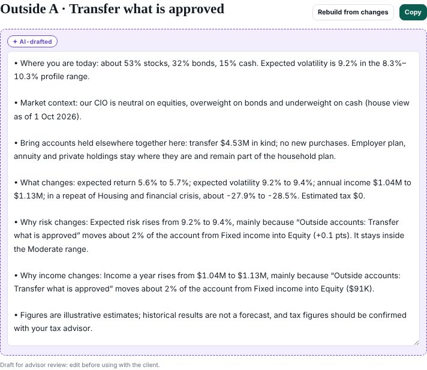

### AI touchpoints

The "Where AI is used" panel now lists 9 touchpoints. Two are new:
- **Outside accounts summary:** the opening paragraph of the step.
- **Statement reading (fallback):** structured rows for a statement the readers could not parse. A row is accepted only if every number appears on the page, and the advisor confirms it.

The client talking points also gain a line for bringing the outside accounts together.

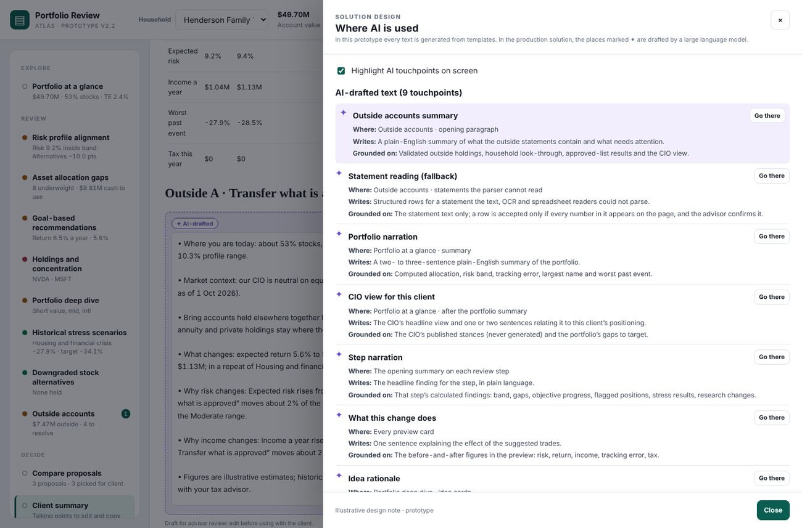

### Guided tour

**▶ Tour** in the top bar runs 14 steps:
1. What is new.
2. The new step.
3. Consent and upload.
4. Five formats.
5. Previewing a statement.
6. The AI summary.
7. Validation.
8. Inside and outside together.
9. Single names and fund costs.
10. The three options.
11. Create proposals in multi-proposal mode.
12. The proposal panel lines.
13. Talking points.
14. The workflow.

Arrow keys move through the steps, and Escape ends the tour. To start the tour on load, open the file with `?tour=1` added to its address.

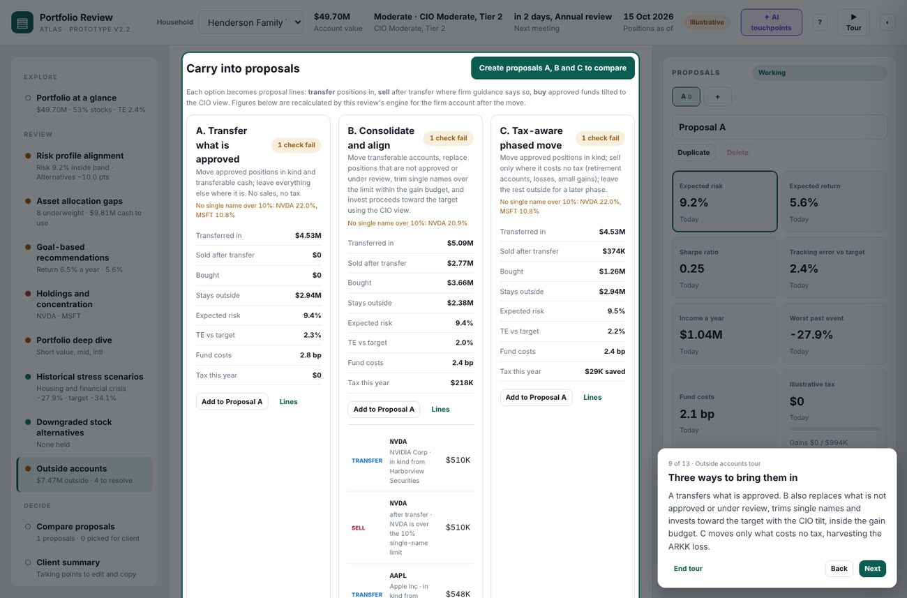

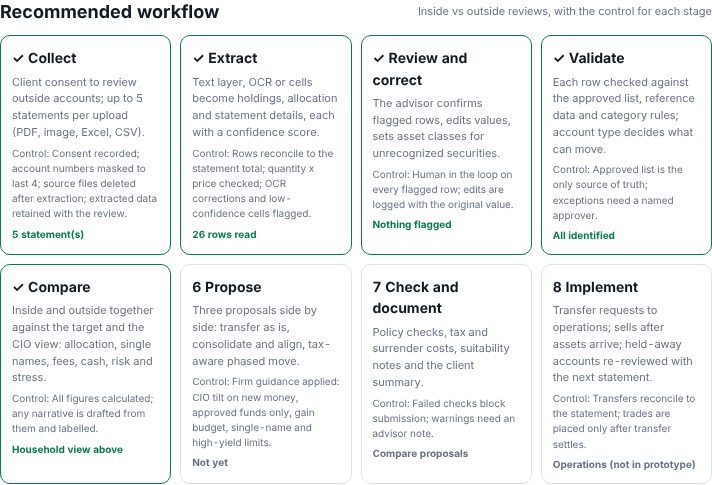

---

## Limits of this proof of concept

- **Extraction:** shown on generated statements. Real statements need a broader set of layouts. Use the review step and the language-model fallback for the rest.
- **Approved list and reference data:** illustrative. In production these come from the firm's security master.
- **Tax:** uses cost basis from the statement and long-term rates where no holding period is printed. Wash-sale rules and lot-level detail are not modelled.
- **Held away:** employer plans and annuities are not traded. Annuity fees and plan fees are not on the statements and need fee schedules.
- **Transfers:** shown as proposal lines only. Transfer requests to operations are outside the prototype.
- **v2.2 offline file:** reads CSV and Excel in the browser and previews every attached file. PDFs and images need the Python service to be read. Thumbnails of your own PDFs are an icon, because rendering a PDF page offline would need a bundled PDF library.
