# Portfolio Review (prototype v2): app and workflow walkthrough

This walkthrough explains what the Portfolio Review prototype does and follows one review from start to finish. Every screenshot was taken from the prototype file at a 1440 × 900 window. The last two show the phone layout and dark mode.

All households, holdings, research ratings and figures in the prototype are illustrative. The app never trades, sends or saves anything. Its proposals are prepared for discussion with a client and are not trading approvals.

---

## 1. What the app is for

An advisor opens a household before a client meeting and works through three questions:

1. **Explore.** What does the portfolio hold today, and where is its exposure?
2. **Review.** Where does it differ from the client's risk profile, target allocation, objectives and the firm's guidelines?
3. **Decide.** Which changes should the advisor take to the client, and how should they be explained?

As the advisor reviews, they collect potential changes into one or more **proposals**. The app recalculates each proposal's risk, return, income, stress loss, fund costs and illustrative tax as changes are added. At the end it checks the proposal against policy limits and drafts client talking points.

## 2. Screen layout

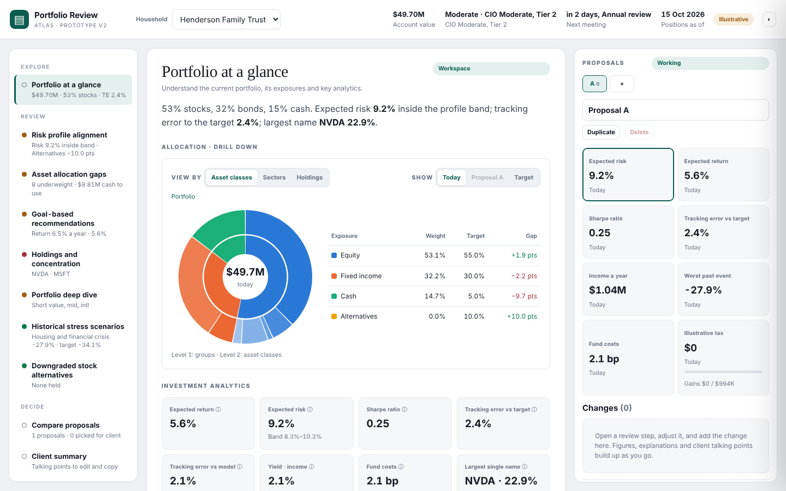

The screen has four parts.

| Area | Where | What it holds |
|---|---|---|
| **Top bar** | across the top | The **Household** picker, account value ($49.70M), risk profile and target ("Moderate · CIO Moderate, Tier 2"), next meeting ("in 2 days, Annual review"), positions date, an **Illustrative** badge and a theme toggle. |
| **Journey** | left column | The steps, grouped **Explore → Review → Decide**. Each step shows a one-line status, such as "Risk 9.2% inside band". A coloured dot shows the state: red means action needed, amber means review, green means on track and hollow means workspace. A number badge counts the changes taken from that step. |
| **Stage** | centre | The selected step: a headline finding, charts, controls and a **Preview** of the suggested change. |
| **Proposal panel** | right column | Proposal tabs (A, B, +), the name, **Duplicate**/**Delete**, eight KPI tiles that update live, the **Changes** list, and the **Check and propose**, **Compare** and **Clear** buttons. |

The eight KPI tiles are:

- expected risk
- expected return
- Sharpe ratio
- tracking error vs target
- income a year
- worst past event
- fund costs
- illustrative tax, with a bar showing gains used against the year's gain budget

Each tile shows the proposal value and the "from" value today. Clicking a tile explains why it changed (see 4.2).

## 3. Explore: Portfolio at a glance

The headline sentence summarises the account: *"53% stocks, 32% bonds, 15% cash. Expected risk 9.2% inside the profile band; tracking error to the target 2.4%; largest name NVDA 22.9%."*

- **Allocation · drill down.** A two-ring sunburst: groups on the inner ring and asset classes on the outer ring. Beside it is a table of weight, target and gap. You can switch the view and the comparison:
  - **View by:** Asset classes, Sectors or Holdings.
  - **Show:** Today, Proposal A or Target.
- **Investment analytics.** Ten tiles, each with an ⓘ definition:
  - expected return 5.6%
  - expected risk 9.2% (band 8.3%–10.3%)
  - Sharpe 0.25
  - tracking error vs target 2.4% and vs model 2.1%
  - yield 2.1% ($1.04M a year)
  - fund costs 2.1 bp
  - largest single name NVDA 22.9%
  - worst past event −27.9%
  - below investment grade 0.0%

### Drilling into the allocation

Click a ring segment or a table row to go one level down. A breadcrumb (Portfolio › Equity › …) leads back up.

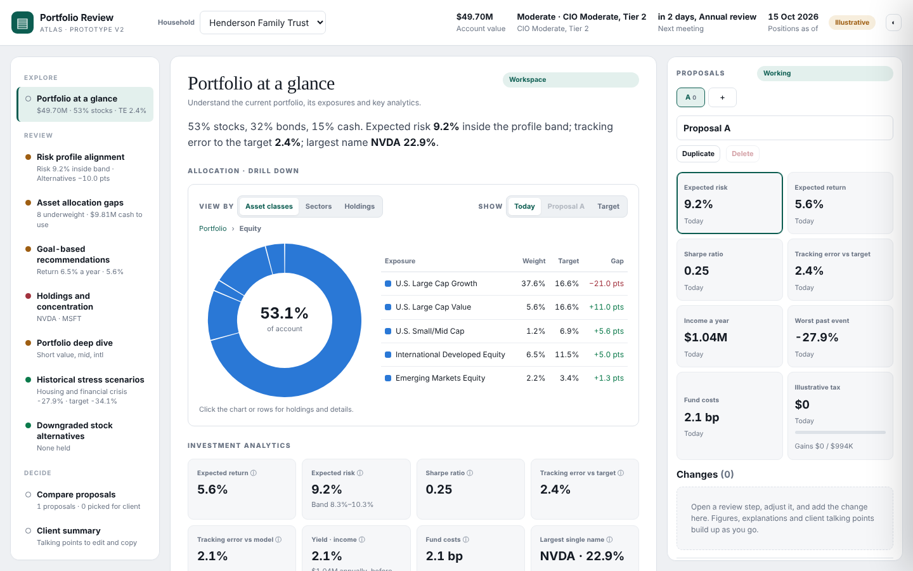

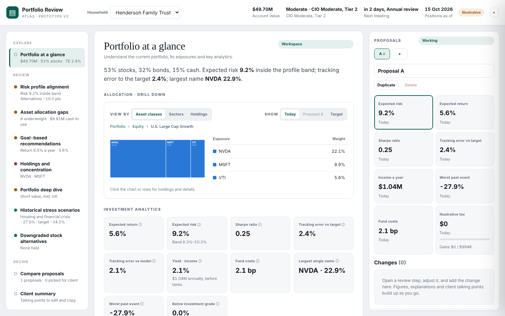

At the asset-class level the chart becomes a treemap of the holdings in that class. Clicking a holding opens its **holding card** below the chart. The card shows position size, weight and research rating. It also shows how much of the exposure is held directly and how much through funds.

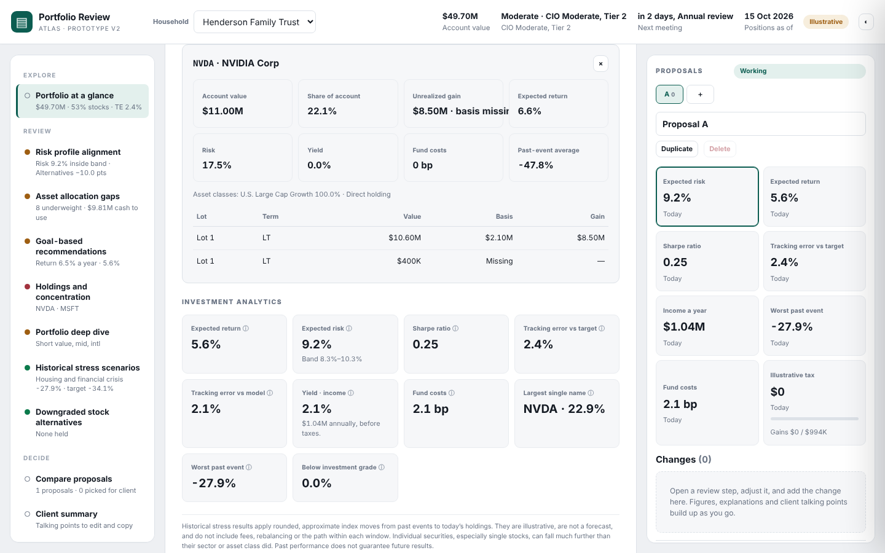

**View by Sectors** shows equity sectors against the equity benchmark. Information Technology stands out at 69.9% against 27.0%.

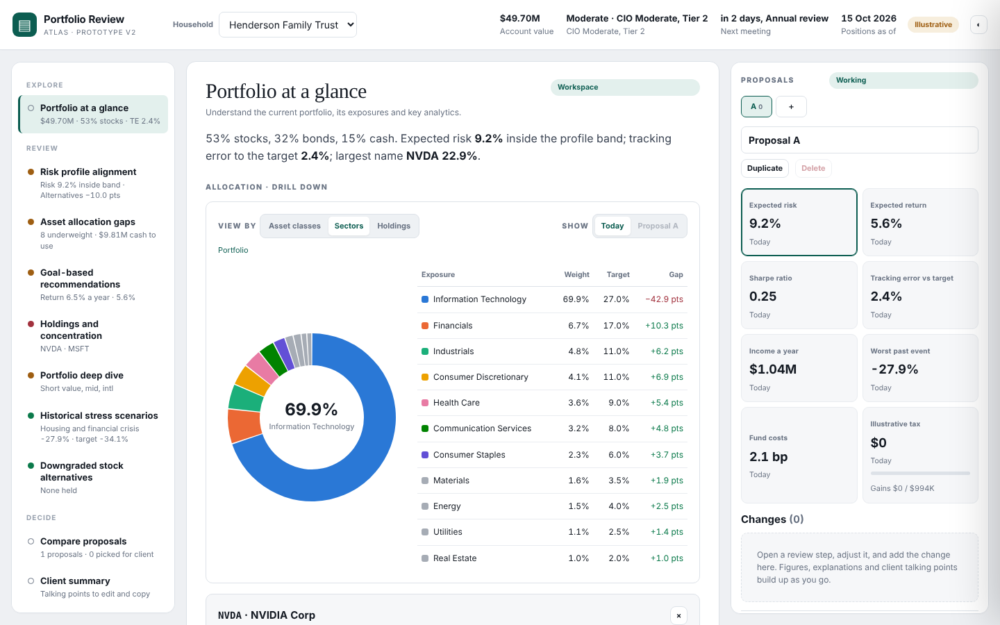

## 4. Review: the seven review steps

Each review step follows the same pattern:

1. a finding;
2. visuals;
3. controls;
4. a **Preview** card showing the change's effect on risk, return, income, tracking error and tax, plus the BUY/SELL trade list;
5. an **Add to Proposal** button.

### 4.1 Risk profile alignment

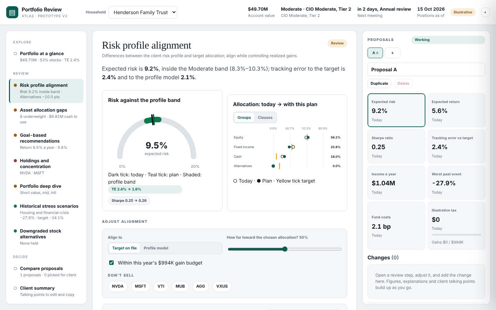

*"Expected risk is 9.2%, inside the Moderate band (8.3%–10.3%); tracking error to the target is 2.4% and to the profile model 2.1%."*

- **Risk against the profile band.** A gauge with the shaded band, a dark tick for today and a teal tick for the plan. Chips below it show tracking error and Sharpe moving from today to the plan.
- **Allocation: today → with this plan.** A dumbbell chart by group or class, with a yellow tick for the target.

**Adjust alignment** has these controls:

- **Align to:** Target on file or Profile model.
- **How far toward the chosen allocation:** a slider from 0 to 100%.
- **Within this year's $994K gain budget:** a checkbox that scales sales so realised gains stay under the budget.
- **Don't sell:** chips that lock holdings (NVDA, MSFT, VTI, MUB, AGG, VXUS).

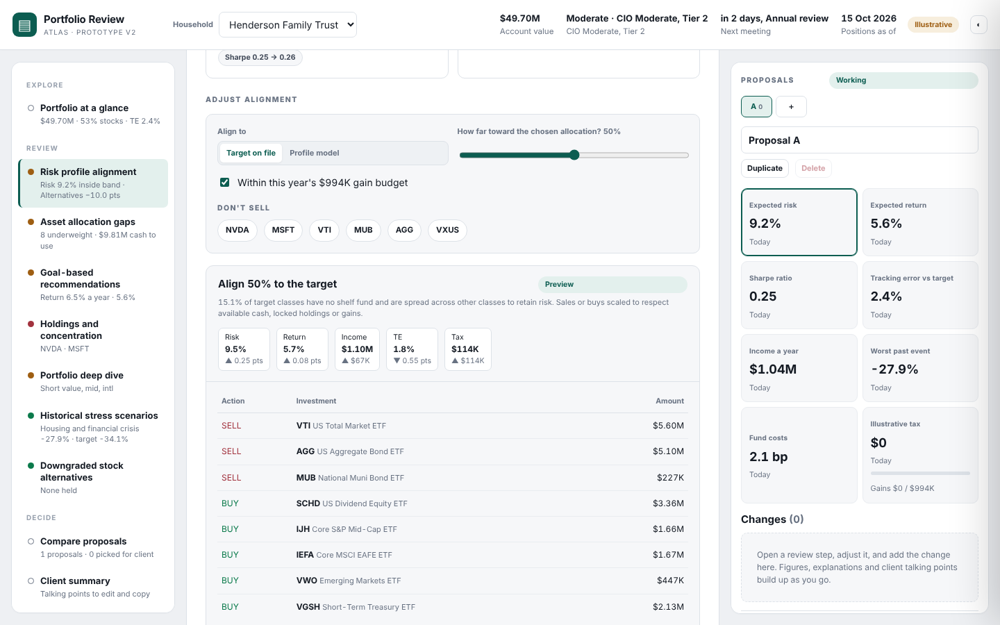

The preview explains any limits, for example: *"16.0% of target classes have no shelf fund and are spread across other classes to retain risk. Sales or buys scaled to respect available cash, locked holdings or gains."*

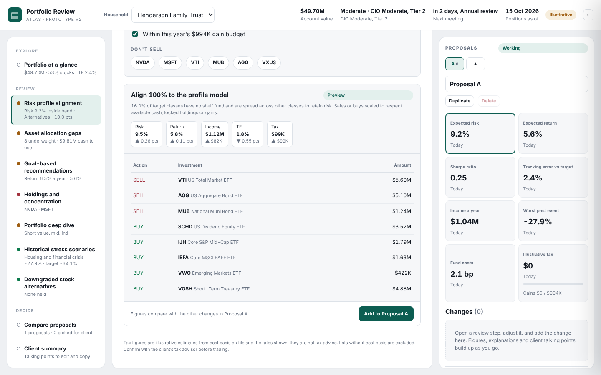

### 4.2 Adding a change, and "why it changes"

**Add to Proposal A** places the change in the proposal panel. A toast confirms the change was added, and the KPI tiles update.

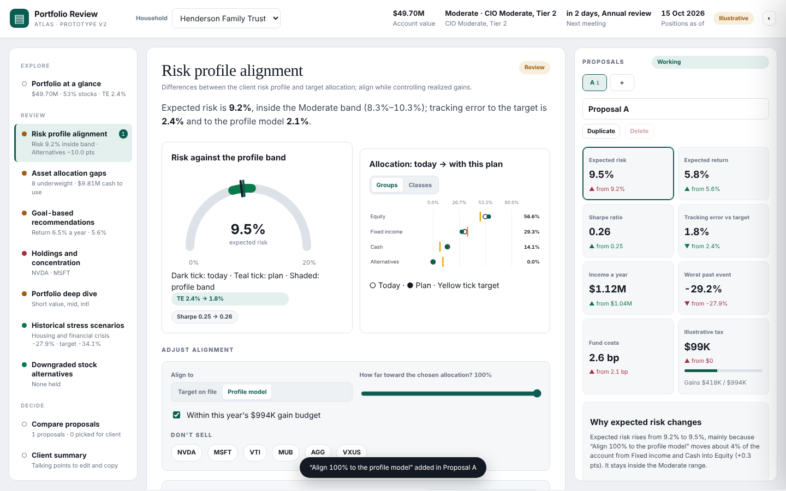

Click any KPI tile to open **Why … changes**. It is a short explanation plus a bar for each step (Today → each change → Proposal), for example:

> *"Expected risk rises from 9.2% to 9.5%, mainly because 'Align 100% to the profile model' moves about 4% of the account from Fixed income and Cash into Equity (+0.3 pts). It stays inside the Moderate range."*

Each change in the list can be expanded. Its trade amounts can be edited inline, and **×** removes it.

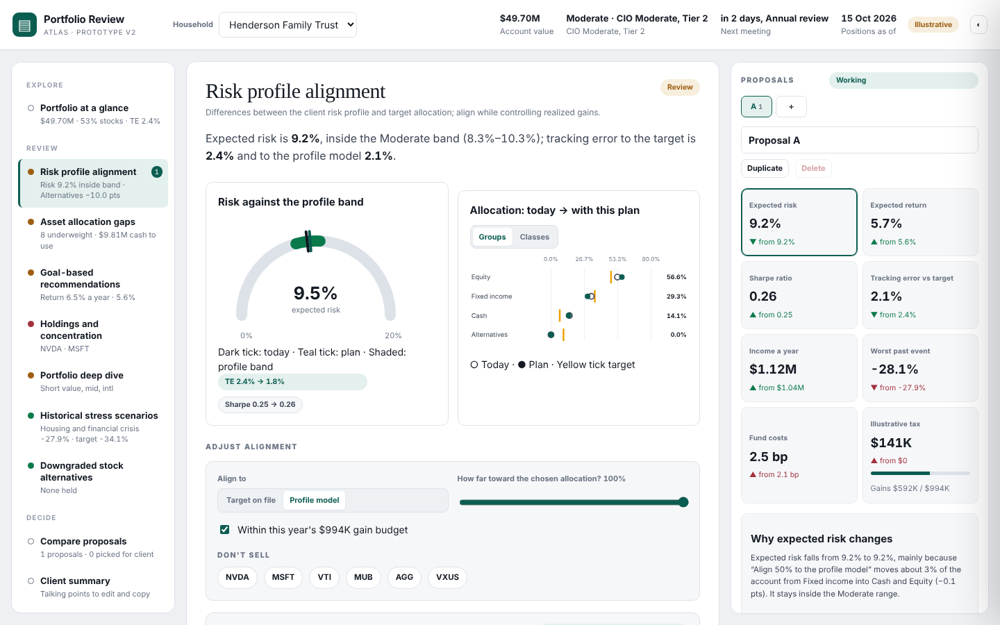

### 4.3 Asset allocation gaps

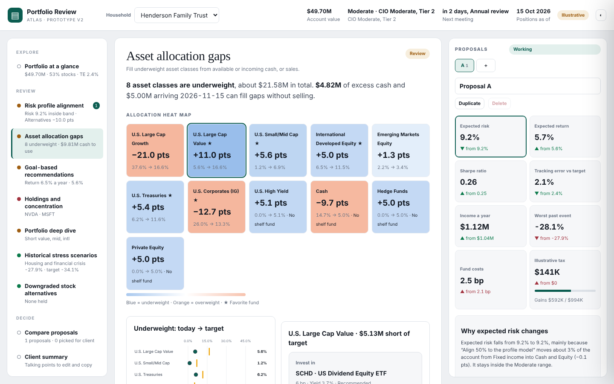

*"8 asset classes are underweight, about $21.58M in total. $4.82M of excess cash and $5.00M arriving 2026-11-15 can fill gaps without selling."*

- **Allocation heat map.** Blue tiles are underweight and orange tiles are overweight. Each tile shows the gap in points and today → target. A star marks a favourite fund, and "No shelf fund" marks classes without an approved fund.
- **Underweight: today → target.** A dumbbell chart of the underweight classes.

Select a tile to plan that gap. You choose the fund (**Choose from heat map or favorites**), the amount and how to **pay for it**:

- cash on hand;
- incoming cash;
- sell holdings.

A second card, **Atlas suggestion: invest new and excess cash in the gaps**, fills all gaps at once.

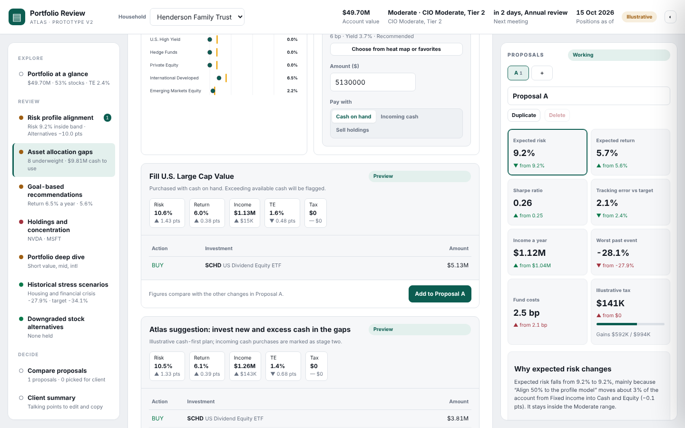

**Investment selection** opens a side sheet with three tabs:

- **Heat map (11):** suitable shelf funds scored on fit, tracking error, cost, research rating, Sharpe, correlation, yield, past-event average and holdings count;
- **★ Favorites;**
- **All shelf funds.**

The sheet notes that a heat map is a comparison tool, not an investment recommendation. **Use SCHD** puts the fund back into the plan.

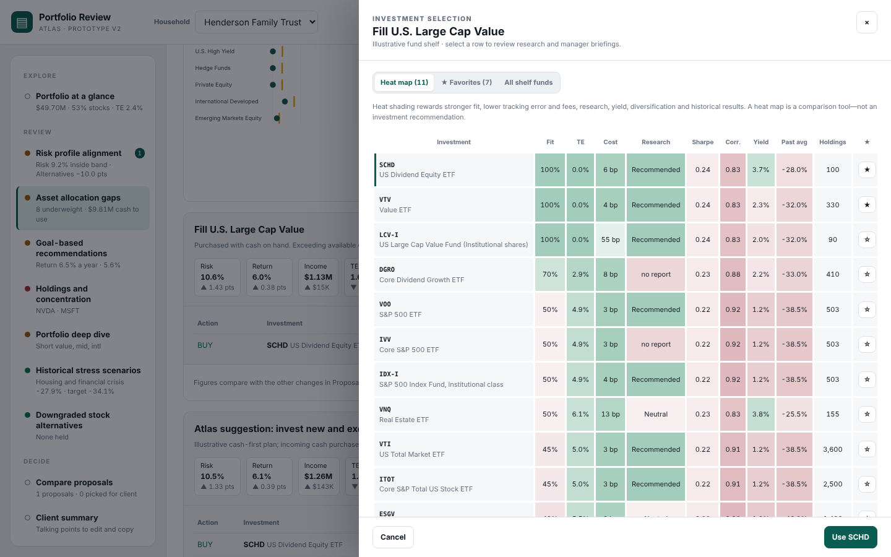

### 4.4 Goal-based recommendations

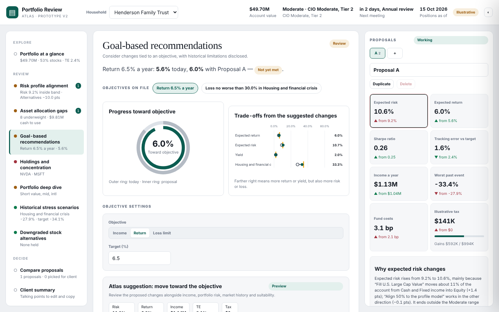

*"Return 6.5% a year: 5.6% today … Not yet met."*

- **Objectives on file** are chips, for example "Return 6.5% a year" and "Loss no worse than 30.0% in Housing and financial crisis".
- **Progress toward objective** is a two-ring dial: the outer ring is today and the inner ring is the proposal.
- **Trade-offs from the suggested changes** compares expected return, risk, yield and the stress loss. Further right means more return, but also more risk.
- **Objective settings** lets you pick the type (Income, Return or Loss limit) and the target.

**Atlas suggestion: move toward the objective** previews the trades.

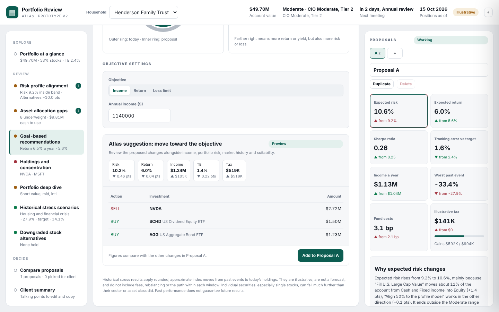

### 4.5 Holdings and concentration

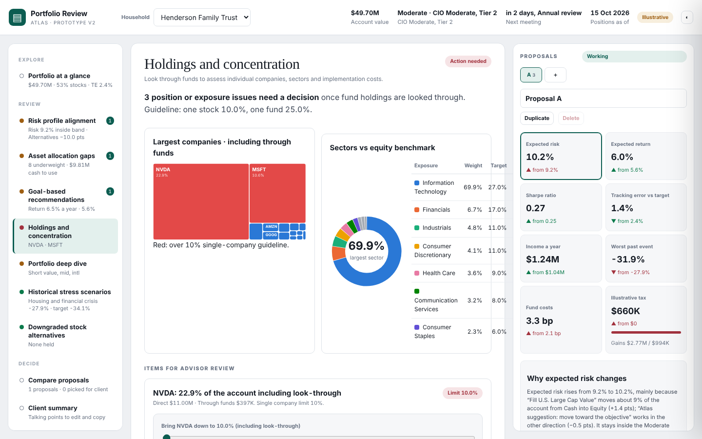

*"3 position or exposure issues need a decision once fund holdings are looked through. Guideline: one stock 10.0%, one fund 25.0%."*

- **Largest companies, including through funds.** A treemap where red marks a name over the 10% single-company guideline.
- **Sectors vs equity benchmark.** A donut plus a table.
- **Items for advisor review.** One card per issue. For example, NVDA is 22.9% of the account: $11.00M held directly and $397K through funds.

For each card, the advisor:

1. drags a slider ("Bring NVDA down to 10.0%");
2. chooses where the proceeds go (**Into the gaps**, **One fund** or **Hold cash**);
3. reads the multi-year tax effect, for example *"This year: $6.43M sold · gains $5.15M · tax $1.23M · 6 tax years at gain budget."*

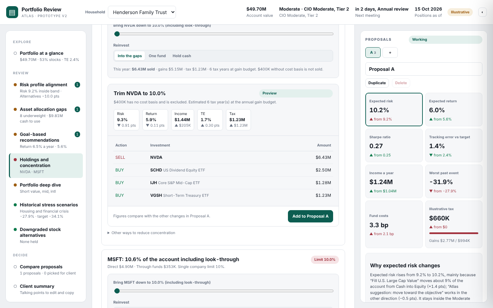

### 4.6 Portfolio deep dive

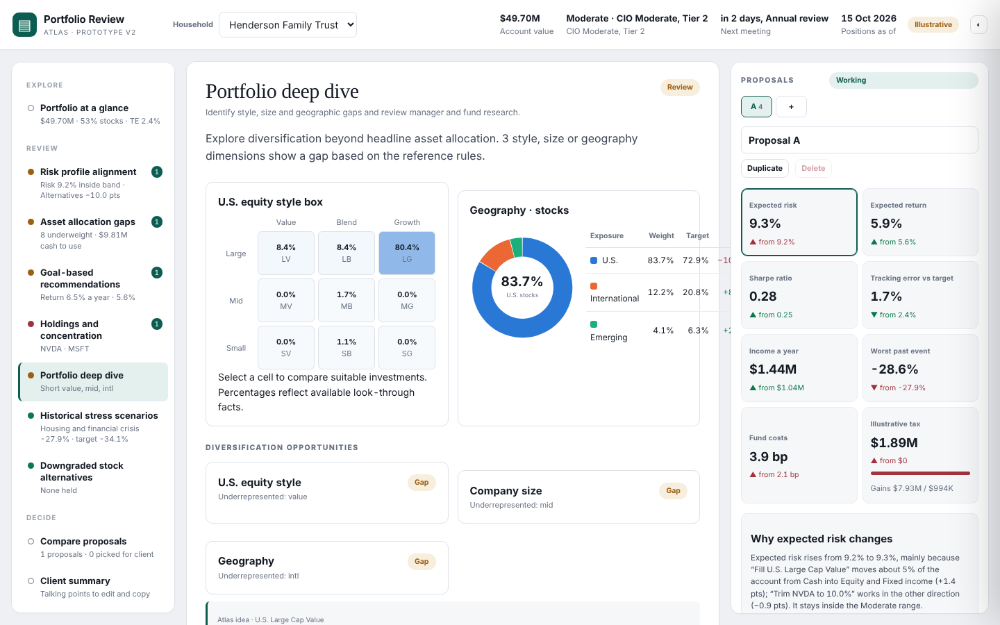

This step looks past headline asset classes:

- **U.S. equity style box:** a 3 × 3 grid of value, blend and growth by large, mid and small. Today 80.4% sits in large growth.
- **Geography · stocks:** U.S. 83.7% against a target of 72.9%.
- **Diversification opportunities:** gaps in style, company size and geography.

Each **Atlas idea** card suggests a fund, such as "Add $1.74M of SCHD", and links to **Compare … with alternatives**. **Broaden the investment mix** previews all the ideas together.

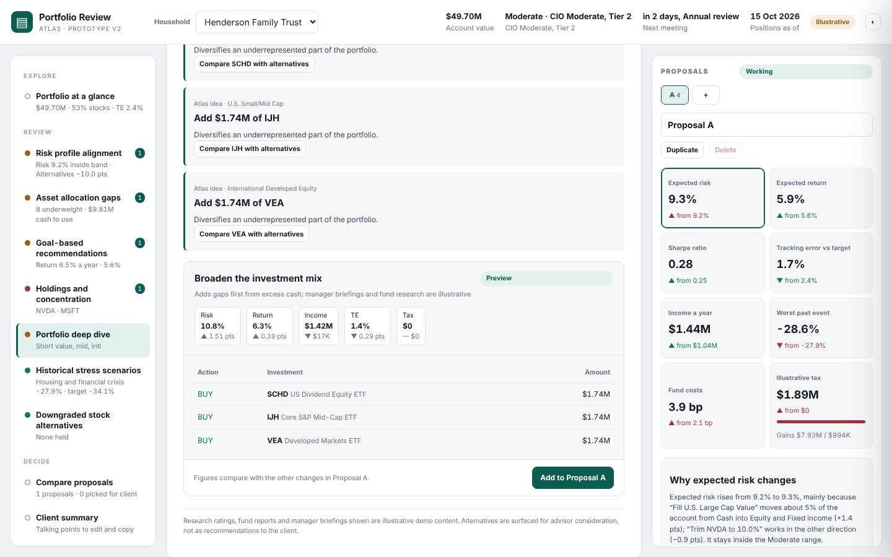

### 4.7 Historical stress scenarios

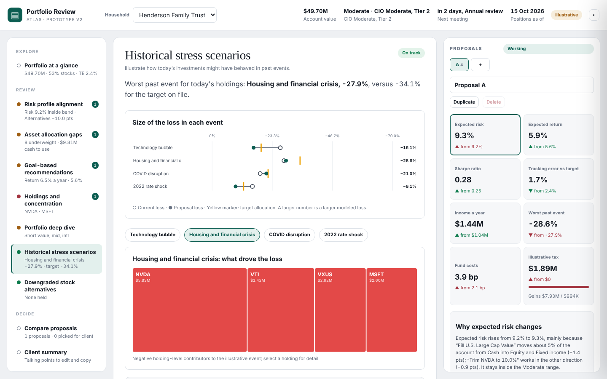

*"Worst past event for today's holdings: Housing and financial crisis, −27.9%, versus −34.1% for the target on file."*

- **Size of the loss in each event.** A dumbbell for each of four scenarios: Technology bubble, Housing and financial crisis, COVID disruption and 2022 rate shock. The hollow dot is the current loss, the filled dot is the proposal and the yellow marker is the target.
- **Scenario buttons** switch the treemap below.
- **"What drove the loss".** A treemap of the holdings that contributed most to the loss, for example NVDA $5.83M and VTI $3.42M.
- **Reduce the modeled stress loss.** A preview card that trims the largest contributor and adds aggregate and short-duration bonds.

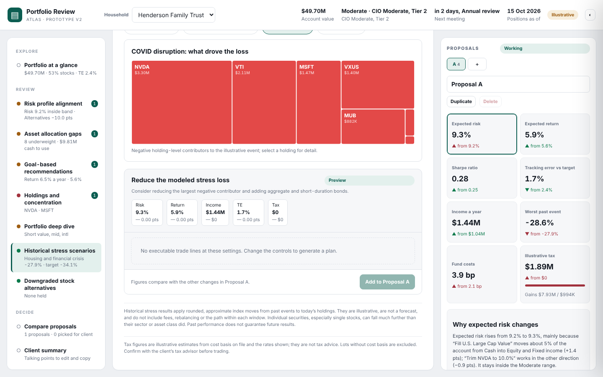

### 4.8 Downgraded stock alternatives

Henderson holds no downgraded names. The screenshot below switches the household to **Castellano Family** ($3.20M).

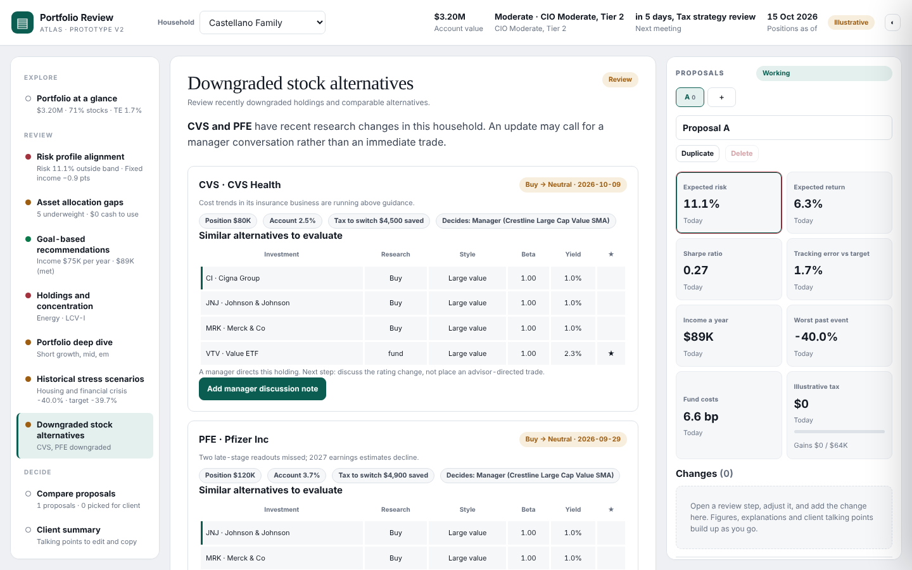

*"CVS and PFE have recent research changes in this household. An update may call for a manager conversation rather than an immediate trade."*

For each name the card shows:

- the rating change, for example "Buy → Neutral · 2026-10-09";
- the position, its share of the account and the tax to switch;
- who decides (manager or advisor);
- **Similar alternatives to evaluate**, a table of research, style, beta and yield;
- **Add manager discussion note.**

When the current household holds no downgrades, the step lists research updates across the book and links to the affected households.

## 5. Decide

### 5.1 More than one proposal

**＋** in the proposal panel starts a new proposal. **Duplicate** copies the current one. In this run, Proposal A collected four changes:

1. align to the profile model;
2. fill Large Cap Value;
3. the income goal;
4. trim NVDA.

Proposal B holds a single alternative: align to the target on file. The tab labels show the change count, and ✓ marks a proposal picked for the client.

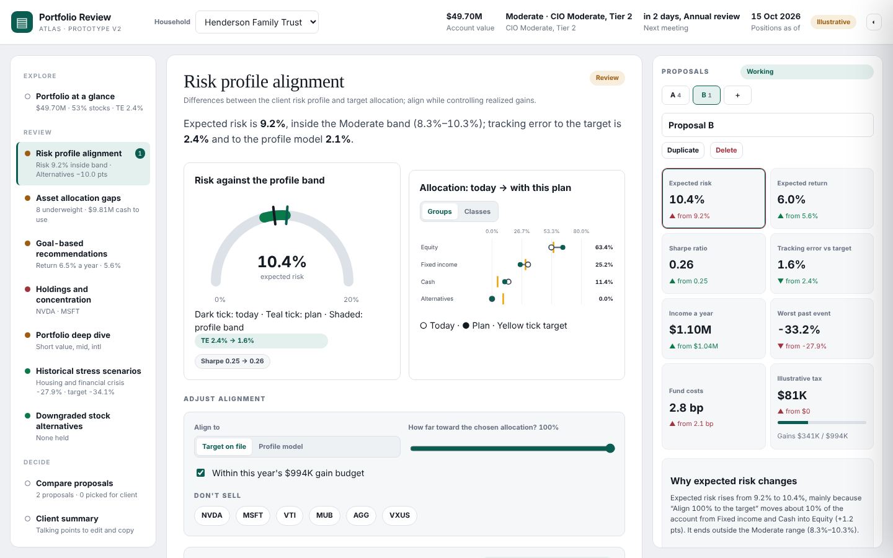

### 5.2 Compare proposals

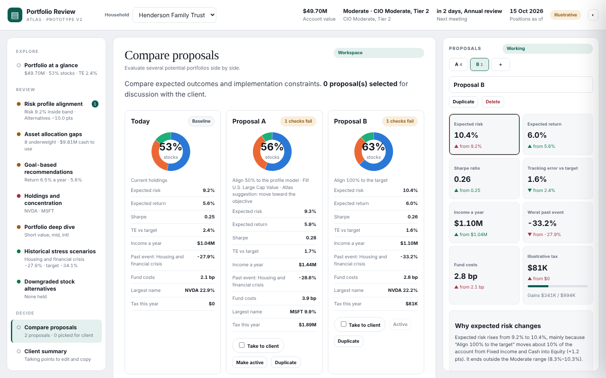

Today, Proposal A and Proposal B appear side by side. Each column shows:

- a stock-share donut;
- its list of changes;
- expected risk, return, Sharpe, tracking error, income, past-event loss, fund costs, largest name and tax this year;
- a badge with the number of failed checks, for example "3 checks fail".

**Take to client** marks the proposals to discuss, **Make active** switches the panel to that proposal, and **Duplicate** copies it. The footer reminds the advisor: *"'Best' depends on the client; suitability remains the advisor's determination."*

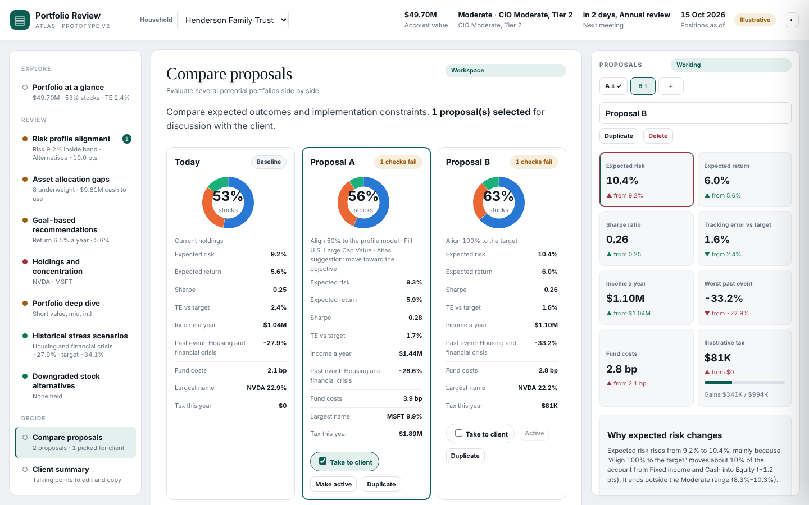

### 5.3 Check and propose

**Check and propose** opens a side sheet: *"A review for client discussion; this is not a trading approval."*

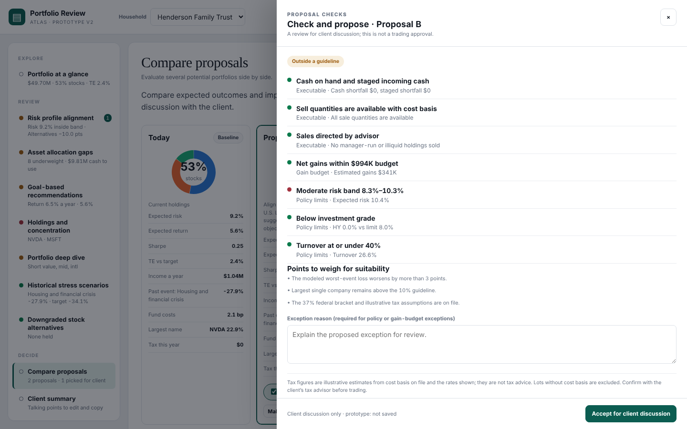

The sheet groups the checks:

- **Executable:** cash on hand and staged incoming cash; sell quantities available with cost basis; sales directed by the advisor (no manager-run or illiquid holdings sold).
- **Gain budget:** net gains within $994K.
- **Policy limits:** moderate risk band 8.3%–10.3%, below investment grade under 8%, and turnover at or under 40%.

A green dot means a check passes and a red dot means it fails. Here Proposal B's risk of 10.4% sits outside the band, so the sheet shows the **Outside a guideline** badge.

**Points to weigh for suitability** lists softer flags. Examples are a worse modeled stress loss, a single name still over 10%, and the tax assumptions on file.

An **Exception reason** is required for any policy or gain-budget exception. **Accept for client discussion** records the result. In the prototype it is not saved.

### 5.4 Client summary

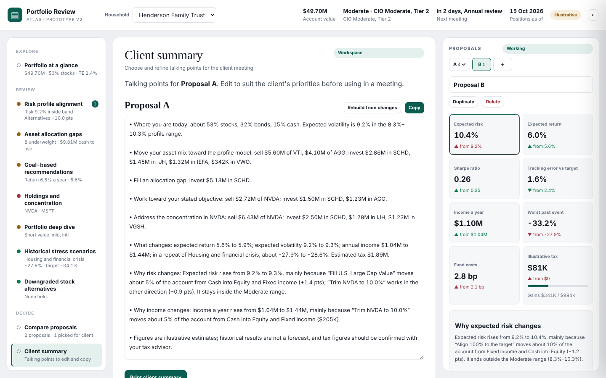

The app drafts talking points for the active proposal in plain language:

- where the client is today;
- each change, with dollar amounts;
- what changes in return, volatility, income and the stress-event loss;
- why risk and income change;
- a closing caveat that figures are illustrative estimates and tax should be confirmed with the client's tax advisor.

The text is editable. **Rebuild from changes** regenerates it, **Copy** copies it, and **Print client summary** prints it.

## 6. Other layouts

**Dark mode.** The toggle at the right of the top bar switches the theme. The charts keep their meaning in both themes.

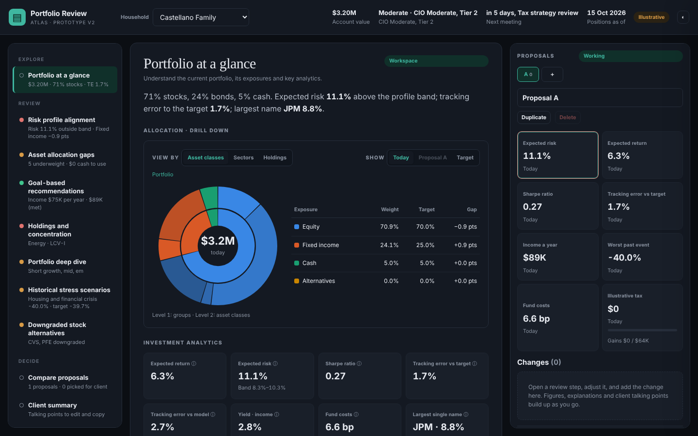

**Phone (390 px wide).** The journey becomes a scrolling row of tabs. The proposal panel collapses into a bar at the bottom ("Proposal A · 0 changes · Open ▴") that opens as a sheet.

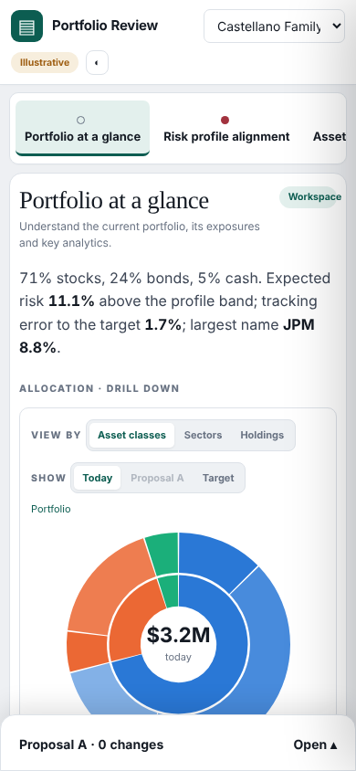 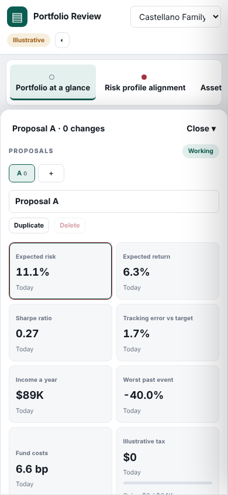

## 7. The workflow in one list

1. **Pick the household** in the top bar.
2. **Explore** the portfolio at a glance, drilling into classes, sectors and holdings.
3. **Work through the review steps** in the order the dots suggest: red first, then amber.
4. In each step, **adjust the controls, read the Preview, then Add to Proposal**.
5. **Watch the proposal panel.** Click a KPI tile to see why it changed, and edit or remove changes as needed.
6. **Build alternatives** with ＋ or Duplicate.
7. **Compare** the proposals and mark the ones to take to the client.
8. **Check and propose:** clear or explain any failed check, then accept for client discussion.
9. **Client summary:** edit, copy or print the talking points.

## 8. Ground rules shown in the app

- Every figure is illustrative. Historical stress results apply approximate index moves and are not forecasts.
- Tax figures are estimates from the cost basis on file and are not tax advice.
- Heat maps and suggestions are comparison tools for the advisor, not recommendations to the client.
- Suitability remains the advisor's determination. "Accept for client discussion" is not a trading approval.
