# Portfolio Review v2.1: AI touchpoints and the CIO market view

**File:** `portfolio-review-prototype-v2.1.html`. It is still one file that opens from disk with no server.

**What changed:** two business comments are addressed.
1. **Where AI is used.** Every place where a large language model would write text in the production solution is now marked on screen.
2. **CIO view.** On Portfolio at a glance, the CIO view now follows the portfolio summary as a short paragraph, and the allocation drill-down shows the CIO stance as a column.

**Checked:**
- Every calculated figure, trade, check result and "why it changes" sentence matches v2 exactly, for all five households, on a test proposal built from three changes.
- All 50 screens render without errors, in light and dark themes and at phone width.
- Only text was added: the AI-drafted lines, the CIO paragraph and column, and one new talking point ("Market context").

---

## 1. Making AI touchpoints visible

### How it shows on screen

- **A purple "✦ AI-drafted" badge** above each block of text an LLM would write. The block sits in a dashed purple frame with a light purple tint. Purple is used for nothing else, so the badge never gets confused with status colours.
- **"✦ AI touchpoints"** in the top bar turns the highlighting on and off. It is on by default; turn it off for a client-ready view.
- **"?"** (or any badge) opens **"Where AI is used"**. This side panel lists every touchpoint with:
  - where it appears;
  - what the LLM writes;
  - what data it is grounded on;
  - a **Go there** button.

  It also lists what is **never** generated, and the guardrails applied to every draft.
- **Numbers stay deterministic.** Charts, KPI tiles, trade tables and checks carry no badge. Under the waterfall, a note says "calculated attribution, not generated".
- **When printing,** the badges and frames are hidden.

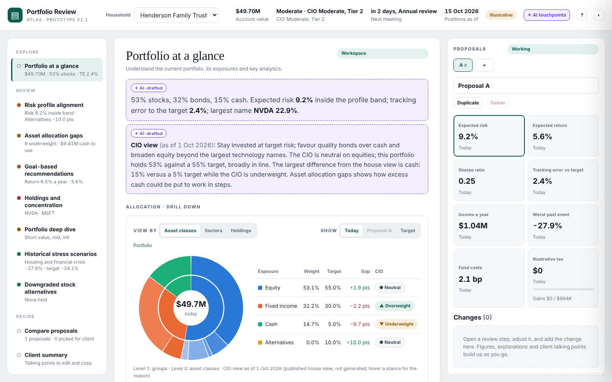

### The seven touchpoints

| Touchpoint | Where | What the LLM writes | Grounded on |
|---|---|---|---|
| Portfolio narration | Portfolio at a glance, summary | 2–3 sentence portfolio summary | Calculated allocation, risk band, tracking error, largest name, worst event |
| CIO view for this client | Portfolio at a glance, after the summary | The CIO headline and how the house view relates to this client | Published CIO stances (never generated) and gaps to target |
| Step narration | Opening summary of each review step | The step's headline finding | That step's calculated findings |
| What this change does (new) | Every preview card | One sentence on the effect of the suggested trades | The preview's before-and-after figures |
| Idea rationale | Deep dive idea cards | Why a fund broadens the portfolio | The style, size or geography gap |
| Why a figure changes | Proposal panel, "Why … changes" | Attribution sentence | The calculated waterfall and group shifts |
| Client talking points | Panel preview and Client summary | Editable talking points | Trades, before-and-after figures, CIO view, approved disclosures |

**New delta explanation on every preview card.** For example: "Compared with the rest of Proposal A, this change raises expected risk by 0.25 pts to 9.5% (inside the Moderate band), raises expected return by 0.08 pts, adds $67K of income a year and realizes about $114K of tax."

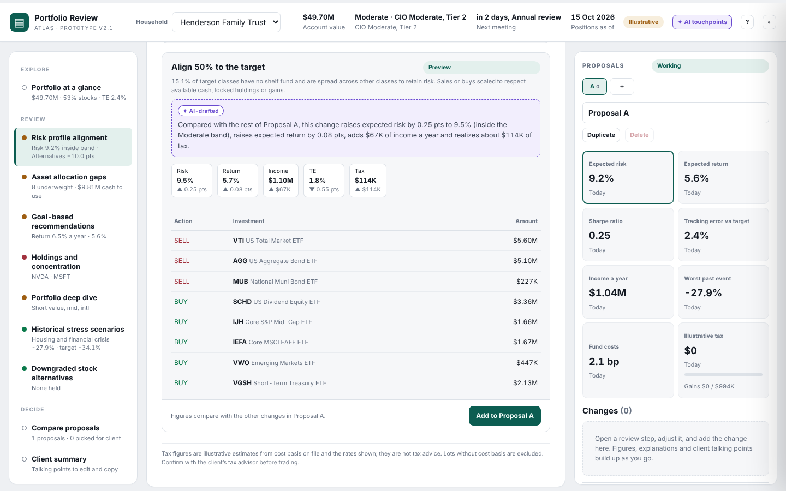

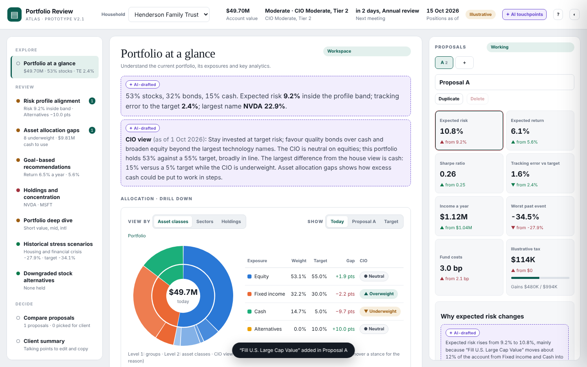

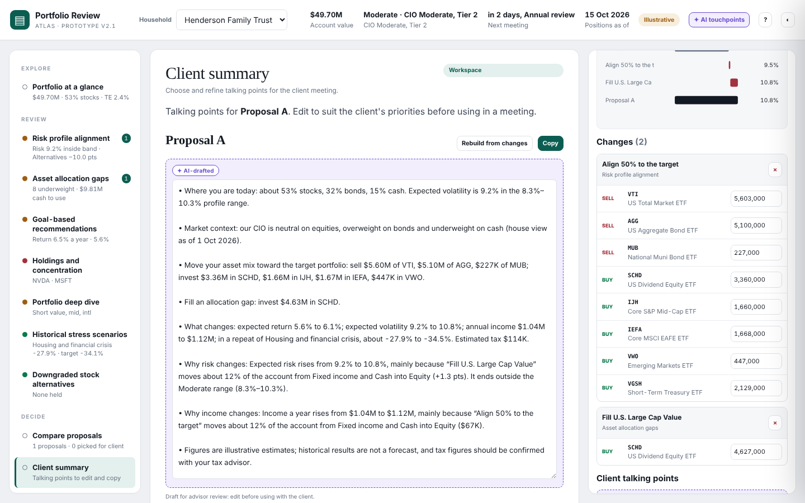

Beneath each talking-points box, a note reads "Draft for advisor review: edit before using with the client." Once the advisor edits the text, it reads "Edited by the advisor."

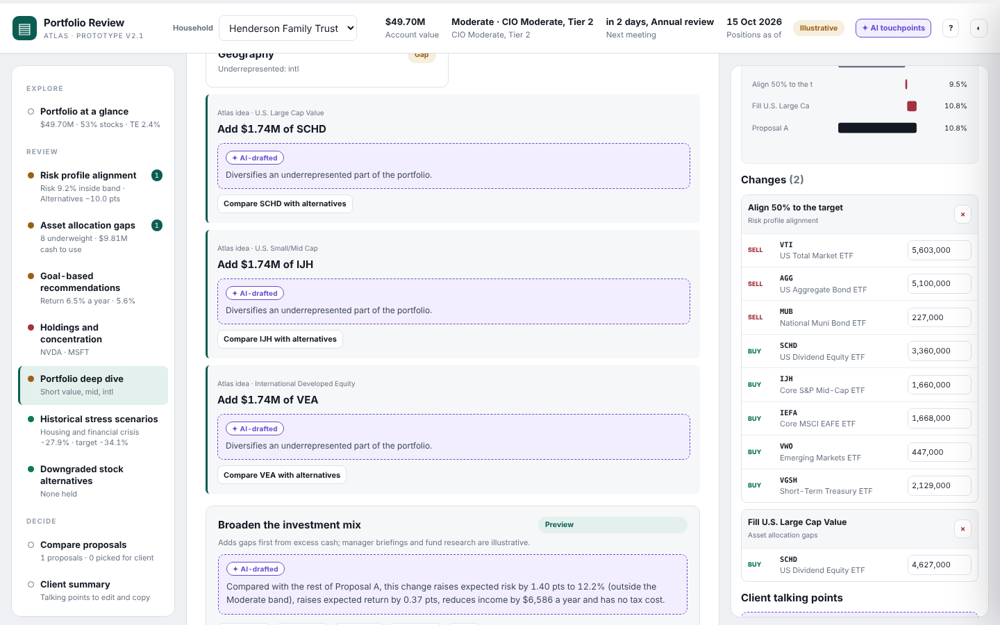

### The "Where AI is used" panel

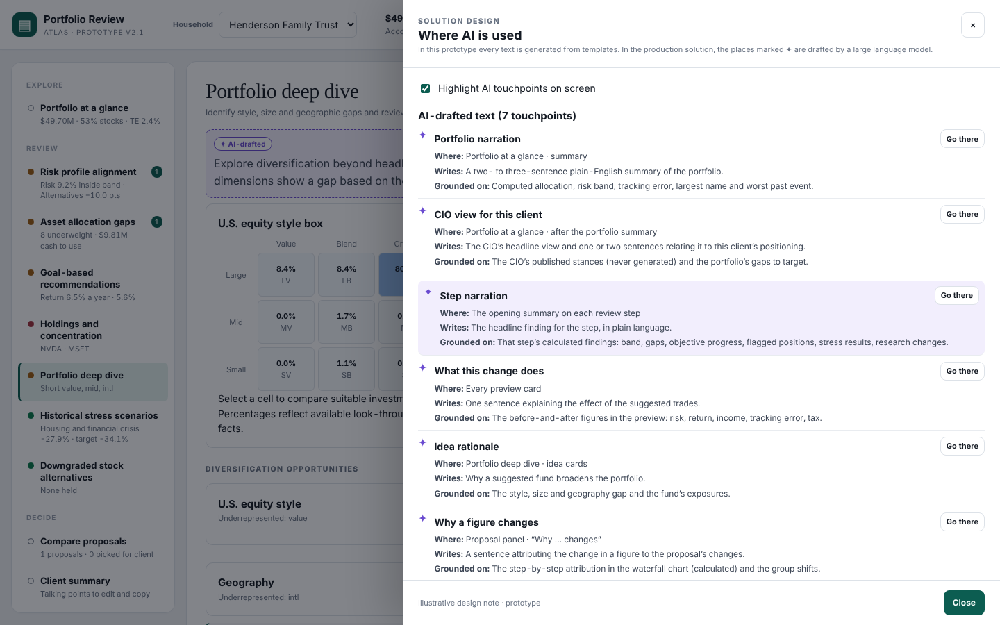

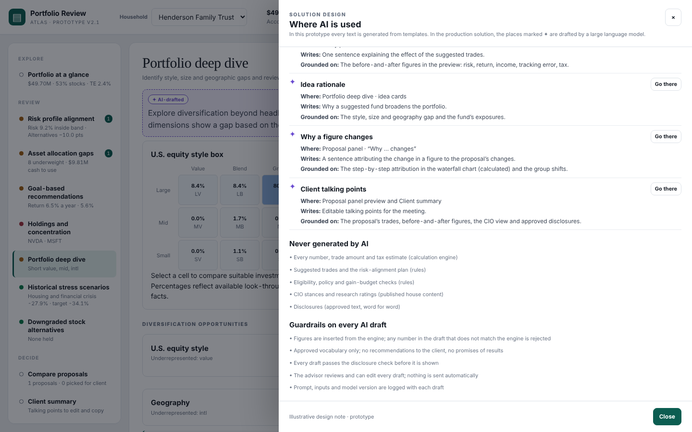

**Never generated by AI:**
- every number, trade amount and tax estimate;
- suggested trades and the alignment plan;
- eligibility, policy and gain-budget checks;
- CIO stances and research ratings;
- disclosures.

**Guardrails on every draft:**
- numbers come from the engine, and a draft whose numbers don't match is rejected;
- approved vocabulary only, with no recommendations and no promises;
- a disclosure check runs before display;
- the advisor reviews and edits; nothing is sent automatically;
- the prompt, inputs and model version are logged.

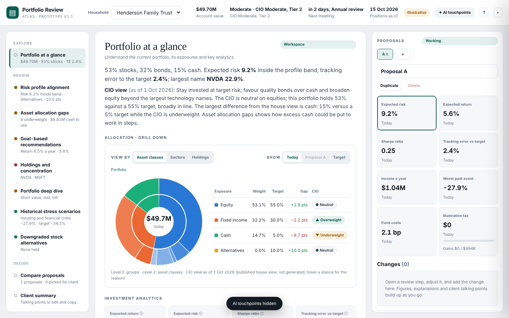

---

## 2. CIO view on Portfolio at a glance

The CIO view appears in two places on the same screen; there is no separate panel.

1. **Right after the portfolio summary,** a CIO paragraph (AI-drafted):
   > **CIO view** (as of 1 Oct 2026): Stay invested at target risk; favour quality bonds over cash and broaden equity beyond the largest technology names. The CIO is neutral on equities; this portfolio holds 53% against a 55% target, broadly in line. The largest difference from the house view is cash: 15% versus a 5% target while the CIO is underweight. Asset allocation gaps shows how excess cash could be put to work in steps.

   The LLM writes this paragraph from the published CIO view and the portfolio's gaps to target. It never sets or changes a stance.
2. **In the allocation drill-down table,** a **CIO** column:
   - the group stance (▲ Overweight, ● Neutral, ▼ Underweight) at level 1;
   - the asset-class stance at level 2;
   - the CIO's reason as hover text on each stance;
   - a caption: "CIO view as of 1 Oct 2026 (published house view, not generated; hover a stance for the reason)".

The client talking points also gain a second bullet: "Market context: our CIO is neutral on equities, overweight on bonds and underweight on cash (house view as of 1 Oct 2026)."

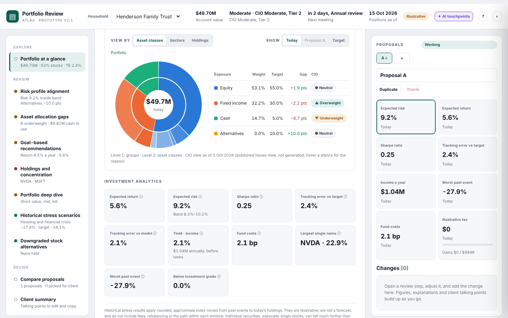

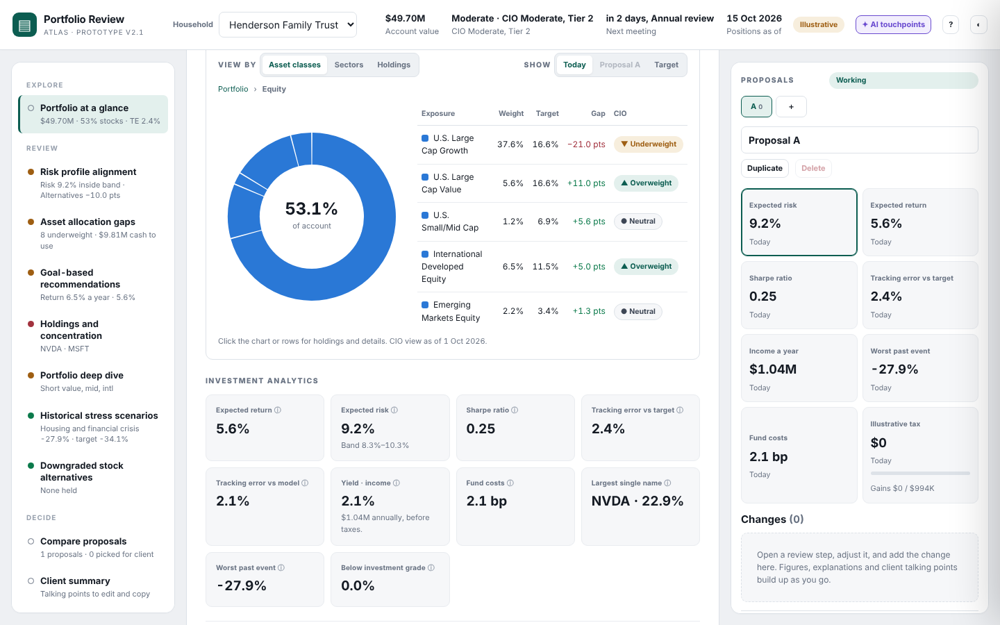

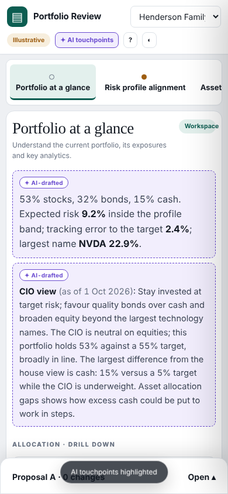

**Rule for "In line" / "With view" / "Against view" in the CIO sentence.** A group counts as over or under target when the gap is more than 2 points.
- **Neutral stance:** in line, or off neutral when over or under.
- **Overweight stance:** with the view when over, against it when under.
- **Underweight stance:** with the view when under, against it when over.

The sentence names the largest group that runs against the view.

**Illustrative CIO stances used in the prototype:**
- **By group:** Equity Neutral; Fixed income Overweight; Cash Underweight; Alternatives Neutral.
- **By class:**
  - U.S. Large Cap Growth Underweight; U.S. Large Cap Value Overweight; U.S. Small/Mid Cap Neutral;
  - International Developed Overweight; Emerging Markets Neutral;
  - Treasuries Overweight; IG Corporates Neutral; High Yield Underweight;
  - Cash Underweight; Hedge Funds Neutral; Private Equity Neutral.

All of these sit in one data block (`DATA.cio`), so the real house view can replace them in one place.

---

## 3. Other small changes

- The version label now reads "prototype v2.1".
- The CIO stance pills don't use the "brand" pill style, because that class collides with the top bar's brand container and stretches the pill to 215 px. The same quirk makes v2's "Workspace" header pills oversized. That was left unchanged to keep the rest of v2 identical.
