# Portfolio Review v2.3: performance attribution

**File:** `portfolio-review-prototype-v2.3.html` (v2.2 plus one new step). It still opens from disk with no server.

**What's new:** a **Performance attribution** step under Explore, right after Portfolio at a glance. It follows the holdings-based method in the document you shared:
- **Approaches:** top-down, bottom-up and three-factor, built on the Brinson-Fachler form with weights anchored to each parent group.
- **Linking:** geometric, or arithmetic with Modified Frongello smoothing.
- **Hierarchy:** a group level, a class level and the holdings within each class.
- **Return gap:** reconciles the attribution to the account's actual return.

**Checked:**

| Check | Result |
|---|---|
| Combinations run | 660 (5 households × 2 views × 3 approaches × 2 methods × 11 periods) |
| Effects add up (arithmetic) or compound (geometric) to the active return | Every combination; largest difference 7×10⁻¹⁶ |
| Group rows add up to the effect totals | Every combination |
| Multi-period arithmetic effects add up to the cumulative active return (Modified Frongello) | Every combination |
| Three-factor results vs an independent textbook Brinson-Fachler calculation | Identical (difference 1×10⁻¹⁶) |
| Existing figures vs v2.2 | 0 differences on every existing step, for all five households |
| Display | No errors in light, dark or phone layout; no horizontal scroll at 390 px on any step |

**The returns are illustrative.** There are eight quarters, Q4 2024 to Q3 2026. The returns are made up but consistent with each other:
- sector returns build the asset-class index returns;
- class returns build fund returns;
- stock returns are their sector's return plus a stock-specific part.

The page says so in its footer. Real use needs real return and holdings history (see the end of this note).

---

## 1. The step at a glance

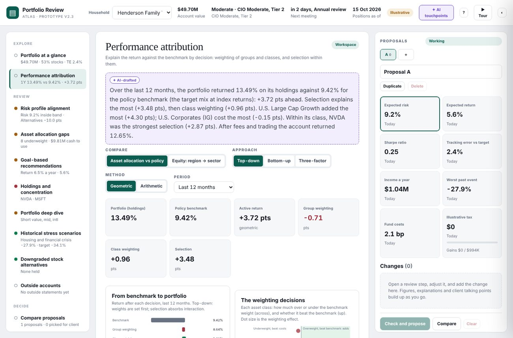

**Controls:**

| Control | Options |
|---|---|
| **Compare** | Asset allocation vs the policy benchmark (group → class → holding), or the equity sleeve (region → sector → holding) |
| **Approach** | Top-down, bottom-up or three-factor |
| **Method** | Geometric (recommended in the method) or arithmetic |
| **Period** | Last 12 months, 2 years annualized, year to date, or any single quarter |

**Stat tiles:** portfolio (holdings-based) return, benchmark, active return, and each effect.

**The opening paragraph** is an AI touchpoint ("Performance story"). It is drafted from the calculated effects, for example:

> Over the last 12 months, the portfolio returned 13.49% on its holdings against 9.42% for the policy benchmark (the target mix at index returns): +3.72 pts ahead. Selection explains the most (+3.48 pts), then class weighting (+0.96 pts). U.S. Large Cap Growth added the most (+4.30 pts); U.S. Corporates (IG) cost the most (−0.15 pts). Within its class, NVDA was the strongest selection (+2.87 pts). After fees and trading the account returned 12.65%.

## 2. From benchmark to portfolio, and the weighting decisions

**The waterfall** steps through the decisions:
1. Benchmark return.
2. After the group weights.
3. After the class weights.
4. After selection, which is the portfolio return.

A check under the chart confirms the effects reproduce the active return exactly.

**The quadrant chart** plots each class two ways:
- **Across:** portfolio weight minus benchmark weight.
- **Up:** how the class's benchmark return compares with the total benchmark.
- **Dots:** dot size is the weighting effect; green added and red cost.

The shaded quadrants are the ones where weighting adds: overweight something that beat the benchmark, or underweight something that lagged.

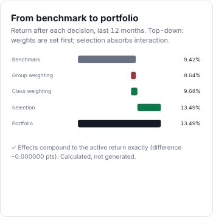

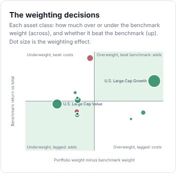

## 3. The attribution table

**Rows:** select a group to open its classes, and a class to open its holdings. A holding held in two lots is shown once.

**Columns:** portfolio and benchmark weight, portfolio and benchmark return, each effect, and the total.

**Top-down layout:**
- Group weighting sits on the group rows.
- Class weighting and selection sit on the class rows, and are summed on the group row.
- Holding rows show selection within their class.

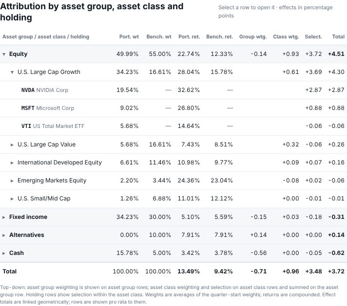

**Henderson, last 12 months, top-down, geometric:**

| | Port. wt | Bench. wt | Port. ret. | Bench. ret. | Group wtg. | Class wtg. | Selection | Total |
|---|---:|---:|---:|---:|---:|---:|---:|---:|
| Equity | 49.99% | 55.00% | 22.74% | 12.33% | −0.14 | +0.93 | +3.72 | +4.51 |
| Fixed income | 34.23% | 30.00% | 5.10% | 5.59% | −0.15 | +0.03 | −0.18 | −0.31 |
| Alternatives | 0.00% | 10.00% | 7.91% | 7.91% | +0.14 | 0.00 | 0.00 | +0.14 |
| Cash | 15.78% | 5.00% | 3.42% | 3.78% | −0.56 | 0.00 | −0.05 | −0.62 |
| **Total** | 100% | 100% | **13.49%** | **9.42%** | **−0.71** | **+0.96** | **+3.48** | **+3.72** |

**How to read it:**
- **Group weighting (−0.71):** holding 16% cash against a 5% target in a rising market cost 0.56 pts.
- **Class weighting (+0.96):** the growth tilt within equity paid off.
- **Selection (+3.48):** mostly NVDA (+2.87) and MSFT (+0.88) within U.S. Large Cap Growth.

## 4. Quarter by quarter, and the return gap

**Quarter by quarter:** each quarter is one holdings period, with weights at the start and returns over the quarter. The chart shows each effect as a bar and the active return as a line.

**Return gap:** fees, trades within quarters and cash-flow timing are not part of the effects. They form the return gap, which reconciles the holdings-based return to the actual net return.

| Henderson, last 12 months | |
|---|---:|
| Holdings-based portfolio return | 13.49% |
| Return gap | −0.74 pts |
| **Actual return, net** | **12.65%** |
| Policy benchmark | 9.42% |
| Active return from attribution | +3.72 pts |
| **Actual active return** | **+2.95 pts** |

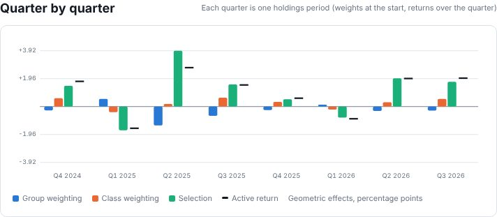

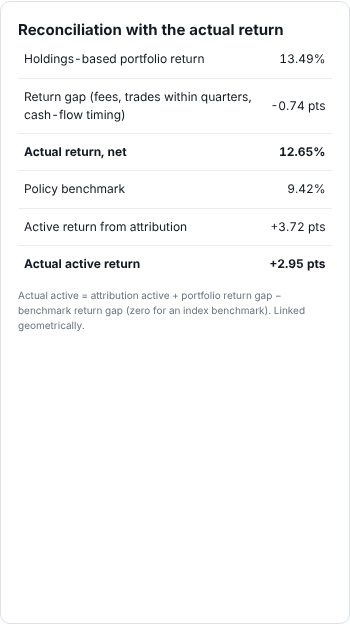

## 5. The equity view: region → sector → holding

**What's included:** the equity sleeve only. Cash, bonds and alternatives are left out, as in the method. The return gap is measured on the whole portfolio, so it appears only in the asset view.

**Funds:** funds are looked through to their sectors. Each slice keeps the fund's own return relative to its sectors, so selection within a sector reflects the fund.

**Benchmark:** the target's equity mix by region, with each region at its index sector weights.

**Henderson, last 12 months:** 22.74% against 12.59%, or +9.02 pts.

| Effect | Points |
|---|---:|
| Region weighting | +0.08 |
| Sector weighting | +3.94 (Information Technology at 66% against 19%) |
| Selection | +4.80 |

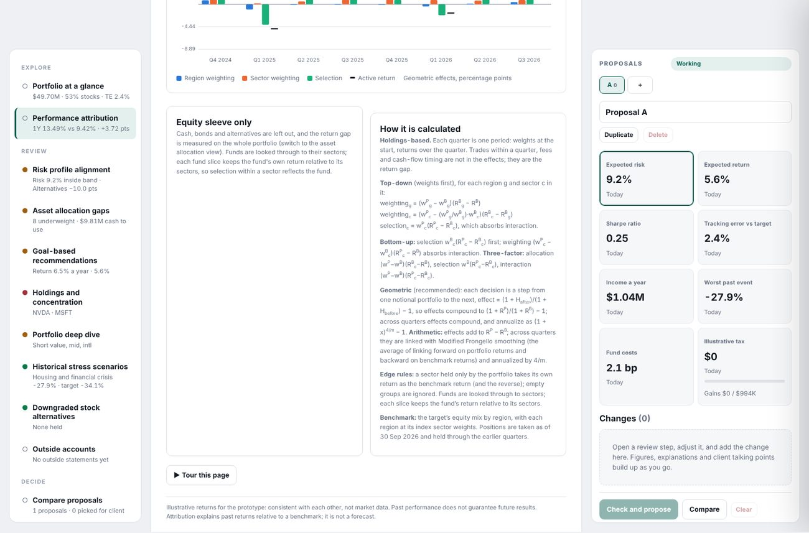

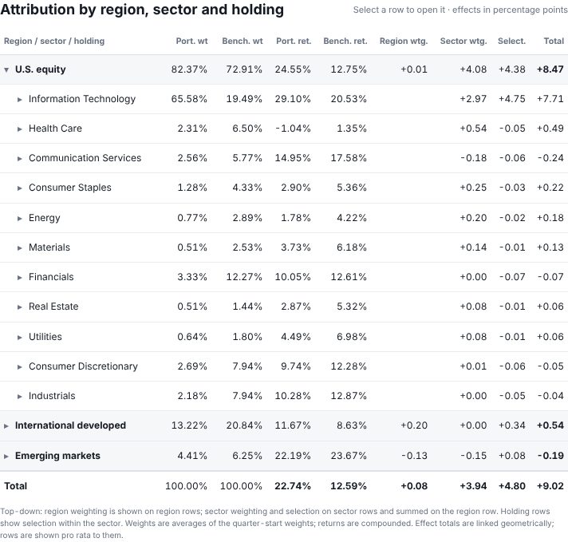

## 6. Other approaches, methods and periods

**Three-factor, arithmetic, two years annualized (Henderson):** 15.17% against 10.61%, or +5.15 pts.

| Effect | Points |
|---|---:|
| Allocation | −0.31 |
| Selection | +2.99 |
| Interaction | +2.46 |

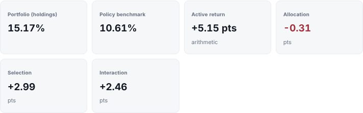

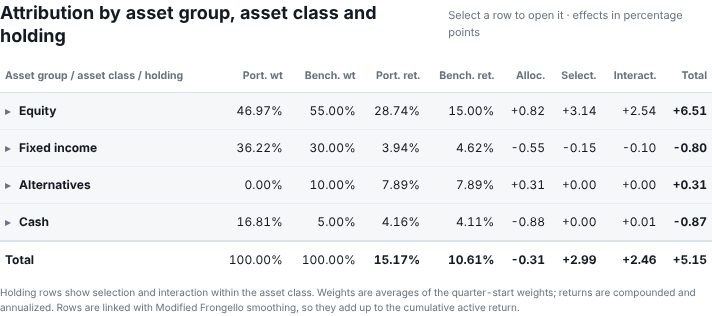

**Bottom-up, geometric, Q3 2026 only:** 5.54% against 3.48%, or +2.00 pts. Selection is +0.82 and weighting +1.17; the two compound to +2.00.

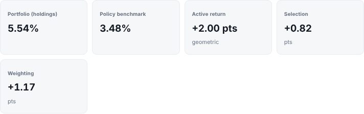

## 7. How it is calculated

The same text appears on the page, so the numbers can be checked.

**Holdings basis**
- Each quarter is one period: weights at the start, returns over the quarter.
- Today's positions are taken as the 30 Sep 2026 values and held through the earlier quarters.

**Top-down** (weights first; selection absorbs interaction), for each group g and class c in it:
- **Group weighting:** (wᴾ_g − wᴮ_g)(Rᴮ_g − Rᴮ).
- **Class weighting:** (wᴾ_c − (wᴾ_g / wᴮ_g)·wᴮ_c)(Rᴮ_c − Rᴮ_g). The benchmark's class weight is scaled to the portfolio's weight in the parent group.
- **Selection:** wᴾ_c(Rᴾ_c − Rᴮ_c).

**Bottom-up** (selection first; weighting absorbs interaction):
- **Selection:** wᴮ_c(Rᴾ_c − Rᴮ_c).
- **Weighting:** (wᴾ_c − wᴮ_c)(Rᴾ_c − Rᴮ).

**Three-factor** (interaction kept separate):
- **Allocation:** (wᴾ − wᴮ)(Rᴮ_c − Rᴮ).
- **Selection:** wᴮ(Rᴾ_c − Rᴮ_c).
- **Interaction:** (wᴾ − wᴮ)(Rᴾ_c − Rᴮ_c).

**Geometric method**
- Each decision moves from one notional portfolio to the next: effect = (1 + H_after)/(1 + H_before) − 1.
- So the effects compound to (1 + Rᴾ)/(1 + Rᴮ) − 1.
- Across quarters, effects compound and annualize as (1 + x)^(4/m) − 1, where m is the number of quarters.
- In three-factor, interaction is solved last so the three compound exactly.
- Group and holding rows are not linked geometrically. Over several quarters they are shown in proportion to each effect's total.

**Arithmetic method**
- Effects add up to Rᴾ − Rᴮ.
- Across quarters every row is linked with Modified Frongello smoothing: the average of linking forward on portfolio returns and backward on benchmark returns. Linked rows add up to the cumulative active return.
- Annualizing scales by 4/m.

**Edge rules**
- A class held only by the portfolio takes its own return as the benchmark return, and the reverse.
- Empty groups are ignored.
- A fund that spans classes is split by its class weights. Each slice keeps the fund's return relative to the class indexes.

**Return gap**
- Actual active = attribution active + portfolio return gap − benchmark return gap.
- The benchmark return gap is zero for an index benchmark.
- Over several quarters the gap is linked geometrically in the geometric method.

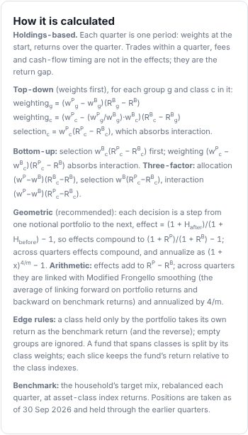

## 8. Also changed

- **Tour:** a "▶ Tour this page" button runs a 9-step tour of the step. The top-bar tour is unchanged and now labels itself "Outside accounts tour".
- **AI touchpoint:** a new one, "Performance story". The "Where AI is used" panel now lists 10 touchpoints.
- **Client summary:** the talking points gain one line, for example: "Recent performance: over the past 12 months the portfolio returned 12.65% after fees, against 9.42% for its policy benchmark; selection explains most of the difference (+3.48 pts). Past performance does not guarantee future results."
- **Status line:** the step's line in the left menu shows the 12-month result, for example "1Y 13.49% vs 9.42% · +3.72 pts".
- **Phone layout fixes:**
  - Step headers wrap on narrow screens.
  - The "Workspace" pill no longer stretches to 215 px.
  - This also removed a 7 px sideways scroll that v2.2 had on the empty Outside accounts step.

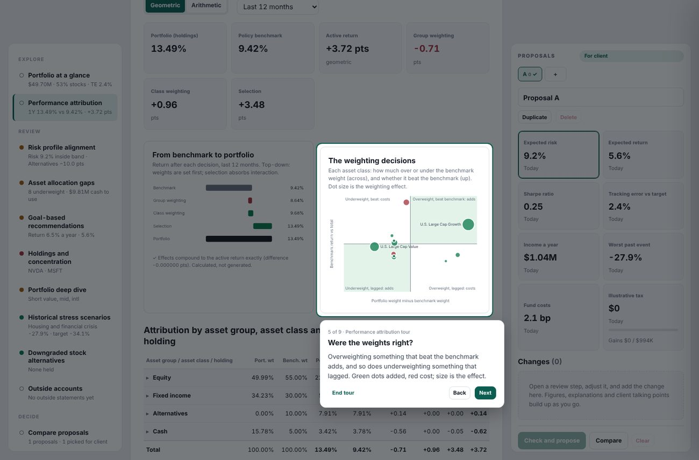

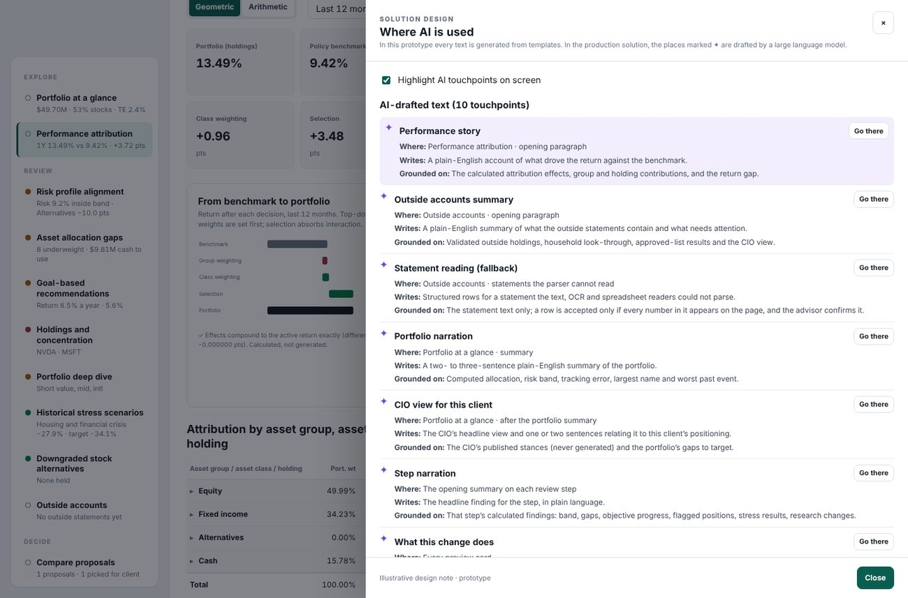

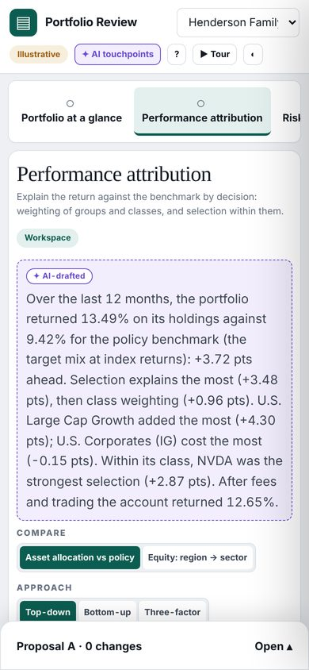

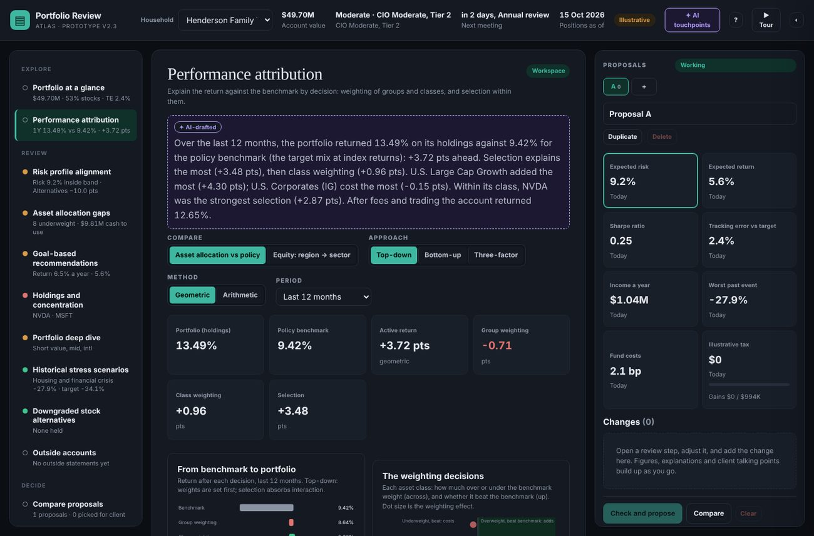

## 9. What real use needs

- **Holdings history:** at each period start (quarterly here; monthly or more often for active accounts, as the method recommends). Today the history is derived backwards from current positions.
- **Return series:** security-level returns and benchmark constituent returns per period. Today these are illustrative.
- **Fee and transaction data:** for the return gap. Today the gap is an illustrative fee plus noise.
- **Benchmarks:** a choice of benchmark per account (policy, broad index or custom). Today it is the household target at class index returns.
- **Out of scope here:** currency effects, fixed-income attribution (duration, curve, spread) and short positions. The method also excludes them.
