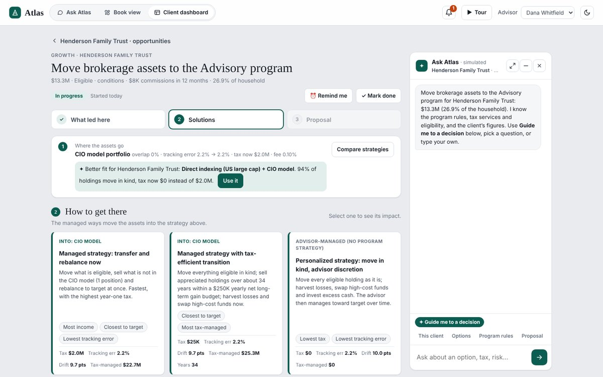
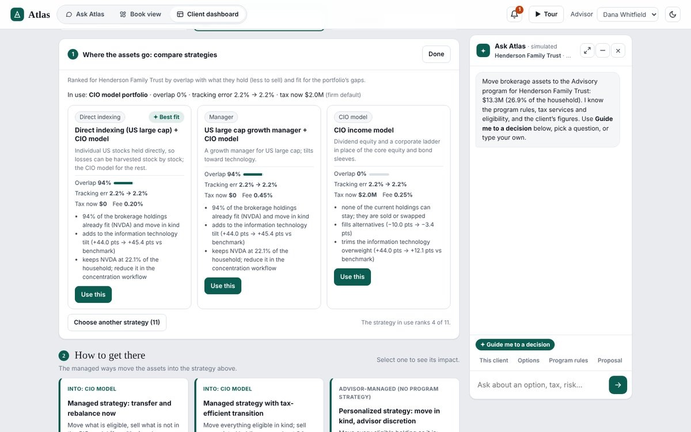
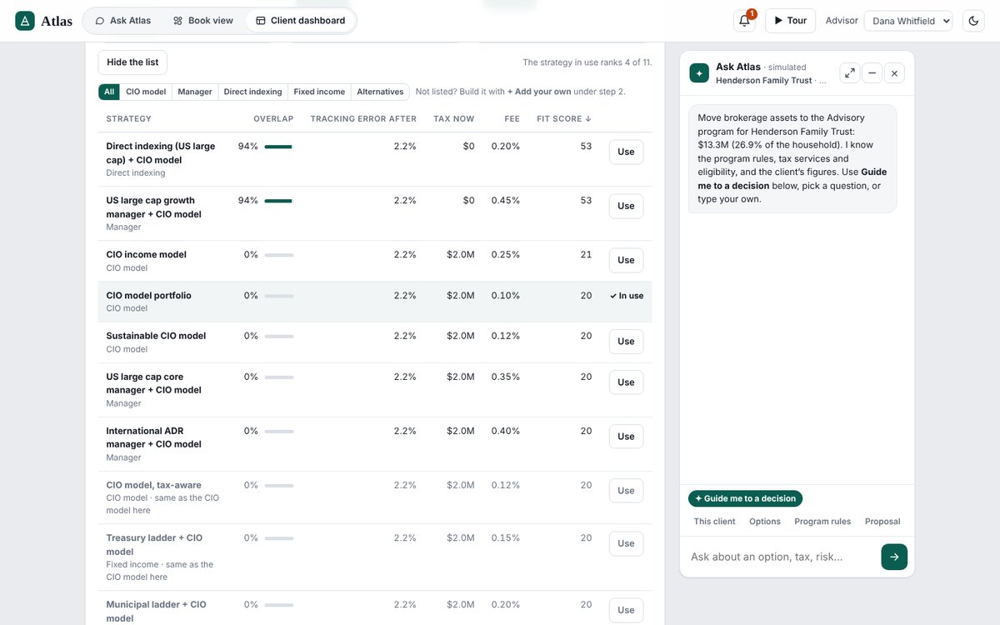
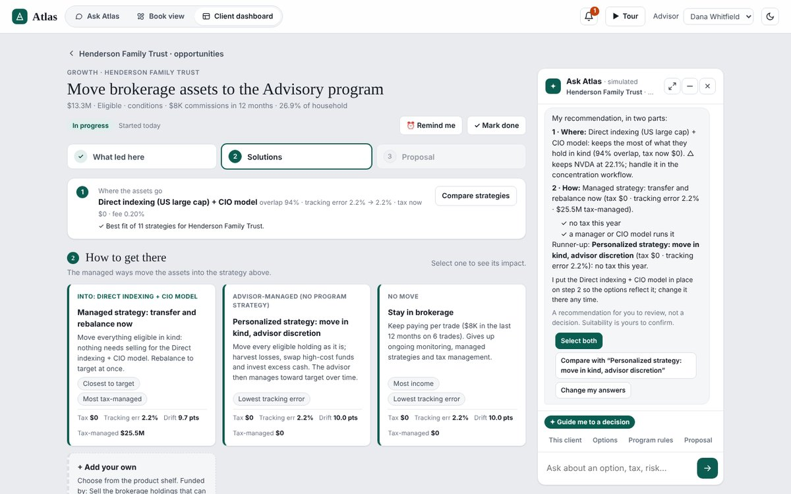
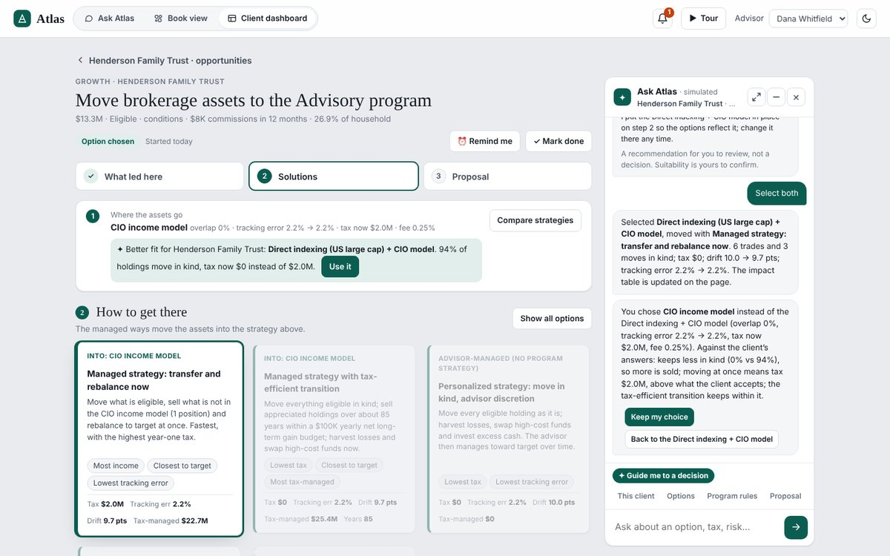

# Choosing the program strategy: rebuild notes

**Scope:** one use case only. When brokerage assets move into the Advisory program, which program strategy should they go into?
- Strategies are ranked by **1. overlap** with what the client holds, and **2. fit for the portfolio's gaps**.
- **3. The advisor can choose something else easily**, on screen or by asking Atlas.
- Includes the latest simplification: step 2 in two parts, and the decision guide joined to the strategy choice.

**Where it applies:** the Brokerage → Advisory opportunity only. Other opportunities are unchanged, and so is the specialist route (one stock above 50%).

**Prototype:** `atlas-console-book-view.html`. Figures come from rules over the sample book; in a rebuild, a model should write the words and call tools for the figures (section 9).

---

## 1. What the advisor sees

Step 2 of the Advisory workflow has two numbered parts on one page:

| Part | Question | Default |
|---|---|---|
| **1 · Where the assets go** | Which program strategy holds the assets | CIO model portfolio (firm default) |
| **2 · How to get there** | How, and how fast, to move them | Nothing selected |

**Part 1 is one line by default:** the strategy in use, with overlap · tracking error before → after · tax now · fee. Under it, one of three things:

| Situation | Line shown |
|---|---|
| Another strategy scores at least 0.03 higher | "✦ Better fit for *client*: ***strategy***. *94% of holdings move in kind* (or *tracking error after x%*), tax now $X instead of $Y." with **Use it** |
| The strategy in use is the best fit | "✓ Best fit of *N* strategies for *client*." |
| The selected way doesn't use a strategy | "Not used by the way you chose: advisor-managed (no program strategy)." |

**Compare strategies** opens the ranking:
- **Three cards:**
  - the best fit (✦ Best fit), then the best of two *other* strategy types, so the alternatives differ;
  - each card shows type, name, a one-line description, overlap with a bar, tracking error before → after, tax now, fee, up to 3 reasons, and **Use this** (or ✓ In use).
- **Choose another strategy (N):** the full list.
  - **Filters:** by type (All, CIO model, Manager, Direct indexing, Fixed income, Alternatives).
  - **Sorting:** by name, overlap, tracking error after, tax now, fee or fit score.
  - **Every row has Use.**
  - **Greyed rows:** strategies that would end up identical to the CIO model are marked "same as the CIO model here"; unavailable ones say why.
  - **Caption:** explains the measures.
- **Using a strategy** closes the comparison and scrolls to part 2. **Done** closes it without changing anything.
- **Not listed?** Use **+ Add your own** in part 2 (the product shelf).

**Part 2 cards say whether they use part 1** (first line, small caps):

| Way | Label | Uses the strategy |
|---|---|---|
| Managed strategy: transfer and rebalance now | INTO: *strategy* | Yes |
| Managed strategy with tax-efficient transition | INTO: *strategy* | Yes. Not shown when the strategy keeps everything (nothing to sell over time) |
| Personalized strategy: move in kind, advisor discretion | ADVISOR-MANAGED (NO PROGRAM STRATEGY) | No |
| Stay in brokerage | NO MOVE | No |
| + Add your own | From the product shelf | No |

- **Direct indexing is a strategy in part 1 only.** It is no longer a separate way.
- **Way titles don't change with the strategy.** The INTO line carries the strategy name.

## 2. The strategy catalog (illustrative)

Each strategy has a type, the asset classes it covers with the vehicle it buys for each, the securities it can hold (for overlap), a manager fee, and an availability rule. **For classes it doesn't cover, it uses the CIO model's funds.**

| Strategy | Type | Covers → vehicle | Holds in kind (besides the CIO funds for other classes) | Fee | Available when |
|---|---|---|---|---:|---|
| CIO model portfolio | CIO model | — (all classes use the CIO funds) | The CIO model funds | 0.10% | Always |
| CIO model, tax-aware | CIO model | Core and corporate bonds → municipal fund | Municipal fund, municipal ladder | 0.12% | Taxable accounts |
| CIO income model | CIO model | US large cap → dividend strategy; core bonds → corporate ladder | Dividend strategy and fund, 10 dividend stocks, corporate ladder | 0.25% | Always |
| Sustainable CIO model | CIO model | US large cap → screened US fund | Screened US fund | 0.12% | Always |
| Direct indexing (US large cap) + CIO model | Direct indexing | US large cap → direct indexing | All US large-cap stocks | 0.20% | $250K+ in brokerage |
| US large cap core manager + CIO model | Manager | US large cap → core manager (made up) | 14 quality large-cap stocks | 0.35% | Always |
| US large cap growth manager + CIO model | Manager | US large cap → growth manager (made up) | 8 growth stocks | 0.45% | Always |
| International ADR manager + CIO model | Manager | International developed → ADR portfolio | The ADR portfolio | 0.40% | Always |
| Municipal ladder + CIO model | Fixed income | Municipal and core bonds → municipal ladder | Ladder, municipal fund, individual municipal bonds | 0.20% | Taxable accounts |
| Treasury ladder + CIO model | Fixed income | Treasuries → Treasury ladder; CDs → T-bills | Ladder, T-bills, Treasury fund, individual Treasuries | 0.15% | Always |
| CIO model with alternatives | Alternatives | Private equity, hedge funds → multi-strategy alternatives | Alternatives holdings | 0.25% | Household $5M+ (stand-in for "qualified") |

## 3. How a strategy is scored for a household

Every strategy is evaluated by building the "transfer and rebalance now" move into it and measuring the household afterwards.

**Kept in kind** = the strategy's holdings ∪ the CIO model's funds for the classes it doesn't cover.

**1. Overlap**
- **Base:** brokerage positions that would move, leaving out:
  - cash;
  - individual bonds and CDs (held to maturity whatever the strategy);
  - excluded assets;
  - lots without cost basis.
- **Kept:** base positions the strategy keeps in kind. Positions sold anyway to harvest a loss count as **not** kept.
- **Overlap** = kept value ÷ base value.
- **Bonds:** bonds the strategy takes in kind (the ladders) are reported separately ("also takes $X of bonds already held").

**2. Fit for the gaps** (each part is the improvement, before − after, divided by before, clipped to −1…+1):

| Part | Weight | Measured as |
|---|---:|---|
| Tracking error to target (asset classes) | 45% | Volatility of the difference between the actual and target mix |
| Sector gap (equity vs benchmark) | 30% | Half the sum of absolute sector differences |
| Largest single stock | 25% | Only when it is above 10% of the household today |

**3. Fit score** = 0.40 × overlap + 0.45 × max(0, fit) + 0.15 × (1 − min(1, tax now ÷ 1% of household assets)).

**Look-alikes:** a strategy is marked "same as the CIO model" when either:
- its trades are identical to the CIO model's; or
- it buys less than $1,000 of its own vehicles and keeps the same value in kind (within $1,000).

Look-alikes are never suggested.

**Ranking order:** available first, then not look-alikes, then fit score (to 0.001), then lower fee, then the CIO model.

**Three suggestions:** the top-ranked, then the best of each further type until there are 3; fill with the next best if fewer types qualify.

**Reasons shown** (up to 3 on a card):
- "*x%* of the brokerage holdings already fit (*top 3 names*) and move in kind", or "none of the current holdings can stay";
- "also takes $X of bonds already held";
- "fills *group* (*gap before* → *after*)" for the two groups that improve most;
- "trims the *sector* overweight/underweight", or "adds to the *sector* tilt";
- "keeps *stock* at *x%* of the household; reduce it in the concentration workflow" (when the largest stock stays above 10%), or "brings *stock* from *x%* to *y%*";
- "no different from the CIO model for this household" (look-alikes).

**Examples:**

| Household | Best fit | What it shows |
|---|---|---|
| Whitaker | CIO model (76% overlap) | Most holdings are already the model's funds; ✓ Best fit |
| Henderson | Direct indexing + CIO model (94% overlap, tax now $0 vs $2.0M) | Overlap saves tax but keeps NVDA at 22%, and the card says so |
| Callahan | Direct indexing (100% overlap) | The only stock (XOM) is held by three strategies; the CIO model would sell it ($33K tax) |

## 4. What switching the strategy does

When a strategy is chosen (by **Use it**, **Use this**, **Use** on a row, the guide, or Atlas), only the **managed ways** are rebuilt:
- **Kept in kind:** positions the strategy keeps (section 3) are moved, not sold.
- **Transfer and rebalance now:** sells what it doesn't keep, then buys to target with the strategy's vehicle for each class it covers. Gaps are measured after the sells and capped at each asset group's own gap.
- **Tax-efficient transition:** sells what it doesn't keep over time within the yearly gain budget (gain per dollar, lowest first).
- **Manager fee:** the strategy's fee, charged only on the assets moved into it.
- **Wash sales:** any sale at a loss blocks buying the same security back, including small losses outside harvesting.

**What follows the choice:**
- Step 1's risk and tax figures (the default way into the chosen strategy).
- The impact table and the option cards.
- The proposal ("Program and strategy" names the strategy and its fee, overlap with $ moved in kind, tracking error before → after, and the next two strategies considered with their overlap).
- The step 3 checklist ("Confirm the program strategy: *name* (fee *x%*); deliver its strategy profile").
- Saved work: resuming restores the strategy.

## 5. The decision guide, joined to the strategy

**The extra question.** It is asked only when "a manager or the CIO model" decides, and not on the specialist route:

> **Where should the assets go? What matters most in choosing the strategy?** Keep what they hold (least selling) · Best fit for the gaps · Lowest fee · Stay with the CIO model

**Full Advisory question order:**
1. Tax this year.
2. Who decides.
3. *(The strategy question)*.
4. What matters most in the move.
5. Cash needs.

The old direct-indexing question was removed: direct indexing is now a strategy.

**How the guide picks the strategy** (available, non-look-alike strategies only; tax weight = 25% if "as little as possible", 15% if "up to about $100K", otherwise 5%):

| Answer | Pick by |
|---|---|
| Keep what they hold | 0.70 × overlap + 0.15 × fit + tax weight × (1 − tax ÷ 1% of assets) |
| Best fit for the gaps | 0.20 × overlap + 0.70 × fit + tax weight × (same) |
| Lowest fee | fit score − 0.004 × fee in basis points |
| Stay with the CIO model | The CIO model |

Ties go to the lower fee.

**The recommendation comes in two parts that match the page:**
- **1 · Where:** the strategy and why. For example:
  - "keeps the most of what they hold in kind (94% overlap, tax now $0)";
  - "best fit for the gaps (tracking error a → b)";
  - "lowest fee among the good fits (x%)".
  It adds a △ warning when the largest stock stays above 10%.
- **2 · How:** the way to move, scored against the answers **with that strategy already in place**, plus a runner-up.
- **The guide puts the strategy in place on step 2 immediately** and the page refreshes, so the screen and the advice agree. It says so: "I put the *strategy* in place on step 2 so the options reflect it; change it there any time."
- **Buttons:** **Select both** (strategy + way), Compare with the runner-up, Change my answers.

- **When the recommended way doesn't use a strategy** (e.g. personalized), there is no "Where" part: "It doesn't use a program strategy, so the strategy choice doesn't apply."

**When the advisor picks a different strategy by hand:**
- **After a guide recommendation:** Atlas compares it with the suggestion against the client's answers:
  - overlap, if "keep" was asked;
  - tracking error after, if "fit";
  - fee, if "fee";
  - tax now against the client's tax limit.
  It offers **Keep my choice** or **Back to *suggestion***.

- **Without the guide:** Atlas states the new figures and offers **Check it against the client** and **Which strategy fits best?**

## 6. Ask Atlas

In the Advisory workflow:

| The advisor types | Atlas does |
|---|---|
| "Which strategy fits best?", "compare strategies", "what about overlap?", "what alternatives?", "which manager / model?" | Ranks the three suggestions with overlap, tracking error, tax now, fee and two reasons each, says which is in use, and how to switch |
| "Use the municipal ladder", "switch to direct indexing", "try the growth manager", "go with …", "… instead" | Switches the strategy (if available), states the new figures, and refreshes the page |
| "What strategy types are there?" | A knowledge answer about strategy types, not the ranking |

**Name matching:**
- Each strategy has a phrase pattern (e.g. "direct index", "muni", "treasur", "large cap core", "growth", "dividend|income", "sustainab|esg", "tax-aware", "alternativ", "international|adr").
- A specific strategy wins over "CIO model" when both match ("use the municipal ladder + CIO model" → municipal ladder).

The workflow's suggested questions include "Which strategy fits best?" under **Options**.

## 7. Edge cases

| Case | Behaviour |
|---|---|
| One stock above 50% (specialist route) | No part 1; no strategy question in the guide |
| Selected way is personalized or stay | Part 1 says the strategy isn't used |
| Strategy keeps everything | The tax-efficient transition way isn't offered (nothing to sell over time) |
| Strategy not available | Greyed in the list with the reason; no Use; the guide never picks it |
| Look-alike of the CIO model | Greyed, "same as the CIO model here"; Use still allowed; never suggested |
| Brokerage only cash and CDs (e.g. Okonkwo) | Overlap 0% everywhere; ranking comes from fit and fee |
| Overlap keeps a concentrated stock | Ranked on its merits, with a warning reason pointing to the concentration workflow |

## 8. Checks to reuse

| Check | Pass condition |
|---|---|
| Every Advisory candidate × every strategy (132 combinations) | Options build; household assets unchanged; no negative positions; no wash sales |
| Suggestions | Three per household, from different types where possible |
| Name matching | Every strategy can be switched to by its full name in Ask Atlas |
| Guide | With "keep what they hold", Henderson gets direct indexing and the page shows it; **Select both** sets the strategy and the way |
| Hand-picked strategy | Atlas compares it with the client's answers and offers Keep / Back |
| Default figures | With the CIO model, all Advisory figures match the earlier version (e.g. Whitaker: transition tax $56K, $20K at the $100K budget) |
| Layout | Phone width: no sideways scroll; part 1 cards stack |

## 9. For a rebuild with another LLM

| Tool | Returns / does |
|---|---|
| `rank_strategies(household)` | Every strategy with availability, look-alike flag, overlap (%, $ kept, names, bonds taken), tracking error before/after, sector gap before/after, largest stock before/after, tax now, fee, fit, score, reasons |
| `suggest_strategies(household)` | The three suggestions (section 3) |
| `use_strategy(household, strategy)` | Sets it, rebuilds the managed ways, returns the new figures |
| `guide_pick_strategy(household, answers)` | The section 5 pick and its reason |
| `options(household)` | The ways for the current strategy, each marked whether it uses the strategy |

**Keep in code, not in the prompt:**
- every number;
- the look-alike test;
- the 0.03 "better fit" threshold;
- availability rules;
- the wash-sale guard;
- "the guide puts its strategy in place before scoring the ways".

**The model's job:**
- explain the trade-off in plain words (overlap saves tax; fit gets risk back to target; they can pull apart, as for Henderson);
- route "use X" to `use_strategy`;
- never invent a strategy, a holding or a fee.

## 10. Prototype limits

- **The catalog is illustrative.** Eleven strategies, two of them made-up manager strategies.
- **Overlap is security by security,** without looking inside funds (a client holding an S&P 500 fund gets no overlap credit with direct indexing).
- **Fit uses class-level risk assumptions** and the equity benchmark's sector weights.
- **Fees and availability thresholds are illustrative.**
