# Skill Studio: skills as building blocks (proof of concept)

Skill Studio is a standalone proof of concept that demonstrates:

1. **Four types of skill**: technical, business, policy and rules-driven. Each type has its own executor.
2. **Parent and child skills.** A child inherits from its parent, can override or switch off what it inherits, and reuses a whole process by setting parameters.
3. **Skills depending on each other** to deliver a capability, with a dependency map and change-impact analysis.
4. **A lightweight registry UI** that takes plain English and gives back a complete, checked and tested skill.

The worked example is the CIO's manager and SMA selection process. All managers, clients and figures are fictional, and nothing is sent or traded. It is a FastAPI app with a plain JavaScript front end and 43 automated tests. The registry is a folder of plain SKILL.md files, one per skill, in the standard Agent Skills layout.

Screenshots were taken at 1440 × 900 unless noted.

---

## 1. What a skill is here

Every skill is one `SKILL.md` file:

- **Frontmatter:** `name`, `description`, and `metadata` with the type, version, owner, status, `extends` (its parent), `uses` (what it depends on), inputs and outputs.
- **Prose:** for people, and for Claude if the file is loaded as a skill.
- **`## Logic`:** one YAML block the runtime executes.
- **`## Tests`:** examples that must pass before the skill can be approved.

| Type | What it is for | Its Logic block | How it runs |
|---|---|---|---|
| **Technical** | Calculations and data | One operation from a reviewed library, plus parameters | Calls the operation. A skill never carries its own code, so a skill written from English is safe to run |
| **Rules-driven** | Screens and thresholds | Rules: an id, a condition, an outcome (exclude, flag, condition, block) and a message | Applies each rule per candidate or once per client, and records every decision with its rule id |
| **Policy** | Compliance controls | Constraints (`must`, `must not`) with severity (block or warn), plus required and banned wording | Removes candidates, warns, or blocks the run; checks generated text |
| **Business** | Processes and capabilities | Steps: use another skill, take, rank, set, write text, or a manual step for a person | Runs the steps in order and calls the sub-skills |

The registry starts with 19 skills:

- 5 technical;
- 4 rules-driven;
- 3 policy;
- 7 business: 4 capabilities, 1 abstract parent process and 2 sub-skills.

## 2. The registry

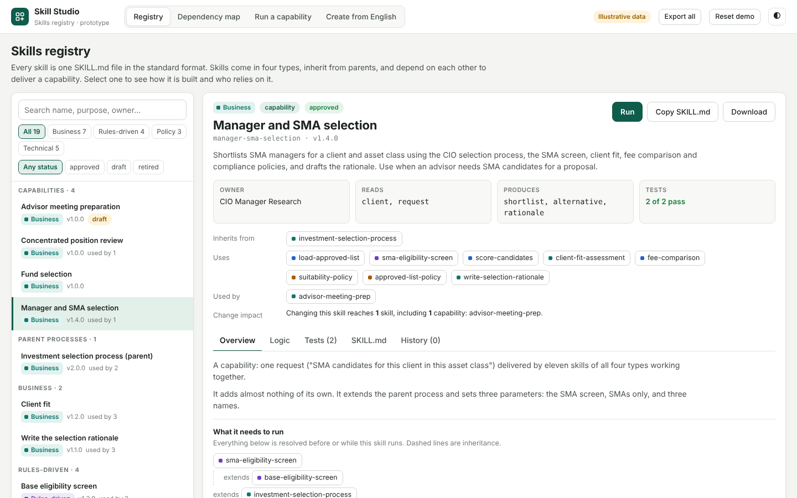

**The list (left)** groups skills as Capabilities, Parent processes, Business, Rules-driven, Policy and Technical. You can search, and filter by type and status. Each entry shows its type, version, a draft badge and "used by N".

**The detail panel (right)** shows:

- **Header:** the type, a capability or parent badge, the status, and **Run**, **Approve** (for drafts), **Copy SKILL.md** and **Download**.
- **Owner, reads, produces, tests:** the data contract and the test result (here "2 of 2 pass").
- **Inherits from:** the parent chain. Manager and SMA selection inherits from `investment-selection-process`.
- **Uses:** every skill it depends on after inheritance, each with its type colour.
- **Used by** and **Change impact:** who relies on this skill. Here, changing it reaches 1 skill, and that skill is a capability.
- **Tabs:** Overview (prose plus a "what it needs to run" tree), Logic, Tests, SKILL.md and History.

### Parent and child: reusing a whole process

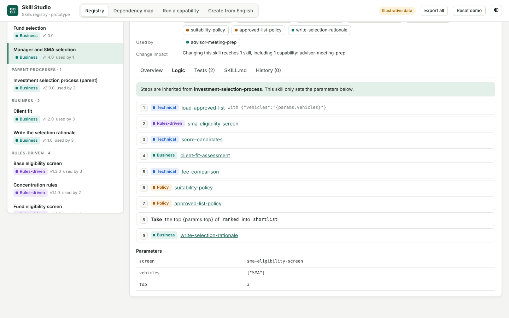

`investment-selection-process` is an **abstract parent**. It defines the CIO's selection process once, in nine steps:

1. load the approved list;
2. screen;
3. score;
4. check client fit;
5. compare fees;
6. apply the suitability policy;
7. apply the approved-list policy;
8. take the top N;
9. write the rationale.

`manager-sma-selection` adds no steps. It sets three parameters: `screen: sma-eligibility-screen`, `vehicles: [SMA]` and `top: 3`. `fund-selection` reuses the same process with the fund screen, funds only and the top 2.

A change to the parent process reaches every selection capability at once.

### Parent and child: rules that inherit, override and switch off

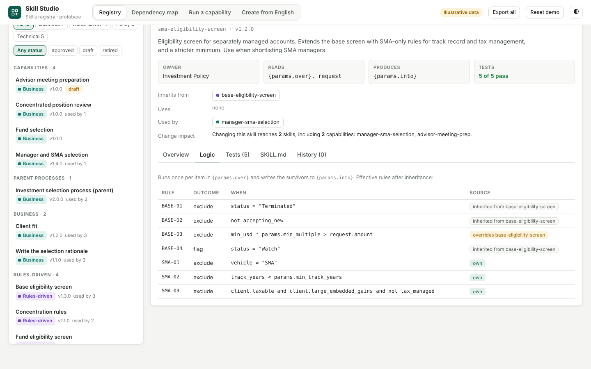

The **Logic** tab shows the effective rules after inheritance, each with its source:

- BASE-01, BASE-02 and BASE-04 are *inherited from base-eligibility-screen*: terminated, closed, Watch list.
- **BASE-03 *overrides* the base rule.** An SMA needs twice its minimum, so the manager can build the full portfolio.
- SMA-01 to SMA-03 are the screen's *own* rules: SMA only, track record of at least 3 years, and tax-managed when the client has large embedded gains.

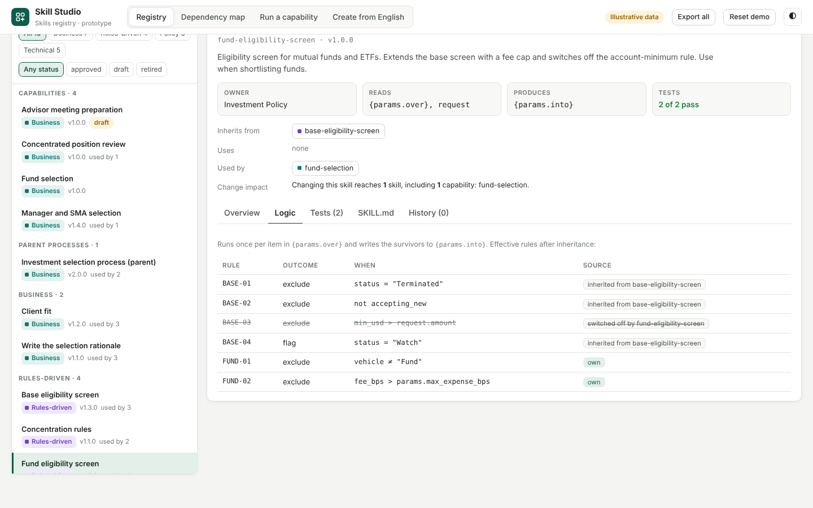

The fund screen inherits from the same parent, **switches off** BASE-03 (funds have no account minimum), and adds a 50 bp fee cap.

### A technical skill and a policy skill

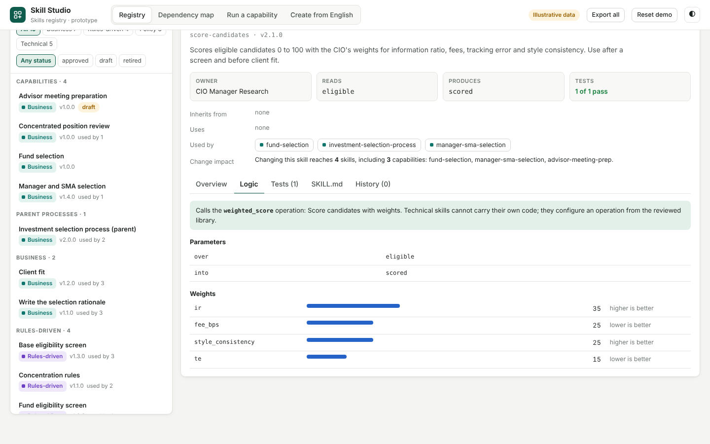

`score-candidates` calls the `weighted_score` operation. The CIO's weights are data, not code: information ratio 35, fee 25, style consistency 25, tracking error 15. Changing a weight is a new version of the skill, not a code release.

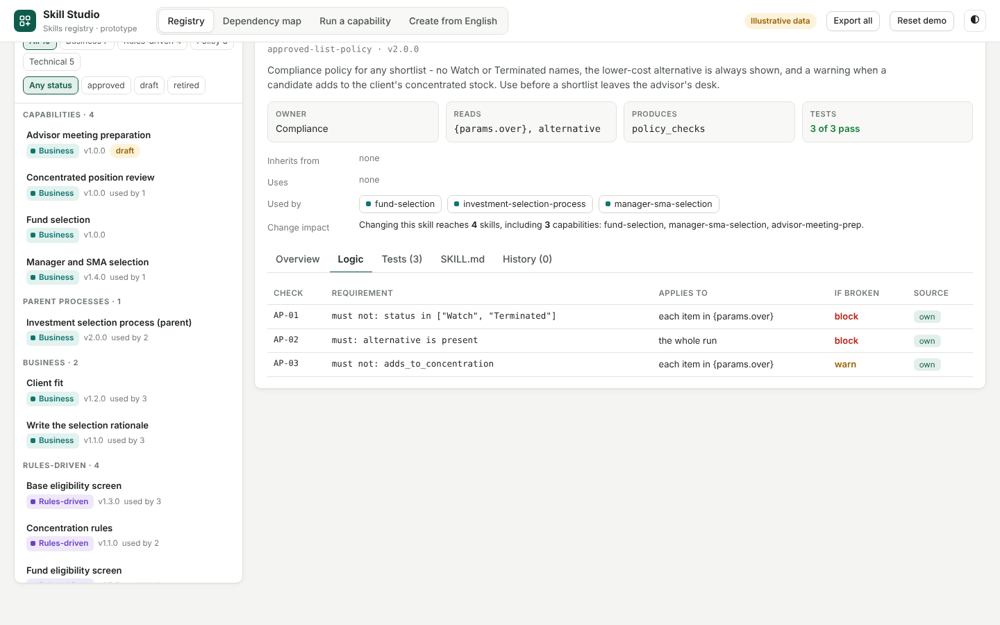

`approved-list-policy` is a control that does not depend on the screens:

- **AP-01** blocks Watch and Terminated names.
- **AP-02** blocks the run if the lower-cost alternative is missing.
- **AP-03** warns when a candidate adds to the client's concentrated stock.

The base screen only *flags* the Watch list; the policy is what keeps those names off a shortlist.

### Tests and the file itself

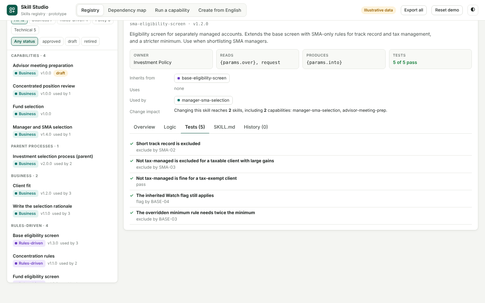

Every seed skill has tests (37 in all). Rules tests check one candidate against one rule. Capability tests run the whole process for a client. A deliberately broken version of a capability (the base screen swapped in for the SMA screen) fails its own test, which is how a bad change is caught.

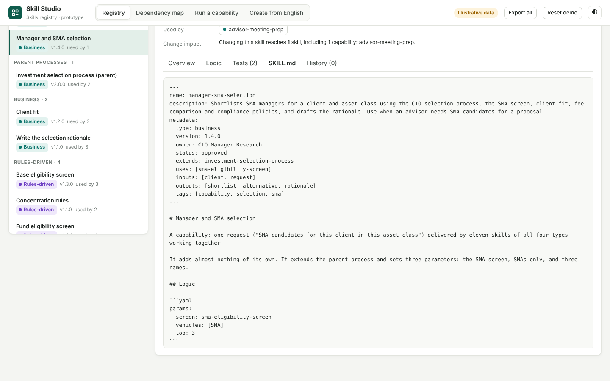

## 3. The dependency map

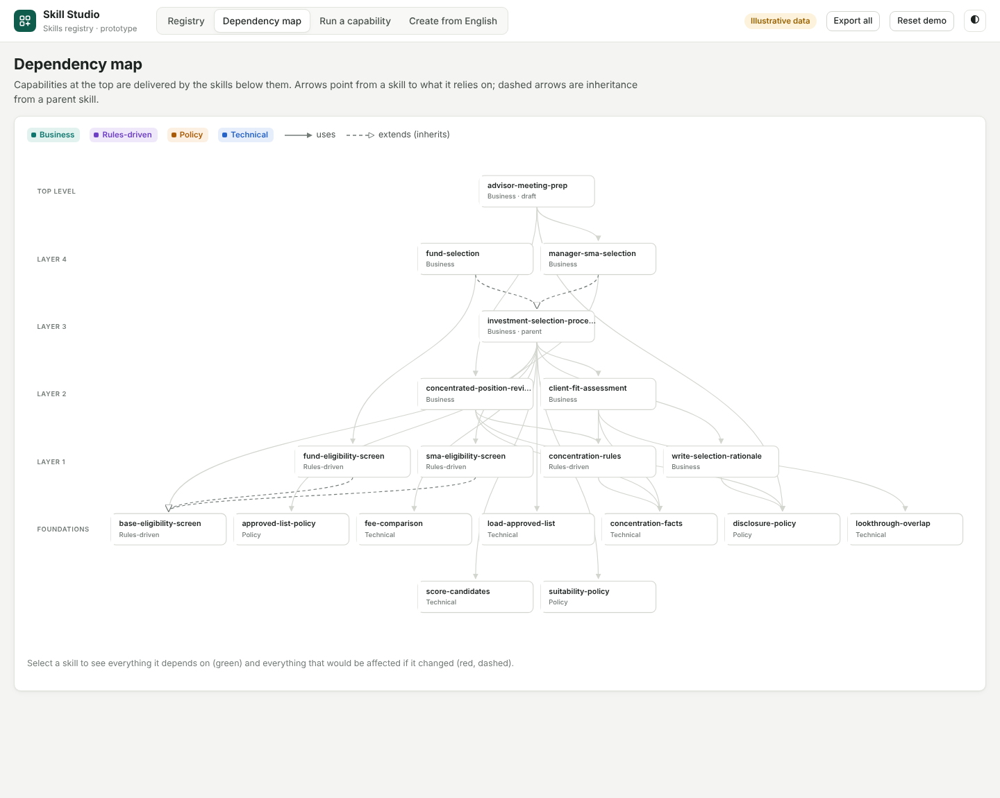

The layers run from the top-level capability down to the foundations. Solid arrows point from a skill to what it **uses**; dashed arrows with an open head point to the parent it **extends**. Each node shows its type in words, not by colour alone.

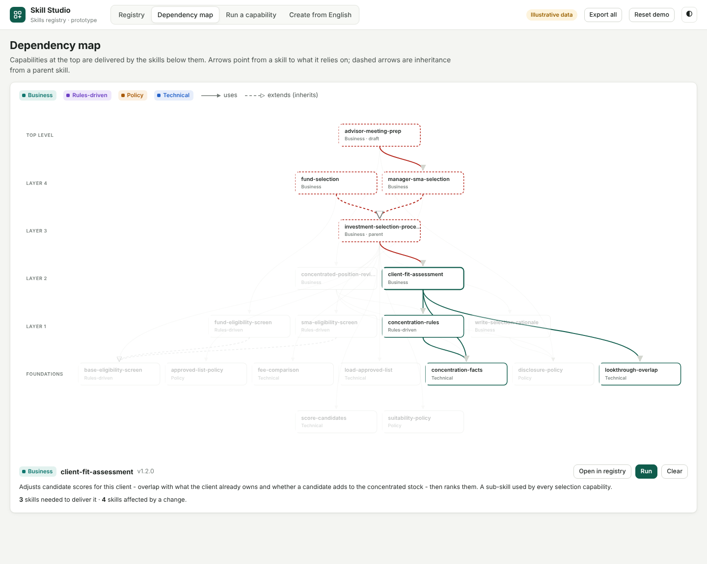

Selecting `client-fit-assessment` shows:

- **in green**, the 3 skills it needs: concentration facts, concentration rules and look-through overlap;
- **in red, dashed**, the 4 skills a change would affect: both selection capabilities, the parent process and the meeting prep.

This is the impact analysis to read before approving a change.

## 4. Running a capability

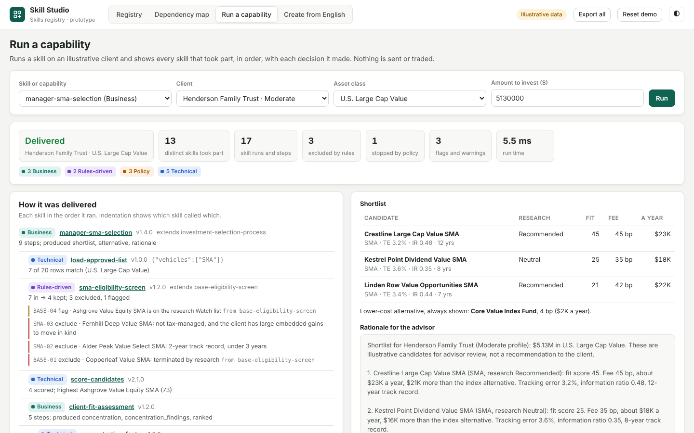

Choose a skill, a client, an asset class and an amount, then select **Run**. For Henderson, **13 distinct skills of all four types** deliver one request:

- 3 business;
- 2 rules-driven;
- 3 policy;
- 5 technical.

The summary counts what each kind of skill did:

- 3 managers excluded by rules;
- 1 stopped by policy;
- 3 flags and warnings.

The output is the shortlist, with fit score and fees, the lower-cost alternative (always shown), and the rationale for the advisor.

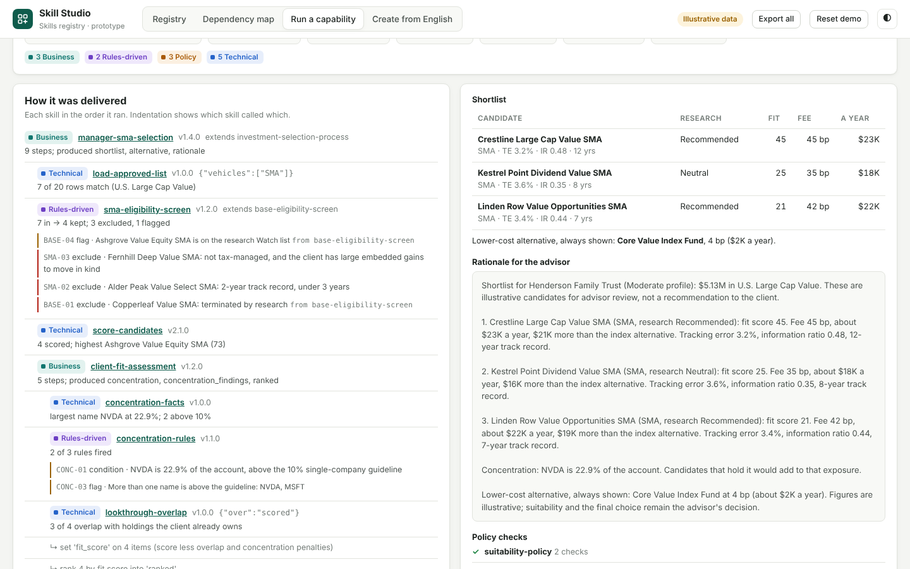

**How it was delivered** lists each skill in the order it ran, indented under the skill that called it, with version and parameters. Every decision carries its rule id and where that rule came from:

| Decision | Made by | Type |
|---|---|---|
| BASE-04 flag: Ashgrove is on the Watch list | `base-eligibility-screen`, inherited by the SMA screen | Rules |
| SMA-03 exclude: Fernhill is not tax-managed, and the client has large gains | `sma-eligibility-screen` | Rules |
| SMA-02 exclude: Alder Peak has a 2-year track record | `sma-eligibility-screen` | Rules |
| BASE-01 exclude: Copperleaf is terminated | `base-eligibility-screen`, inherited | Rules |
| CONC-01 and CONC-03: NVDA 22.9% and MSFT 10.6% are above the guideline | `concentration-rules`, inside client fit | Rules |
| AP-01 removed: Ashgrove | `approved-list-policy` | Policy |
| 6 wording checks passed on the rationale | `disclosure-policy` | Policy |

### Same capability, different path per client

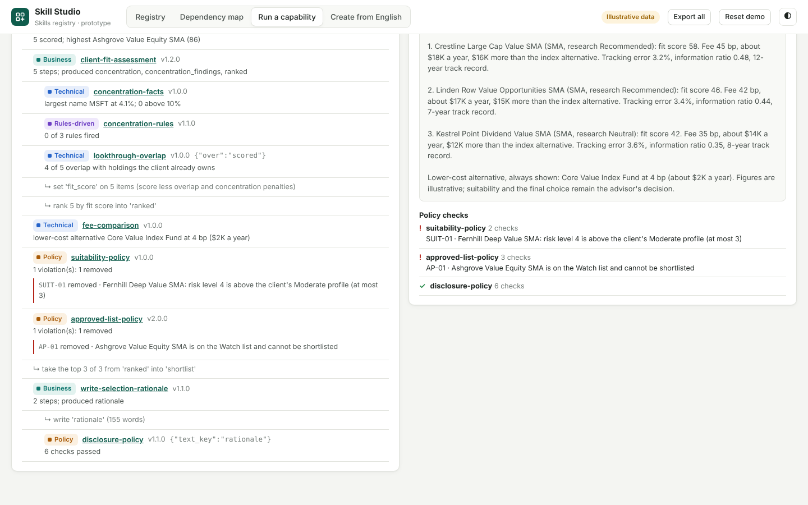

**Okonkwo** has a tax-exempt account, so SMA-03 does not fire and Fernhill passes the screen. The **suitability policy** then removes it: its risk level 4 is above the Moderate profile.

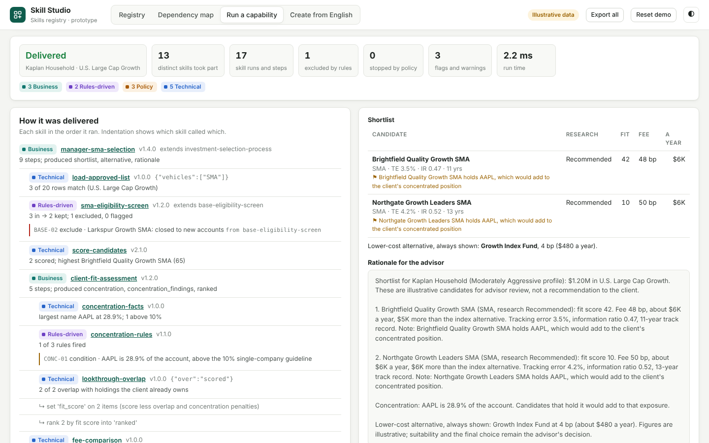

For **Kaplan** (U.S. Large Cap Growth), the closed manager is excluded. Both remaining managers hold AAPL, which is 28.9% of the account, so AP-03 adds a warning to each and the rationale says so.

### A capability made of capabilities

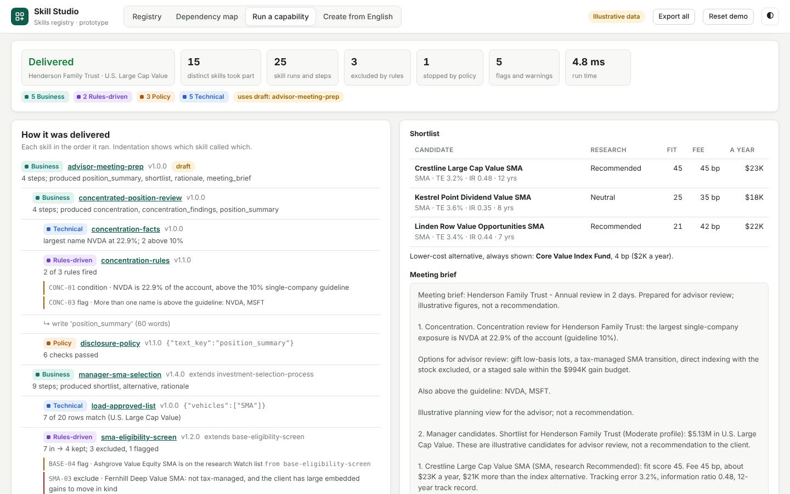

`advisor-meeting-prep` runs two capabilities in turn: the concentrated position review, then manager and SMA selection. It composes their results into one brief, checked by the disclosure policy. Fifteen distinct skills take part.

The trace is marked "uses draft" because this capability is still a draft, which shows the approval workflow.

## 5. Create from English

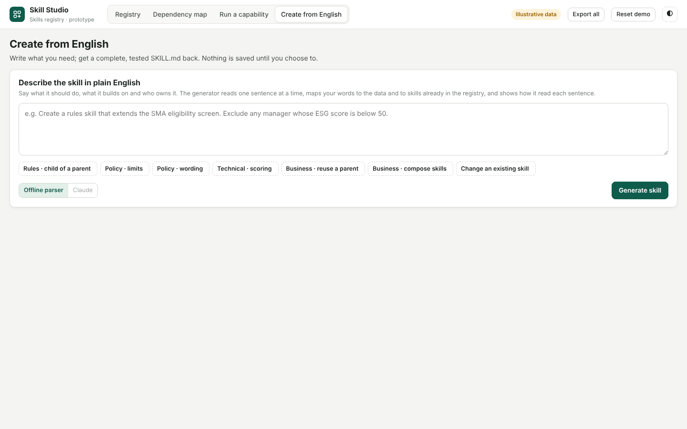

Describe the skill in plain English. Seven example buttons cover:

- each type of skill;
- reusing a parent;
- composing skills;
- changing an existing skill.

The **Offline parser** is transparent and gives the same output for the same input. The **Claude** switch turns on when the server has an API key, and Claude's draft goes through the same checks.

### A rules skill that extends a parent

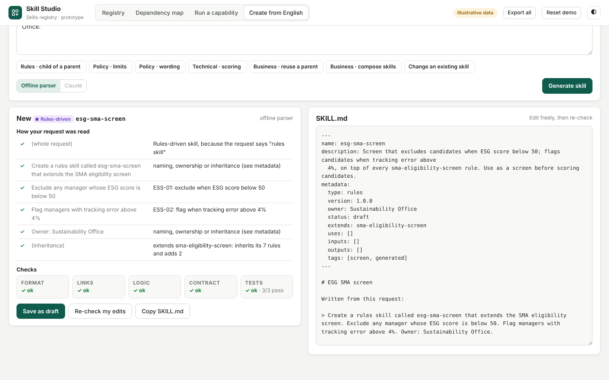

The request:

> Create a rules skill called esg-sma-screen that extends the SMA eligibility screen. Exclude any manager whose ESG score is below 50. Flag managers with tracking error above 4%. Owner: Sustainability Office.

**How your request was read** shows each sentence and what it became:

- the type, name, owner and parent;
- **ESS-01: exclude when ESG score is below 50**;
- **ESS-02: flag when tracking error is above 4%**;
- "extends sma-eligibility-screen: inherits its 7 rules and adds 2".

The SKILL.md appears on the right and can be edited.

**Checks** run in five layers:

1. **format:** name, description, type, version, owner;
2. **links:** the parent exists and has the same type, the dependencies exist, and there are no cycles;
3. **logic:** fits the type, with known fields and operators;
4. **contract:** each step has the data it needs;
5. **tests:** the generator wrote three tests, a typical manager that passes plus one boundary case per rule, and all three pass.

**Save as draft** is enabled only when nothing fails.

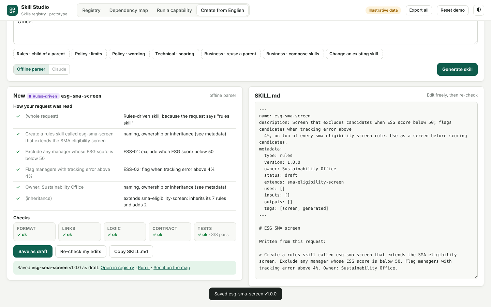

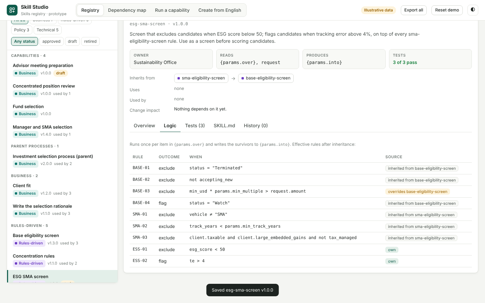

The new skill is in the registry straight away. Its Logic tab shows 9 effective rules: 4 inherited from the base screen (one overridden), 3 inherited from the SMA screen, and 2 of its own.

### A new capability, in English, built on the new skill

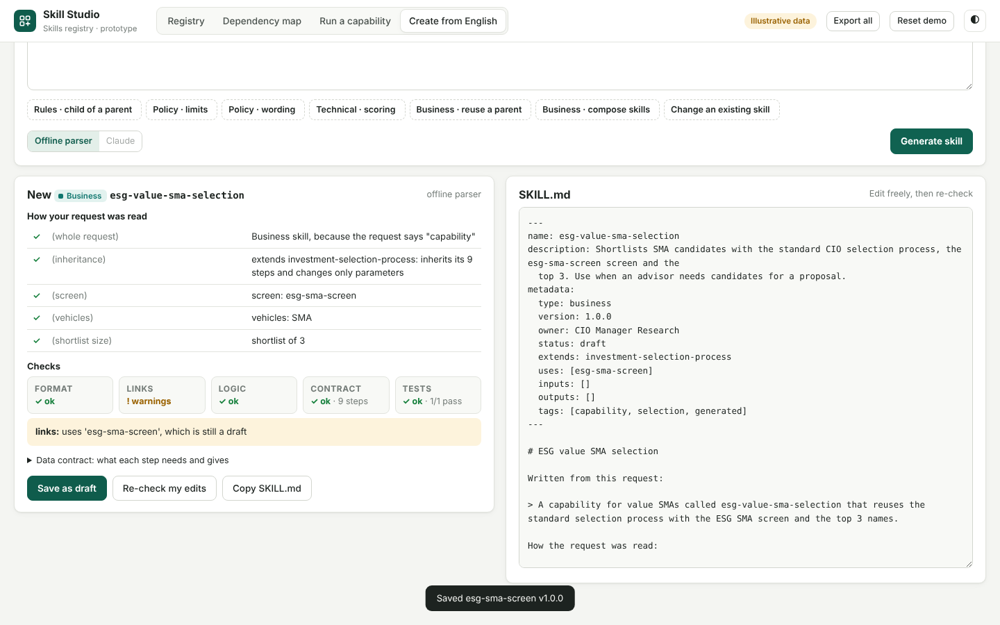

The request:

> A capability for value SMAs called esg-value-sma-selection that reuses the standard selection process with the ESG SMA screen and the top 3 names.

The generator recognises "the standard selection process" and extends the parent. It matches "the ESG SMA screen" to the skill just saved, and sets the screen, the vehicles and the shortlist size. **links** warns that it uses a draft skill.

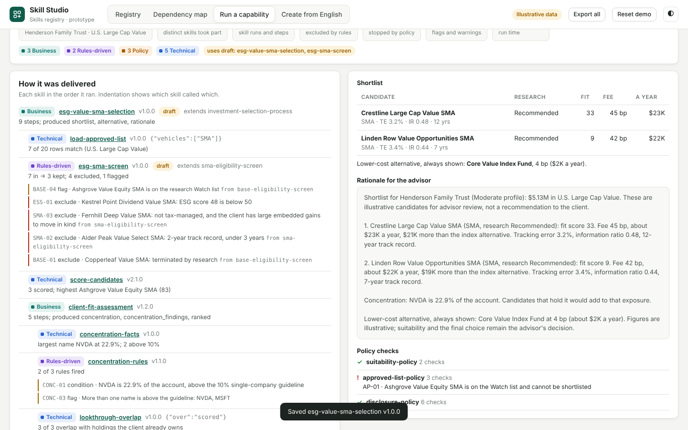

Run for Henderson, the new capability excludes Kestrel Point under ESS-01 (ESG score 48), on top of every inherited rule. Two English sentences produced a working capability, and every decision is traceable to a rule id.

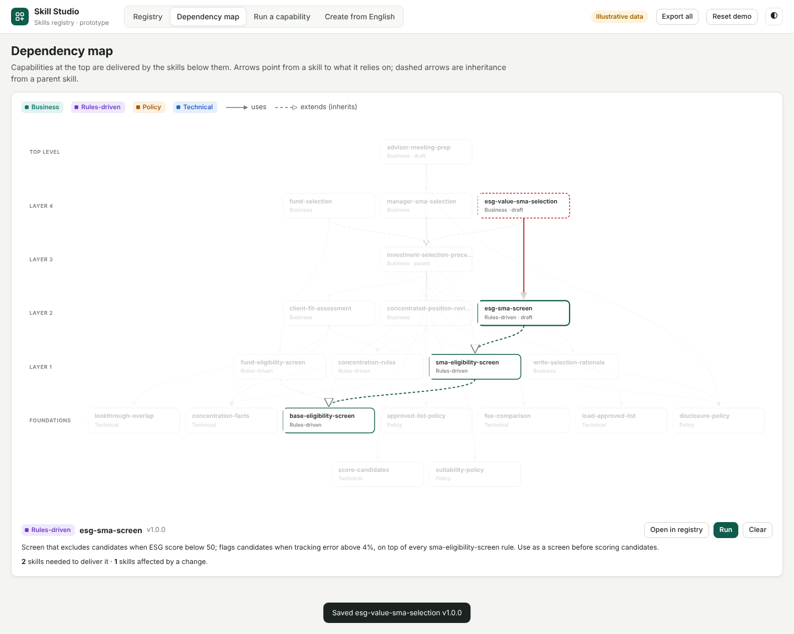

### The other types from English

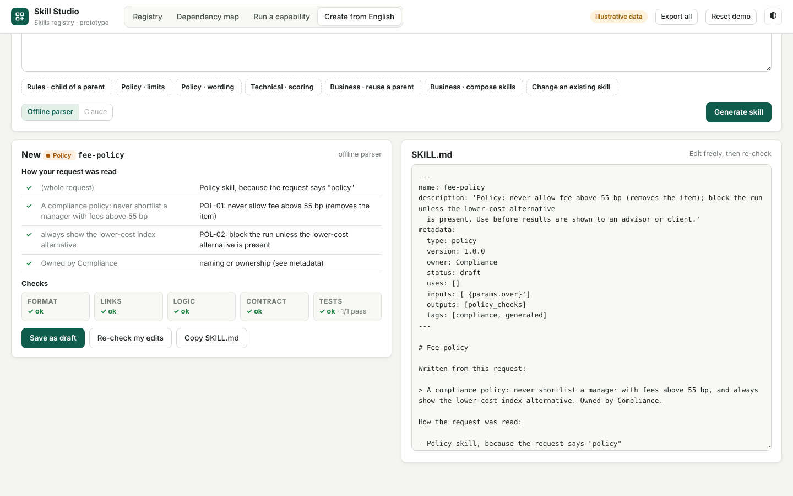

> A compliance policy: never shortlist a manager with fees above 55 bp, and always show the lower-cost index alternative. Owned by Compliance.

This becomes two constraints:

- **POL-01** never allows a fee above 55 bp, and removes the candidate. A generated test checks it with a 65 bp manager.
- **POL-02** blocks the run unless the alternative is present.

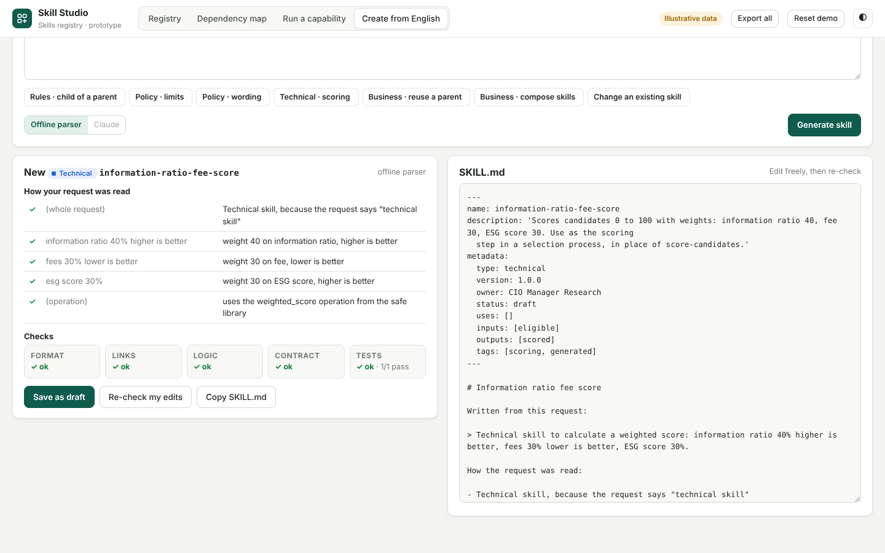

> Technical skill to calculate a weighted score: information ratio 40% higher is better, fees 30% lower is better, ESG score 30%.

This becomes the `weighted_score` operation with those weights and directions, and a test that runs it on sample managers.

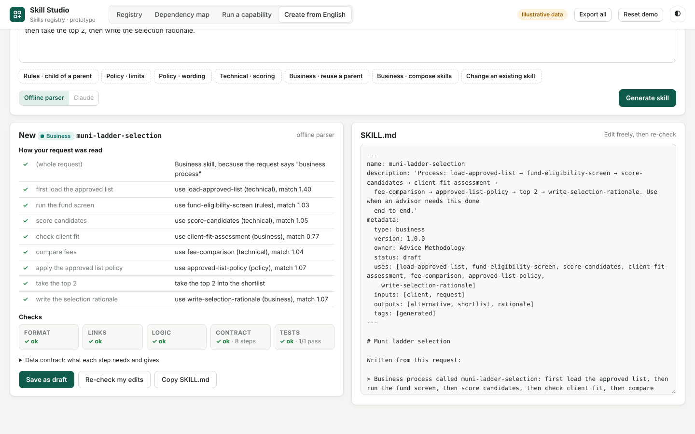

> Business process called muni-ladder-selection: first load the approved list, then run the fund screen, then score candidates, then check client fit, then compare fees, then apply the approved list policy, then take the top 2, then write the selection rationale.

Each step is matched to an existing skill, with a match score, so the process is composed from reused parts.

### What the checks catch

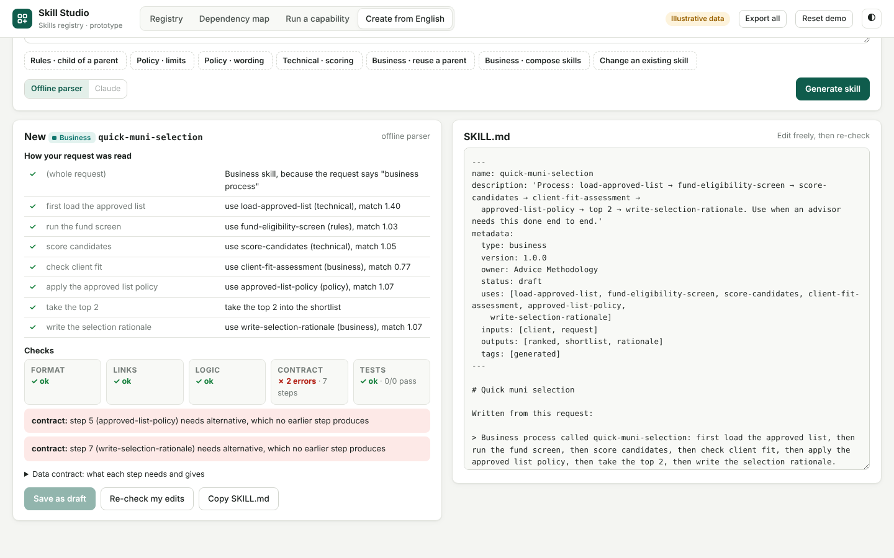

The same process **without "compare fees"** fails the **contract** check:

- the approved-list policy needs `alternative`, but no earlier step produces it;
- the rationale step needs it too.

Saving stays disabled.

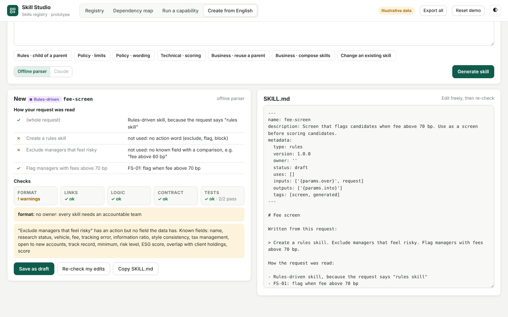

"Exclude managers that feel risky" has no field and no number. It is reported as **not used**, with the list of fields the data holds, and is left out of the skill. Only the measurable sentence becomes a rule, and the missing owner is flagged.

### Changing an existing skill in English

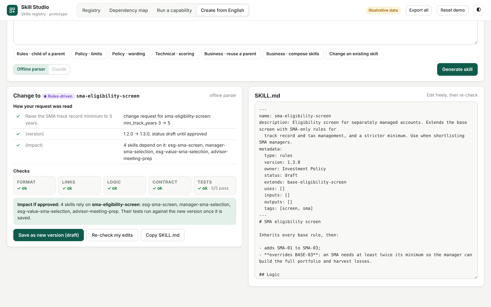

> Raise the SMA track record minimum to 5 years.

This edits `min_track_years` (3 → 5) in the existing skill and produces **version 1.3.0 as a draft**. It lists the **4 skills that rely on it**, including the two new ones, and all 5 of its tests still pass.

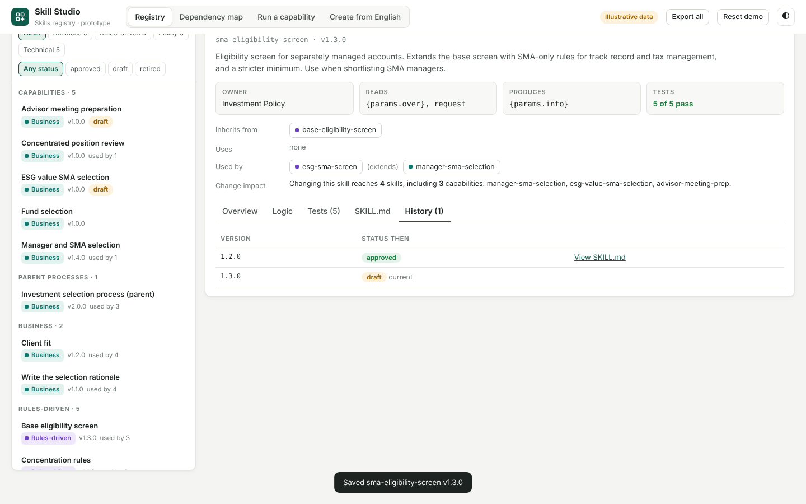

After saving, **History** keeps version 1.2.0, which can be viewed in full. Approving a capability that depends on the changed screen is refused until the screen itself is approved.

## 6. Other layouts

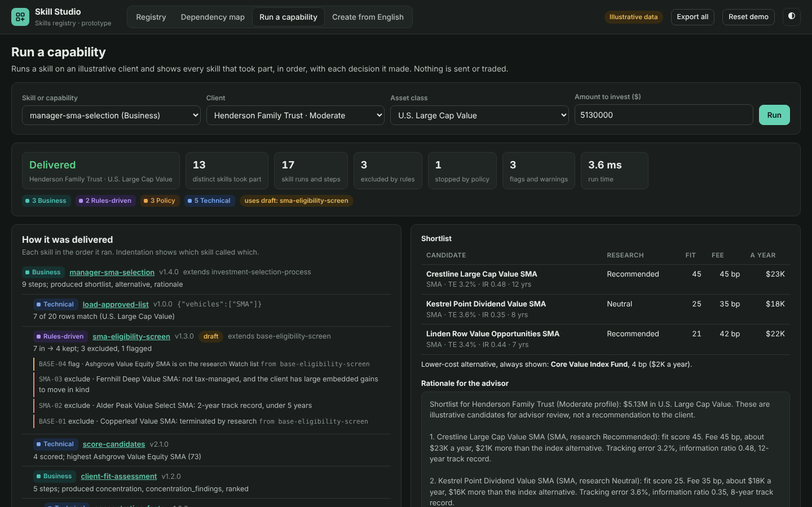

**Dark mode** follows the system setting, or the toggle in the top bar.

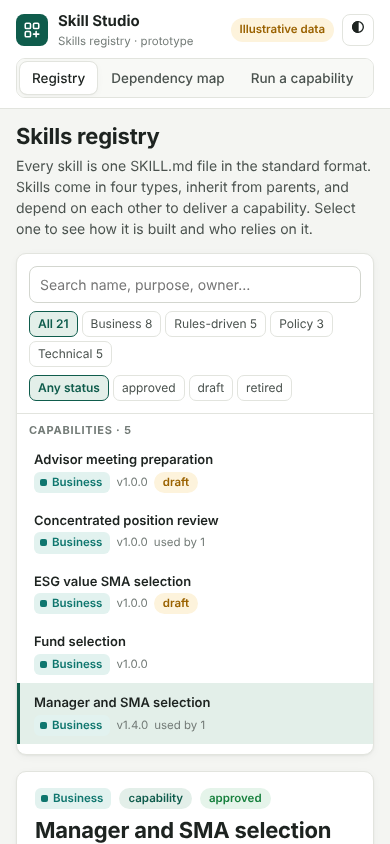 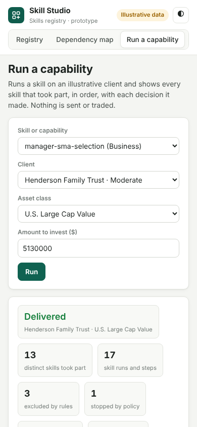

**On a phone (390 px)**, the panels stack and the view tabs scroll sideways.

## 7. The demo in one list

1. **Registry → Manager and SMA selection:** a capability that inherits a whole process and sets three parameters.
2. **SMA eligibility screen → Logic:** rules that are inherited, overridden and owned. The fund screen switches one off.
3. **Dependency map:** select `client-fit-assessment` to see what it needs and what a change would affect.
4. **Run:** Henderson, then Okonkwo, then Kaplan. The same capability takes three different paths, and the trace shows why.
5. **Create from English:** a child screen, then a capability built on it, then **Run** it.
6. **Change an existing skill:** a new version, its impact, its history, and approval held until the dependency is approved.

## 8. How it works, briefly

| Piece | Where | What it does |
|---|---|---|
| Skill file | `app/skillfile.py` | Reads and writes SKILL.md. Registry details sit under `metadata`, so the files stay valid Agent Skills |
| Registry | `app/registry.py` | Inheritance (rules merge by id; parameters filled after the whole chain is merged), dependency graph, impact, versions and history |
| Runtime | `app/runtime.py` | One executor per type; run traces; the skill test runner |
| Operations | `app/ops.py` | The only calculations technical skills may call: load the approved list, weighted score, look-through overlap, fee comparison, concentration facts |
| Logic | `app/logic.py` | A safe JSON-Logic evaluator and text templates. No code is executed |
| Checks | `app/validate.py` | Format, links, logic, contract and tests |
| Generator | `app/generator.py` | English to SKILL.md: offline parser, optional Claude, change requests |
| UI | `app/static/` | Registry, dependency map, run, and create from English |

## 9. Boundaries

- It is a proof of concept. There are no users or roles: approval is one button, and the history is files.
- The offline parser understands a fixed vocabulary (the fields in `app/data/fields.json` and the skills in the registry). Anything else is reported as not used, never guessed. Claude mode handles freer wording, and the checks are the same either way.
- Technical skills can only call the reviewed operations. A new kind of calculation is a code change that people review.
- Business skills write text from templates. In production, Claude would draft the prose and the disclosure policy would check it exactly as it does here.
